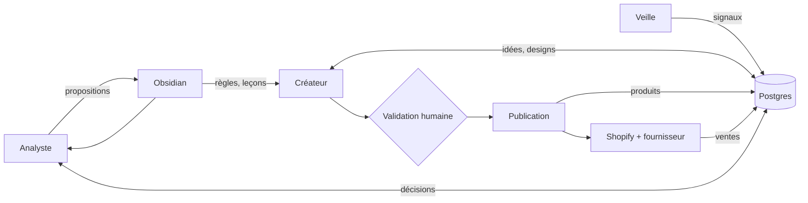

# OVR - Drop shipping agentique

## Le projet
Une boutique Shopify de produits personnalisés en impression à la demande, pour un public de plus de 40 ans, en France puis dans l'Union européenne. Le produit de départ est le mug, personnalisé par prénoms ou texte. La boutique est gérée en grande partie par des agents IA, avec une validation humaine au début.

Antoine est développeur, spécialisé en systèmes agentiques. Deux développeurs travaillent sur le projet. Le projet sert aussi à tester s'il peut créer son entreprise.

## La boucle
Les agents ne se parlent pas directement. Chacun lit et écrit dans une base commune, et le statut d'un objet indique à l'agent suivant qu'il peut agir.

- **Veille** : tendances, saisonnalité, calendrier. Écrit des signaux.
- **Créateur** : idées et designs, à partir des signaux et des règles. Propose, ne publie pas.
- **Publication** : script testé, pas un agent. Crée le produit chez le fournisseur et sur Shopify.
- **Analyste** : juge les produits sur les ventes Shopify, propose garder, retirer ou remplacer, et des leçons.
- **Obsidian** : règles, leçons et calendrier lus par les agents. Les chiffres restent en base.

Le workflow du créateur, discuté le 28/10/2026, a trois phases : calibration (générer en boucle, l'humain valide ou refuse avec une raison courte), lancement (8 à 12 designs validés, un mug chacun), boucle sur les ventes (garder, retirer, remplacer). L'agent génère l'illustration seule, en calques ; les prénoms sont rendus par le système à la commande, dans une zone de texte réservée, et le fichier final est poussé au fournisseur par l'API (décision 07).

## État au 29/10/2026
- Phase : **décisions prises, recherches produit terminées, préparation de Noël 2026**. Aucune boutique ouverte, aucun échantillon commandé, aucune ligne de code.
- 36 recherches rangées, 6 synthèses mises à jour, un registre A VERIFIER de 55 points, 7 décisions.
- Ce que les recherches du 25/10 ont établi : le mug générique à moins de 15 € est intenable ; il faut un design différenciant à 22-30 € et un panier d'au moins 35 à 60 € selon les hypothèses ; l'acheteur est un proche, surtout une femme adulte ; l'assiette n'est pas un produit de départ ; le premier risque est la contrefaçon produite en série par les agents ; l'analyste doit décider sur un modèle bayésien, jamais sur un taux brut.
- Ce que les recherches des 28 et 29/10 ont ajouté : la « famille illustrée » existe déjà sous deux formes chez les concurrents (avatars réglables par le client, illustration fixe artisanale), et le vide réel est une scène riche, en couleur, fixe, avec aperçu, déclinée sur plusieurs supports ; trois acteurs dominent et livrent en 24 h (Monsieur TShirt, Ourson Câlin, Henriette and Co) ; le fournisseur UE est le goulot sur dix produits sur treize, et le partenaire Printify UE du mug n'a pas pu être confirmé hors connexion ; le droit de douane de 3 € par catégorie condamne sous 40 € tout produit fabriqué hors UE ; le statut de TVA et l'abonnement Printify Premium décident de la marge avant le choix du produit ; aucune application de personnalisation n'offre d'API de gabarits ; les conditions de Nano Banana Pro et Ideogram sont compatibles avec la décision 06, sous réserve de la conservation des marqueurs IA ; aucune recherche n'a obtenu de volume Google.
- Angles de niche : grands-parents en principal, retraite par métier en secondaire. Produits d'élargissement classés dans [[RCH - Synthèse comparative des produits d'élargissement (29-10-2026)]] : affiche, tote bag et torchon ont un imprimeur UE confirmé ; sous-verres, coussin et tablier dépendent d'une vérification connectée ; gobelet, plaid, bougie, boîte, planche sont sans fournisseur UE.

## Décisions
Chacune fait l'objet d'une note NN dans `decisions/`.
1. ~~L'angle principal et l'angle secondaire~~ : prise, [[01 - Grands-parents en principal, retraite par métier en secondaire]].
2. ~~Le produit, le prix et le panier cible~~ : prise, [[02 - Mug famille illustrée à 24,90 €, duo à 44,90 €, panier cible 45 €]]. À relire : les recherches du 28/10 montrent que l'illustration fixe sans réglage des personnages n'a d'équivalent chez aucun concurrent au même prix ; c'est un pari à tester à Noël, pas une preuve.
3. ~~Le niveau de validation humaine au lancement et les actions toujours bloquées~~ : prise, [[03 - Approbation unitaire au lancement, paliers d'autonomie, actions toujours bloquées]].
4. ~~Le premier test : Noël 2026 ou Fête des grands-mères 2027, avec son budget~~ : prise, [[04 - Noël 2026 en test manuel réduit, Fête des grands-mères 2027 pour le système]].
5. ~~Le fournisseur principal et le schéma de TVA qui en découle~~ : prise, [[05 - Printify en principal avec partenaire UE figé, Gelato en second, franchise de TVA au départ]]. À relire : le partenaire Printify UE du mug 11 oz n'est pas visible sur le catalogue public ; la décision tient si la vérification connectée le trouve, sinon Gelato ou Printful passent en principal.
6. ~~L'orchestration et le modèle d'images~~ : prise, [[06 - LangGraph au départ, interface d'images interne avec Nano Banana Pro et Ideogram]].
7. ~~La personnalisation à la commande~~ : prise, [[07 - Personnalisation à la commande en génération interne, test Printify avant le 5 novembre]]. Génération interne dès Noël, test de la commande externe Printify avant le 05/11, repli Printful.

Décisions attendues, dans l'ordre proposé :
8. Les produits d'élargissement après le mug, et l'ordre, après la vérification Printify connectée ([[SYN - Choix de la niche]], [[SYN - Fournisseurs]]).
9. La politique de lots et de port : duo, remises par paliers, seuil de port offert, port facturé ou inclus ([[SYN - Choix de la niche]], [[SYN - Modèle économique]]).
10. Le brief visuel de la « famille illustrée » : scène fixe, variantes par composition de famille, ou symboles à la place des personnes ; gabarits de prénoms par support ([[SYN - Choix de la niche]], [[SYN - Système]]).
11. La conservation des métadonnées IPTC et C2PA dans la chaîne de publication ([[SYN - Juridique]], [[SYN - Système]]).
12. La politique de contenus interdits, base de la REGLE des agents ([[SYN - Juridique]]).

## Où lire quoi
| Question | Note |
|---|---|
| Les règles du dossier | [[_conventions]] |
| Quelle niche, quel public, quel calendrier | [[SYN - Choix de la niche]] |
| Quels produits après le mug, et pourquoi | [[RCH - Synthèse comparative des produits d'élargissement (29-10-2026)]] |
| Combien ça rapporte, combien ça coûte | [[SYN - Modèle économique]] |
| Qui imprime, avec quelle API, quelle application de personnalisation | [[SYN - Fournisseurs]] |
| Ce qui est interdit, ce qui est obligatoire, conditions des modèles d'images | [[SYN - Juridique]] |
| D'où vient le trafic, à quel prix | [[SYN - Acquisition]] |
| Comment le système fonctionne, formats par support | [[SYN - Système]] |
| Ce qui n'est pas sûr, avec priorité et moyen de vérification | [[A VERIFIER - Points à valider, vérifier, tester]] |

## Prochaines étapes
- Avant le 05/11/2026 : test de la commande externe Printify avec fichier propre à la commande (décision 07).
- Points P1 du registre, avant le 15/11/2026 : vérification Printify UE connectée, prix Gelato et Printful en euros, échantillons rendus par le système, zone d'impression exacte, TVA sur les factures, dates limites Noël, CGV et bouton de rétractation, personne GPSR, contact alimentaire du mug, organisation Shopify, police et OCR sur les accents, conditions des modèles d'images, volumes Google.
- Noël 2026 en test manuel : ouvrir la boutique, commander des échantillons, 8 à 12 mugs en ligne au plus tard le 15/11/2026 (notes TODO à créer).
- Décisions 8 à 12, une par une, selon le protocole de [[_conventions]].
- Dans `3-systeme/` : la note FLOW de la personnalisation à la commande, puis les notes MOD, CMP et FLOW, à partir du schéma de données esquissé le 25/10/2026 et des formats par support de [[SYN - Système]], pour le test de mars 2027.
- Recherche restante : le puzzle, non étudié. Les deux RCH planche du 29/10 ont été fusionnées ; la note « gravée ou imprimée » n'est plus qu'une redirection, supprimable.
