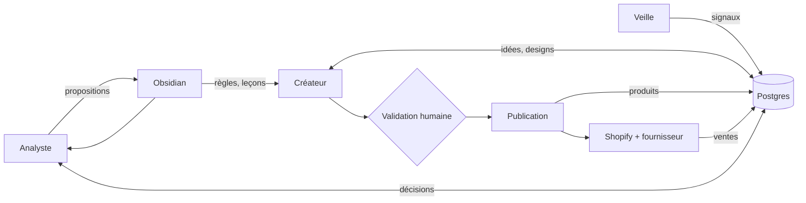

# OVR - Drop shipping agentique

## Le projet
Une boutique Shopify de produits personnalisés en impression à la demande, pour un public de plus de 40 ans, en France puis dans l'Union européenne. Le produit de départ est le mug, personnalisé par prénoms ou texte. La boutique est gérée en grande partie par des agents IA, avec une validation humaine au début.

Antoine est développeur, spécialisé en systèmes agentiques. Le projet sert aussi à tester s'il peut créer son entreprise.

## La boucle
Les agents ne se parlent pas directement. Chacun lit et écrit dans une base commune, et le statut d'un objet indique à l'agent suivant qu'il peut agir.

- **Veille** : tendances, saisonnalité, calendrier. Écrit des signaux.
- **Créateur** : idées et designs, à partir des signaux et des règles. Propose, ne publie pas.
- **Publication** : script testé, pas un agent. Crée le produit chez le fournisseur et sur Shopify.
- **Analyste** : juge les produits sur les ventes Shopify, propose garder, retirer ou remplacer, et des leçons.
- **Obsidian** : règles, leçons et calendrier lus par les agents. Les chiffres restent en base.

## État au 25/10/2026
- Phase : **décisions prises, préparation de Noël 2026**. Aucune boutique ouverte, aucun échantillon commandé, aucune ligne de code.
- 17 recherches rangées, 6 synthèses écrites : une par domaine du marché, une pour le système.
- Ce que les recherches ont établi : le mug générique à moins de 15 € est intenable ; il faut un design différenciant à 22-30 € et un panier d'au moins 35 à 60 € selon les hypothèses ; l'acheteur est un proche, surtout une femme adulte ; l'assiette n'est pas un produit de départ ; le premier risque est la contrefaçon produite en série par les agents ; l'analyste doit décider sur un modèle bayésien, jamais sur un taux brut.
- Angles de niche en tête : grands-parents, puis retraite déclinée par métier. Passions (jardinage, animaux, pêche) en réserve.

## État au 29/10/2026
- Nom de la boutique : NolaPrint. Maquette complète validée visuellement, documentée dans `5-boutique/`
  (1 OVR, 6 MOD, 3 CMP, 3 FLOW) ; elle sert de cahier des charges au thème Shopify.
- Recherches ajoutées le 28/10/2026 : TVA, retours et remboursements, statut juridique, marge et prix de vente.
- Fiches TODO ouvertes : corriger la maquette, choisir l'app de personnalisation, choisir les apps de
  rétractation et de consentement.

## Décisions attendues
Chacune fera l'objet d'une note NN dans `decisions/`.
1. ~~L'angle principal et l'angle secondaire~~ : prise, [[01 - Grands-parents en principal, retraite par métier en secondaire]].
2. ~~Le produit, le prix et le panier cible~~ : prise, [[02 - Mug famille illustrée à 24,90 €, duo à 44,90 €, panier cible 45 €]].
3. ~~Le niveau de validation humaine au lancement et les actions toujours bloquées~~ : prise, [[03 - Approbation unitaire au lancement, paliers d'autonomie, actions toujours bloquées]].
4. ~~Le premier test : Noël 2026 ou Fête des grands-mères 2027, avec son budget~~ : prise, [[04 - Noël 2026 en test manuel réduit, Fête des grands-mères 2027 pour le système]].
5. ~~Le fournisseur principal et le schéma de TVA qui en découle~~ : prise, [[05 - Printify en principal avec partenaire UE figé, Gelato en second, franchise de TVA au départ]].
6. ~~L'orchestration et le modèle d'images~~ : prise, [[06 - LangGraph au départ, interface d'images interne avec Nano Banana Pro et Ideogram]].
7. ~~Le rôle de la maquette de la boutique~~ : prise, [[07 - La maquette est le cahier des charges du thème Shopify]].

## Où lire quoi
| Question | Note |
|---|---|
| Les règles du dossier | [[_conventions]] |
| Quelle niche, quel public, quel calendrier | [[SYN - Choix de la niche]] |
| Combien ça rapporte, combien ça coûte | [[SYN - Modèle économique]] |
| Qui imprime, avec quelle API | [[SYN - Fournisseurs]] |
| Ce qui est interdit, ce qui est obligatoire | [[SYN - Juridique]] |
| D'où vient le trafic, à quel prix | [[SYN - Acquisition]] |
| Comment le système fonctionne | [[SYN - Système]] |
| La boutique et son code (maquette NolaPrint) | [[OVR - Boutique NolaPrint]] |
| Ce qui n'est pas sûr | [[A VERIFIER - Points à valider, vérifier, tester]] |

## Prochaines étapes
- Les six décisions sont prises le 25/10/2026.
- Noël 2026 en test manuel : ouvrir la boutique, commander des échantillons, 8 à 12 mugs en ligne au plus tard le 15/11/2026 (notes TODO à créer).
- Créer le registre `A VERIFIER` à partir des ⚠️ des synthèses et des décisions.
- Puis, dans `3-systeme/` : les notes MOD, CMP et FLOW, à partir du schéma de données esquissé le 25/10/2026, pour le test de mars 2027.
