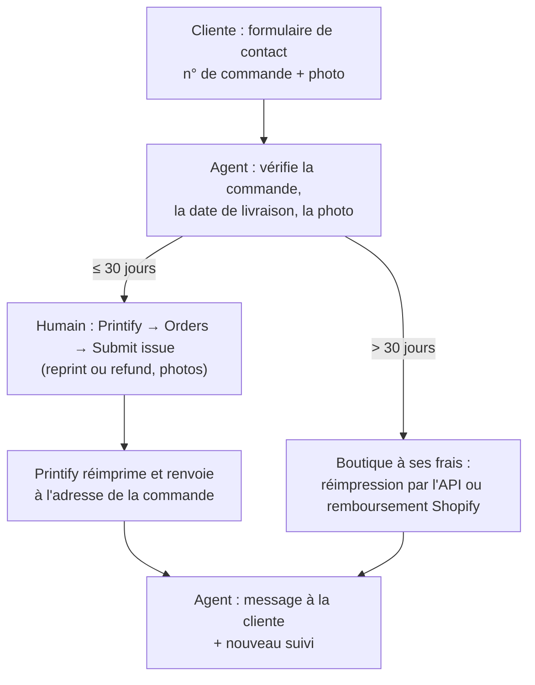

# RCH - Défauts produit, casse et réclamations Printify (31-10-2026)

Recherche menée par Maitre avec Claude (Cowork). Ce n'est pas un avis juridique.

## Contexte posé
TODO du 31/10/2026 : vérifier comment s'appuyer sur Printify quand une cliente reçoit un produit
mal imprimé, défectueux ou cassé : ce que Printify prend en charge, le renvoi (réimpression), ce qui
peut être automatisé, et ce qui reste à la charge de la boutique.

Méthode : aide Printify, spécification de l'API des commandes, lecture du compte Printify connecté
(réglages de la boutique, sans rien modifier), fiche INC sur la garantie de conformité.

## Conclusion en une phrase
Printify réimprime ou rembourse sans retour du produit un défaut ou une casse signalés avec photo
sous 30 jours après la livraison, mais seulement à la main depuis le tableau de bord (aucune API) ;
au-delà de 30 jours et jusqu'à 2 ans, la garantie légale de conformité reste à la charge de la boutique.

## Résultats

### 1. Défaut ou casse : ce n'est pas une rétractation
```
Problème signalé par la cliente
   ├─ changement d'avis, article sans texte ────► rétractation 14 jours (L221-18), frais de renvoi à sa charge
   │                                              → retour chez Sylvain ([[RCH - Retours, rétractation et abus (30-10-2026)]])
   └─ défaut, mauvaise impression, casse ──────► garantie légale de conformité, 2 ans, même article personnalisé
                                                  → c'est la boutique qui répond, pas Printify
```
- La garantie de conformité s'applique aussi aux articles personnalisés : l'exclusion de L221-28 3°
  ne vise que la rétractation (source : INC) ⚠️ à faire relire.
- La boutique répond des défauts présents à la livraison pendant 2 ans ; ils sont présumés exister à
  la livraison pendant 24 mois (source : INC) ⚠️ articles exacts à relire sur Légifrance.
- Le risque du transport est pour le vendeur jusqu'à la remise du colis à la cliente
  (art. L216-4, source : INC) : une boule cassée à l'arrivée est notre problème, pas celui de la cliente.

### 2. Ce que Printify prend en charge (aide Printify, lue le 31/10)
| Cas | Printify | Preuve demandée |
|---|---|---|
| Mauvaise impression, produit défectueux | réimpression gratuite ou remboursement | photo nette du produit à plat, design et défaut dans le même cadre |
| Mauvais produit envoyé | réimpression gratuite ou remboursement | photo de l'article |
| Abîmé à la livraison (casse) | réimpression gratuite ou remboursement | photo ou vidéo du colis, du design et du dommage |
| Réimpression avec le même défaut | nouvelle prise en charge | photo de l'original et de la réimpression ensemble |
| Plusieurs articles au même défaut | idem | une photo avec tous les articles visibles |
| Colis perdu | réimpression gratuite si aucune erreur de notre part ou de la cliente | adresse exacte, démarche faite auprès de la Poste |
| Colis revenu, adresse incomplète | réimpression **payante** ou remboursement partiel | motif du suivi |
| Colis perdu, adresse fausse donnée par la cliente | rien | — |
| Changement d'avis, mauvaise taille ou couleur choisie | rien : Printify n'accepte aucun retour | — |
| Impression floue due à une image de mauvaise qualité | rien | — |

- **Délai : 30 jours** après la livraison ou la date de livraison estimée ; « We're not able to
  accept reports filed after this timeframe » (aide Printify).
- **Pas de retour du produit** : la cliente garde l'article abîmé (aide Printify).
- Jusqu'à 5 photos ou vidéos : JPEG, JPG ou PNG jusqu'à 15 Mo, une vidéo MOV ou MP4 jusqu'à 250 Mo.
- Suivi de la demande dans le détail de la commande : Pending → In progress → Resolved.
- Remboursement sous 1 jour ouvré une fois les informations reçues (Merchant Protection).
- **Le renvoi** : la réimpression repart chez la cliente, à l'adresse de la commande, sans frais
  pour nous (Merchant Protection : « free reprints for damaged or misprinted products »)
  ⚠️ à vérifier sur un premier cas : le port de la réimpression est-il refacturé ?
- Le support Printify ne contacte jamais la cliente : c'est à nous de lui annoncer la solution
  (aide Printify Connect).

### 3. Ce qui peut être automatisé, et ce qui ne peut pas
L'API des commandes Printify n'a que sept points d'accès : lister, créer, lire une commande, commande
express, calcul du port, envoi en production, annulation d'une commande non payée. **Aucun point
d'accès pour signaler un problème, demander une réimpression ou un remboursement** (spécification
OpenAPI, lue le 31/10).


- **Automatisable** : recevoir la réclamation et la photo, vérifier le n° de commande et le délai,
  préparer le dossier (texte en anglais, photos), répondre à la cliente, relancer, suivre le colis
  de remplacement.
- **Manuel** : le clic « Submit issue » dans le tableau de bord Printify. Le dossier préparé par
  l'agent rend ce clic court (≈ 2 minutes, estimé).
- **Au-delà de 30 jours** : une nouvelle commande Printify par l'API (réimpression à nos frais,
  coût d'un article livré : mug 13,36 €, boule 20,80 €, bois 15,38 €, décision 09) ou un remboursement
  Shopify. Choix à décider.
- Cela reste compatible avec la décision 03 (remboursements = action bloquée, validée par un humain).

### 4. Printify Connect (Premium seulement)
- Page de suivi sans la marque Printify : après la livraison, un e-mail de
  customer@trackorder.site, au nom de la boutique, demande une note ; une note de 1 à 3 ouvre un
  signalement qui part directement au support Printify, avec demande de réimpression ou de
  remboursement (aide Printify Connect).
- **Réservé à Printify Premium** (34,99 €/mois ou 299 €/an) : l'onglet affiche « Available with
  Printify Premium » sur notre compte (lu le 31/10).
- Langues de l'e-mail et de la page non indiquées ⚠️ : une cliente française pourrait recevoir de l'anglais.
- Sans Premium, notre formulaire de contact fait ce travail.

### 5. Ce que montre notre compte Printify (lu le 31/10, rien modifié)
| Réglage | État | Effet |
|---|---|---|
| Nom de la boutique | « My new store » | apparaît sur les étiquettes d'expédition : à renommer NolaPrint |
| Order Routing | **désactivé** | conforme à la décision 05 (partenaire UE figé) |
| « Activate my upgrade to Printify Choice » | coché au relevé ; **décoché le 31/10 à la demande de Sylvain** (enregistré, vérifié après rechargement) | évite qu'une commande parte chez un autre imprimeur Printify ; conforme à la décision 05 |
| Order submission | non lu | toutes les commandes de produits « personalizable » doivent être soumises à la main ; nos commandes passent par l'API avec l'image finale (décision 10) ⚠️ à vérifier sur la commande test |
| Ship from address | « Printify default » : adresse de l'imprimeur | un colis non distribué revient chez l'imprimeur, pas chez Sylvain ; les CGV doivent donner l'adresse de Sylvain pour les rétractations |
| Commandes | 0 | le formulaire « Submit issue » n'a pas pu être vu en vrai |

### 6. À faire côté boutique
- **Formulaire de contact** : il doit vraiment envoyer la photo (aujourd'hui elle n'est envoyée
  nulle part, [[MOD - Pages légales et rétractation]]) et demander le n° de commande.
- **CGV, articles 6 et 8** : défaut ou casse à signaler avec photo, idéalement dans les 30 jours
  après réception ; réimpression ou remboursement sans renvoi du produit ; rappel de la garantie
  légale de 2 ans, qu'on ne peut pas raccourcir ⚠️ rédaction par un juriste.
- **Boule** (sachet plastique, verre) : risque de casse le plus élevé ; demander une vidéo de
  déballage n'est pas exigible de la cliente, une photo suffit.
- **Délai interne** : traiter une réclamation en moins de 7 jours pour rester loin des 30 jours
  de Printify (estimé).

## Chiffres
| Chiffre | Valeur | Provenance |
|---|---|---|
| Délai de signalement Printify | 30 jours après la livraison | source : aide Printify |
| Photos ou vidéos | 5 au plus ; images ≤ 15 Mo, vidéo ≤ 250 Mo | source : aide Printify |
| Remboursement Printify | sous 1 jour ouvré, dossier complet | source : Merchant Protection |
| Garantie légale de conformité | 2 ans, présomption 24 mois | source : INC |
| Printify Premium (Connect inclus) | 34,99 €/mois ou 299 €/an | [[RCH - Audit des coûts réels Printify des trois produits (31-10-2026)]] |
| Réimpression à nos frais, au-delà de 30 jours | 13,36 / 20,80 / 15,38 € TTC | estimé, décision 09 |

## Caveats
- Le formulaire « Submit issue » n'a pas été vu : la boutique n'a encore aucune commande.
- La spécification de l'API est une copie (api-evangelist), pas la doc officielle
  developers.printify.com ⚠️ à recouper.
- Port de la réimpression : « free » selon Merchant Protection, non précisé par l'aide ⚠️.
- Les articles de loi sont cités d'après l'INC, pas lus sur Légifrance.

## Retenu / écarté
(à remplir à la revue)
