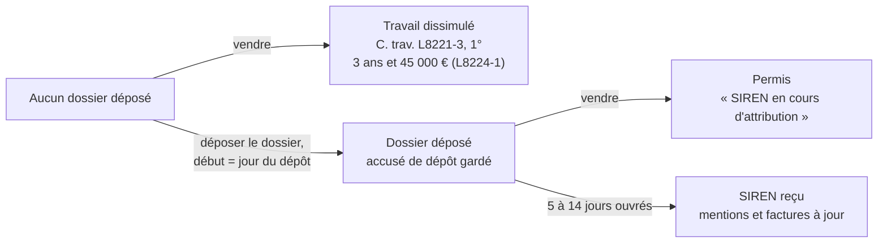

# RCH - Création de la micro-entreprise, impôts, délais et nom sur le site (02-11-2026)

Recherche menée par Maitre avec Claude (Cowork), le jour du début des démarches.
Ce n'est pas un avis juridique ni fiscal : les points ⚠️ passent par l'URSSAF, le centre des impôts
ou un expert-comptable.

## Contexte posé
Sylvain crée la micro-entreprise qui porte le test de Noël
([[RCH - Statut juridique et création de société (28-10-2026)]],
[[05 - Printify seul fournisseur avec partenaire UE figé, franchise de TVA au départ]]). Questions :
1. Quelles lois peuvent jouer contre nous, article par article ?
2. Quel effet sur les impôts, sachant qu'il est rattaché au foyer fiscal de sa mère et a d'autres revenus ?
3. Combien ça coûte ?
4. Peut-on ne pas afficher son nom et son prénom sur le site ? Cadeau Plus ne montre qu'un e-mail et une adresse.
5. Peut-on domicilier l'entreprise gratuitement dans un appartement inhabité appartenant à sa mère ?
6. Combien de temps, quelles pièces, et peut-on vendre avant d'avoir le SIREN pour tenir Noël ?

## Conclusion en une phrase
La création est gratuite et prend 30 minutes ; le nom du titulaire doit figurer dans les mentions
légales, l'adresse de l'entreprise reste à décider (l'appartement de sa mère est possible avec son
accord écrit), et la vente est permise dès le dépôt du dossier, jamais avant.

## Résultats

### 1. Le nom et le prénom sur le site
| Obligation | Texte |
|---|---|
| Nom, prénoms, domicile, téléphone, numéro d'immatriculation | LCEN, art. 1-1, I, 1° (ex-art. 6 III, renuméroté par la loi SREN n° 2024-449 du 21/05/2024) |
| Adresse où le vendeur est établi, adresse e-mail | LCEN, art. 19 ⚠️ texte à relire |
| Identité et coordonnées du vendeur, avant l'achat | C. conso., art. L111-1, R111-1, L221-5 |
| « EI » ou « entrepreneur individuel » accolé au nom | C. com., art. R526-26 |
| SIREN sur les factures et documents commerciaux | C. com., art. R123-237 |

- Sanction : 1 an d'emprisonnement et 75 000 € d'amende pour une personne physique (LCEN, art. 1-2)
  (source : Simonnet avocat).
- Pas d'anonymat : l'art. 1-1, II ne vise que l'édition « à titre non professionnel » (source : Simonnet avocat).
- Ce qui reste possible sans société :
  - « NolaPrint » partout ; le nom du titulaire seulement dans les mentions légales, les CGV et les
    conditions d'utilisation ;
  - une adresse d'entreprise au lieu du domicile personnel (§ 2) ;
  - l'opposition à la diffusion Sirene (C. com., art. R123-232-1 ; RGPD, art. 21) : masque le nom, le
    nom commercial et l'adresse exacte dans Sirene, pas le SIREN ; en ligne sur
    statut-diffusion-sirene.insee.fr avec FranceConnect, effet sous 48 h (source : INSEE).
    Ne dispense pas des mentions du site.
- Seule une société (SASU, EURL) retire le nom du site ; le président reste visible au registre.
- Cadeau Plus : pied de page vu le 02/11/2026, un e-mail et l'adresse « Le Cassiopée, 5-7 place
  Copernic, Évry-Courcouronnes », vraisemblablement un centre de domiciliation (estimé). Probablement
  une société ; une mention absente chez un concurrent n'est pas une règle ⚠️ mentions légales
  complètes non relues.

### 2. L'adresse de l'entreprise (à décider)
- C. com., art. L123-10 : les personnes physiques « doivent déclarer l'adresse de leur entreprise et en
  justifier la jouissance » (source : Baumann avocats). Ce n'est pas forcément leur logement.

| Option | Coût | Pièce pour le dossier | Vigilance |
|---|---|---|---|
| Appartement inhabité de sa mère | gratuit | convention de mise à disposition signée (modèle dans [[TODO - Déclarer la micro-entreprise sur le guichet unique]]), sa pièce d'identité, justificatif de l'appartement à son nom de moins de 3 mois | règlement de copropriété ⚠️ ; nom et « NolaPrint » sur la boîte aux lettres ; changement d'adresse si l'appartement est vendu ou loué |
| Société de domiciliation | ≈ 15 à 30 € par mois (estimé) | contrat de domiciliation signé avant le formulaire | prestataire agréé |
| Domicile personnel | gratuit | justificatif de domicile | l'adresse personnelle devient publique |

- Dans le formulaire : adresse personnelle = domicile réel ; adresse de l'entreprise = l'option retenue,
  reprise sur le site. La CFE se calcule dans sa commune.
- Adresse de retour : la décision 11 envoie les retours chez Sylvain ; si c'est son domicile, il est
  communiqué aux clients qui renvoient un article ⚠️ à trancher avec l'adresse de l'entreprise.
- Zone grise : « domicile » (art. 1-1) contre « adresse où elle est établie » (art. 19) ; un modèle
  d'avocat admet l'adresse professionnelle (source : Simonnet avocat). Même risque pour les deux
  premières options ⚠️.

### 3. Impôts
- Micro-BIC ventes : abattement de 71 % (CGI, art. 50-0) ; les 29 % restants s'ajoutent aux autres
  revenus du foyer, salaires compris, au barème. Le salaire n'est pas taxé autrement ; seule la tranche
  peut monter.
- Rattachement au foyer parental (CGI, art. 6-3) : moins de 21 ans, ou moins de 25 ans en poursuite
  d'études (source : LegalPlace). L'âge s'apprécie au 1er janvier de l'année des revenus ⚠️ : selon la
  date de naissance, les revenus 2026 peuvent être rattachés sans condition d'études ; ensuite, la
  poursuite d'études à 42 doit être reconnue ⚠️.
  - Rattaché : le revenu micro entre dans la déclaration de sa mère ; son impôt, son revenu fiscal de
    référence et les aides qui en dépendent peuvent bouger (source : LegalPlace).
  - Détaché : déclaration propre ; sa mère perd la demi-part et peut déduire une pension alimentaire
    (CGI, art. 156 II-2°).
  - L'exonération des salaires d'étudiant (CGI, art. 81 bis) ne couvre pas le revenu micro.
  - Choix à faire par simulation des deux cas sur impots.gouv.fr.
- Versement libératoire (CGI, art. 151-0) : 1 % du CA ventes payé avec la cotisation URSSAF, impôt soldé.
  Condition pour 2026 : RFR 2024 du foyer (avis 2025) ≤ 29 315 € par part (source : lamicrobyflo) ;
  s'il est rattaché, c'est le RFR de sa mère qui compte. Pour 2027 : RFR 2025. Option à la création,
  délai exact pour un créateur ⚠️.
- Cumul avec un emploi salarié : permis, sauf clause d'exclusivité ; obligation de loyauté
  (C. trav., art. L1222-1).

### 4. Délais et pièces
- Saisie en 15 à 30 min ; SIREN en 5 à 14 jours ouvrés sans anomalie ; chaque complément demandé ajoute
  7 à 15 jours ; réponse sous 15 jours ou dossier classé ; pics en janvier et septembre (source : Swim.legal).
- Pièces : pièce d'identité recto-verso, justificatif d'adresse de l'entreprise de moins de 3 mois,
  déclaration de non-condamnation signée en ligne (source : Swim.legal).
- Liste à cocher : [[TODO - Déclarer la micro-entreprise sur le guichet unique]].

### 5. Vendre avant le SIREN

- L8221-3, 1° vise celui qui « n'a pas demandé son immatriculation » (source : code.travail.gouv.fr) :
  compte le dépôt de la demande, pas la réception du numéro.
- La date de dépôt est enregistrée : impossible de soutenir après coup qu'on « faisait les démarches ».
- Entre le dépôt et le SIREN : « SIREN en cours d'attribution, déclaration déposée le JJ/MM/2026 » dans
  les mentions ; facture émise à réception du SIREN, ou mention « en cours d'immatriculation »
  (source : L-Expert-Comptable, contradictoire ⚠️).
- Activité non déclarée : 80 % de pénalité, rappels de cotisations et de TVA
  ([[RCH - Statut juridique et création de société (28-10-2026)]]).
- Blocage non juridique possible : Shopify Payments ou PayPal peuvent exiger un SIREN ⚠️ à tester tout de suite
  (Shopify : Paramètres → Paiements).

## Chiffres
| Chiffre | Valeur | Provenance |
|---|---|---|
| Création sur formalites.entreprises.gouv.fr | gratuit | source : [[RCH - Statut juridique et création de société (28-10-2026)]] |
| Cotisations sociales, ventes | 12,3 % du CA encaissé | source : Hayot |
| Formation professionnelle, commerçant | 0,1 % du CA | source : Hayot |
| ACRE, micro créée depuis le 01/07/2026 | exonération de 25 % jusqu'à la fin du 3e trimestre civil suivant le début ; 18 à moins de 26 ans éligibles ; formulaire sous 60 jours, réponse sous 30 jours, silence vaut accord | source : service-public (11/02/2026), Hayot ; décret n° 2026-69 du 06/02/2026 |
| Versement libératoire, ventes | 1 % du CA | source : Hayot |
| Seuil du versement libératoire 2026 | 29 315 € de RFR 2024 par part | source : lamicrobyflo ⚠️ une seule source |
| Plafond de CA micro, ventes, 2026-2028 | 203 100 € | source : Hayot |
| Franchise de TVA, ventes | 85 000 € (majoré 93 500 €) | source : Hayot |
| Compte bancaire dédié | au-delà de 10 000 € de CA deux années de suite (CSS, art. L613-10) | source : Hayot |
| Délai d'obtention du SIREN | 5 à 14 jours ouvrés | source : Swim.legal |
| Sanction des mentions légales | 1 an, 75 000 € | source : Simonnet avocat |
| Sanction du travail dissimulé | 3 ans, 45 000 € | source : C. trav., art. L8224-1 |
| Cotisations ventes avec ACRE | ≈ 9,2 % (12,3 % × 0,75) | estimé |
| CFE après la 1re année | cotisation minimum de la commune, ≈ 100 à 500 € | estimé |
| Société de domiciliation | ≈ 15 à 30 € par mois | estimé |

## Caveats
- Corrigé le 02/11/2026 par rapport aux réponses du chat du même jour : délai ACRE de 60 jours (pas 45) ;
  ACRE jusqu'à la fin du 3e trimestre civil suivant le début (pas « la 1re année ») ; opposition Sirene
  par l'art. R123-232-1 (pas A123-96) ; RFR à regarder pour 2026 : celui de 2024 sur l'avis 2025 (pas
  l'avis 2026) ; l'e-mail est exigé par l'art. 19 LCEN, pas par l'art. 1-1.
- L-Expert-Comptable se contredit sur la facturation avant le SIREN.
- Seuil du versement libératoire : une seule source ⚠️.
- Statut d'étudiant de 42 et date d'appréciation de l'âge pour le rattachement non vérifiés ⚠️.
- Les mentions légales complètes de Cadeau Plus n'ont pas été relues.
- Aucune donnée personnelle (adresses, revenus) dans cette note : le dépôt est partagé.

## Retenu / écarté
(à remplir à la revue)
