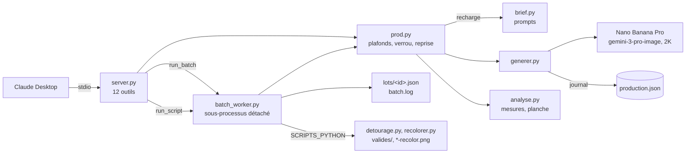

# MOD - Connecteur nolaprint-image

## Rôle
Un serveur MCP local qui permet à Claude Desktop de produire lui-même les illustrations de Noël 2026
avec Nano Banana Pro, sans copier-coller de commandes. Claude génère, mesure, regarde les images et
écrit les verdicts ; Antoine tranche en chat. Le serveur ne contient aucun prompt : il appelle
`brief.py`, `generer.py` et `analyse.py` du dossier `3-systeme/recherches/tests-images/production/`,
tels qu'ils sont utilisés en ligne de commande. Il lance aussi les scripts de post-traitement du même
dossier (`detourage.py`, `recolorer.py`), sans appel à l'API.

## Intention
- **Le brief reste la seule source des prompts.** Le serveur importe `brief.py` et le recharge à chaque
  appel : une correction de prompt s'applique sans redémarrer Claude Desktop.
- **Le journal reste celui de `generer.py`.** Chaque appel est écrit dans `production.json` par
  `generer.py`, comme en ligne de commande. Le serveur n'ajoute que des champs (`derogation`, `reessai`).
- **La dépense a trois plafonds** : 4 essais réussis par élément, `max_calls` par lot validé en chat,
  `MAX_CALLS_PER_DAY` par jour (300 pendant la production de Noël). Le plafond Google sur
  `ai.studio/spend` reste le dernier filet.
- **L'humain tranche.** Dérogation au-delà de 4 essais, lancement d'un lot et verdicts passent par
  l'accord d'Antoine en chat ; le serveur refuse ce qui n'est pas autorisé, il ne décide rien.
- **Les lots tournent la nuit.** Un lot est un sous-processus détaché, qui continue si Claude Desktop
  est fermé et se relit le matin par `list_batches` et `batch_status`.

## Diagramme

## Entrées et sorties
| Outil | Entrée | Sortie |
|---|---|---|
| `list_elements` | aucune | éléments du brief, fichiers, verdicts, essais restants, référence active, appels du jour, coût cumulé |
| `generate` | `kind` (element, scene, hiver), `name`, `seed`, `derogation` facultative | chemin, durée, erreur, tentatives, mesures d'`analyse.py` |
| `analyse` | un fichier de `production/` | fond uni, marges, part de l'objet, tiers droit |
| `contact_sheet` | liste de fichiers, nom de sortie | chemin de la planche |
| `read_image` | un fichier de `production/` | l'image en JPEG de 1024 px au plus |
| `set_verdict` | fichier, `ok` ou `refus`, raison | l'entrée du journal mise à jour |
| `set_reference` · `clear_reference` | fichier validé · nom | `reference.png` posée ou mise de côté |
| `run_batch` | items, graines, `max_calls` | identifiant du lot, coût maximal |
| `batch_status` · `list_batches` · `stop_batch` | identifiant · aucune · identifiant | avancement, fichiers, erreurs, coût · liste des lots · demande d'arrêt |
| `run_script` | `detourage.py` ou `recolorer.py`, arguments vérifiés | identifiant ; `batch_status` rend le code de retour et la fin de la sortie |

Écrit seulement dans `production/` : images, `production.json`, planches, `batch.log`, `lots/`,
verrou `.production.lock`. Variables d'environnement : `PRODUCTION_DIR`, `GEMINI_API_KEY`,
`MAX_CALLS_PER_DAY` (défaut 60), `GENERATE_TIMEOUT_S` (défaut 230), `SCRIPTS_PYTHON` (le Python de
conda, où `rembg`, `onnxruntime`, `opencv-python`, `pymatting` et `scipy` sont installés à la main).
Installation, bloc JSON de Claude Desktop et lot de nuit : voir le `README.md` du dépôt.

## Cas limites
- **La graine fixe la composition, pas les pixels.** `oeillet-seed3.png` généré deux fois, même
  prompt, sans référence : même dessin, mais tête plus grande (17,3 % de l'image contre 13,9 %) et
  différence moyenne de 9,5 sur 255 par canal (mesuré le 02/11). Une image validée ne se régénère
  pas à l'identique : il faut garder le fichier. Le serveur refuse donc une graine déjà générée.
- **Erreurs 429 et 503** : pause de 45 s et une seconde tentative, chaque tentative comptée. En
  interactif, seulement si elle tient dans 235 s, car Claude Desktop abandonne un outil après 4 minutes.
- **Plafond journalier non atomique** : un lot et un appel simultanés peuvent le dépasser d'un appel
  chacun. Le jour est le jour calendaire du Mac.
- **Un Mac en veille arrête le lot.** Lancer `caffeinate -i` pendant la nuit.
- **Les fichiers `.png` contiennent du JPEG** (type MIME du journal) : la chaîne de détourage devra
  le savoir.
- **La clé Gemini est en clair** dans `claude_desktop_config.json`, hors du vault.
- **Scripts sous liste fermée** : chaque argument est un `.png` de `production/`, un destinataire, une
  fraction ou une option permise ; pas de shell, aucune clé transmise, une heure au plus.
- **Un détourage partiel écrase `controle-detourage.png`** : relancer le détourage complet pour
  retrouver la planche.
- **Coût estimé** à 0,134 USD par appel réussi en 2K (estimé) ; la facture réelle est sur Google AI Studio.

## Notes liées
Prompts : [[CMP - Brief de génération des illustrations de Noël 2026]] · Choix du modèle :
[[06 - LangGraph au départ, interface d'images interne avec Nano Banana Pro et Ideogram]] · Catalogue :
[[15 - Catalogue de Noël 2026, six destinataires, fleurs de naissance et table de goûter, neuf produits]]
· Suite de la chaîne : [[RCH - Détourage, nettoyage des bords et agrandissement pour l'impression (02-11-2026)]]
