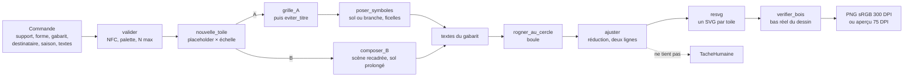

# MOD - Module de rendu

## Rôle
Compose le fichier d'impression d'une commande (décision 10) : la toile à la taille du placeholder
Printify, les éléments validés de `production/valides/` ou la scène recolorée, le support des symboles
(sol ou branche), puis les textes de la cliente. La même fonction rend l'aperçu du thème à 25 %.
Le module ne décide d'aucune position : il lit `production/gabarits.json`, le miroir de
[[CMP - Gabarits de support]]. Quand un texte ne tient pas, il lève une tâche humaine au lieu de couper.

## Intention
- **Tout en millimètres jusqu'à l'export.** Le nombre de pixels par millimètre vient du placeholder.
  Aucune image n'est redimensionnée d'un support à l'autre.
- **Un seul code pour l'impression et l'aperçu.** `rendre(commande, echelle=0.25)` ne change que la
  densité : ce que la cliente voit est ce qui part chez l'imprimeur.
- **Le texte suit la RCH polices.** Mesure par Pillow avec libraqm, rendu par resvg avec les polices
  passées en fichiers, normalisation NFC, hauteur de capitale mesurée sur le glyphe H.
- **Jamais de coupure silencieuse.** Réduction par pas de 0,1 mm jusqu'au minimum du gabarit, puis
  `TacheHumaine` avec le texte, la zone et le minimum.
- **Une alerte dit ce qui mérite un regard, pas ce qui marche comme prévu.** Les ajustements voulus
  (zone ramenée dans le cercle, grille descendue sous le titre) sont des informations, pas des alertes.
- **Les positions vivent dans `gabarits.json`.** Le code ne garde que deux constantes : le décalage du
  mug à Noël et la capitale minimale de la phrase.

## Diagramme

## Ce que fait le module
- **Gabarit A** : symboles réduits en Lanczos dans un carré fixé par N ; fleurs calées sur le bas
  opaque et plantées dans le sol de 15 %, ornements calés sur le haut opaque et suspendus à la branche
  par une ficelle de 0,6 mm. Sol et branche recomposés en trois morceaux (bout gauche, tuile répétée
  sans jamais être coupée, bout droit), à la largeur de la rangée plus un symbole.
- **Prénom et mois** : une ligne « Léa · juin », mois plus petit à 60 % ; si la ligne est trop large,
  le mois passe dessous avant toute réduction.
- **Gabarit B** : scène du destinataire (`scene-<d>-seed1-recolor.png`, ou `-hiver-recolle-recolor.png`
  à Noël) recadrée selon le gabarit ; sol prolongé sous la zone de texte par un carré de sol sans objet
  répété en miroir, fondu sur 1 mm. Sur le mug, la phrase se pose sur le mur, au-dessus de la ligne du
  sol lue sur la scène.
- **Boule** : phrase en arc par `textPath` ; zones rectangulaires ramenées dans le cercle utile ; tout
  ce qui sort du disque est masqué.
- **Calques de contrôle**, jamais imprimés : `zones=True` (zones du gabarit) et `contour=True`
  (contour de la forme de bois : ellipse exacte pour l'ovale, polygone estimé pour les autres).

## Règles prises en route (02 et 03/11/2026)
| Règle | Où | Raison |
|---|---|---|
| Titre de la boule A omis à Noël, et au-delà de N = 3 | `gabarits.json` : `titre_omis_noel`, `titre_si_n_max` | la branche croise l'arc à toute disposition essayée, même à 3 ornements |
| Boule A, N = 4 à 6 : symboles de 14 mm, rangées à −12 et +14,5 mm | `gabarits.json` | les rangées se chevauchaient |
| Phrase omise sur la boule au-delà de N = 3, sur l'ovale et les formes basses au-delà de N = 4 | `gabarits.json` : `si_n_max`, `phrase_si_n_max` | plus de place sous la grille |
| N max par forme : 6 (mug, boule, ovale, chaussette, sapin), 4 (cloche, cœur, étoile) | `gabarits.json` : `n_max` | au-delà, la fiche ne propose pas le champ ; le module refuse en tâche humaine |
| Ovale A, N = 5 et 6 : 20 mm au pas de 30 en base, 16 mm au pas de 31 à Noël | `gabarits.json` : `disposition`, `pas_par_n`, `noel` | la troisième rangée dépassait en bas |
| Titres du gabarit B : mug sur deux lignes (55 × 14 mm), ovale sur deux lignes (49 × 11), boule en deux lignes droites en haut du disque | `gabarits.json` | « Le goûter chez Maman » fait 71,6 mm à 5 mm de capitale ; l'arc de la boule traversait le gâteau |
| Boule B : recadrage à 75 % de la hauteur, centré à 62 %, calé en haut de la scène ; phrase sur le mur sous les prénoms | `gabarits.json` : `haut_fraction` | la table descend sous le titre |
| Mug B : prénoms sur deux colonnes dès N = 4 | `gabarits.json` | la phrase garde sa place au-dessus du sol |
| Capitales de titre visées : bois 5 mm, ovale A 4,5, ovale B 4,4, mug B 5,5 | `gabarits.json` : `cap`, `titre_cap` | les valeurs d'avant ne tenaient jamais dans leurs zones |
| Titre du gabarit A sur deux lignes sur le bois | code | cloche et chaussette partaient en tâche humaine |
| Ornements du mug descendus de 4 mm à Noël | code : `MUG_NOEL_DECALAGE_MM` | la branche entrait dans la zone du titre |
| Branche jamais dans le titre : la grille descend (mug, bois) ; sur la boule, le titre est omis | code : `eviter_titre` | descendre sortirait les rangées du cercle |
| Écart entre rangées du bois à Noël : compte la branche de la rangée suivante | code | elle passait sur les prénoms du dessus |
| Réduction automatique par pas de 0,1 mm jusqu'au minimum : titre 5 (mug) ou 4, prénom 3 (3,5 sur bois), phrase 2,5 ; au-delà, tâche humaine | `gabarits.json` : `cap_min_mm` ; code : `PHRASE_CAP_MIN_MM` | jamais de texte coupé ni illisible |
| Zones de titre et de phrase estimées pour étoile, cœur, cloche et chaussette | code : `zone_bois` | absentes du gabarit, en attendant le gabarit de découpe |

## Alertes
Chaque alerte porte un type : `réduction` (de quelle capitale à quelle capitale), `omission` (zone omise
par une règle), `dépassement` (dessin réel hors d'une zone, mesuré après le rendu), `autre` (donnée
estimée ou décision à prendre). Sur les quatorze exemples du 03/11 : aucune alerte sur les mugs, l'ovale
et la boule de base ; les autres viennent du bois non relevé (étoile, cœur, cloche, chaussette) et des
titres de famille.

## Entrées et sorties
- Entrée : un dict `commande` (support, forme, gabarit, destinataire, saison, surnom, prénoms avec
  symbole et mois, phrase, couleur de texte de la palette).
- Données : `gabarits.json`, `brief.py` (palettes), `valides/` (20 éléments, dont `sol-*` et
  `branche-*` en trois morceaux), `scene-*-recolor.png`, `rendu/fonts/` (Caveat Brush, Nunito et leurs
  licences OFL, dépôt google/fonts).
- Sortie : `rendre()` renvoie l'image RGBA et les alertes ; `enregistrer()` écrit le PNG sRGB à 300 DPI
  (mug opaque sur le crème de la palette, boule et bois transparents hors objet).
- Contrôle : `exemples.py` rend quatorze commandes et leur planche (`--contour` : planche avec le
  contour des formes de bois) ; `apercu.py` rend les mêmes à 25 % et mesure l'écart à l'impression.
- Mesuré le 03/11 sur le Mac : 0,1 à 0,3 s par rendu, environ 1 s au premier gabarit B (préparation
  de la scène, ensuite en cache) ; aperçu aussi long que l'impression ; écart de l'aperçu à
  l'impression réduite de 1,7 à 3,7 sur 255.
- Environnement : Pillow doit avoir libraqm active, ce qui demande fribidi. Sur le Mac, Python ne le
  trouve qu'avec `DYLD_FALLBACK_LIBRARY_PATH=/opt/homebrew/lib` (dans `~/.zshrc`) ; le connecteur le
  trouve sans réglage. Sans libraqm, le module refuse de mesurer.

## Cas limites
- Phrase vide : le bas du mug A reste vide, par construction (décision 13). Une phrase par défaut
  sera proposée dans la fiche produit, pas dans le code.
- Texte trop long même au minimum : `TacheHumaine` (prénom, titre, phrase, arc). Exemple connu : le
  titre « Le goûter chez Papy et Mamie » sur la boule B.
- N au-delà du maximum de la forme, symbole hors de la famille de la saison, couleur hors palette,
  forme sans gabarit B : `TacheHumaine` avant tout rendu.
- Ovale B avec une phrase : tâche humaine, le gabarit ne lui laisse que 1,5 mm.
- Mug B avec trop de prénoms pour loger la phrase au-dessus du sol : tâche humaine (jamais vu jusqu'à
  6 prénoms, grâce aux deux colonnes).
- Placeholder de bois non relevé (tout sauf l'ovale) : taille calculée à 300 DPI, alerte.
- Titre de famille (« Le sapin de Famille ») : rendu fait, alerte « tournure à décider ».
- Placeholders de l'API différents de `gabarits.json` pour le mug et l'ovale : voir A VERIFIER ;
  aucun fichier du module ne part chez Printify avant la correction.

## Notes liées
[[CMP - Gabarits de support]] · [[CMP - Personnalisation par produit]] ·
[[RCH - Rendu du texte, polices et OCR des accents (02-11-2026)]] · [[MOD - Connecteur nolaprint-image]] ·
[[FLOW - Personnalisation à la commande]]
