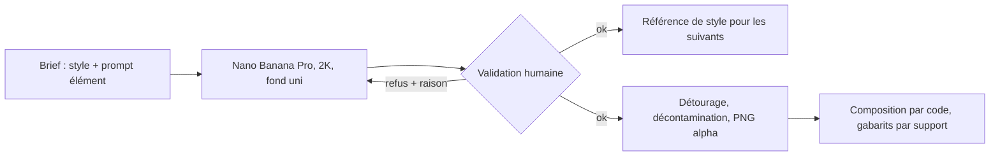

# CMP - Brief de génération des illustrations de Noël 2026

## Rôle
Ce que la conversation de production (ou plus tard l'agent créateur) donne à Nano Banana Pro pour
produire les 18 éléments isolés et les 7 scènes de la décision 15, et comment chaque sortie est
jugée. Le brief ne décide rien : il applique les décisions 14 et 15 et les contraintes de rendu de
[[CMP - Personnalisation par produit]].

## Intention
- **Un seul style pour tout le catalogue** : la signature de la boutique est le rendu, pas le sujet.
- **Des éléments faits pour être placés par le code** : isolés, centrés, sans ombre, sur un fond uni
  éloigné de toute la palette, pour un détourage par réseau et clé de couleur.
- **Lisible à 85 mm** : une fleur doit se reconnaître à sa silhouette, pas à ses détails.

## Diagramme

## 1. Style commun
Préfixe de tous les prompts, en anglais, inchangé. Version v3 du 02/11/2026 : le v1 (« opaque flat
pigment, closed bold contours ») donnait du vecteur à contour noir ; le v2 (traces de pinceau, sans
contour) a réglé la matière mais ramené du lavis sur les feuilles et des fonds en dégradé. Les deux
restent en commentaire dans `brief.py`.

> gouache painting, hand-painted with visible brush strokes inside the shapes, fully opaque paint,
> no wash, no watercolor, no transparency, no faded or ghosted parts, every shape ends with a clean
> crisp edge, thick painterly shapes, no black outline, no vector look, no gradient, medium to
> saturated colors, simple bold shapes, no fine detail, no drop shadow, no text, no letters,
> no watermark, children's book illustration, no realistic face, no recognizable character or brand

Suffixe des éléments isolés (v2 du 02/11/2026, renforcé contre les fonds en dégradé) :

> single object, centered, fully inside the frame with wide margins, the background is one single
> flat color {FOND} with no gradient, no vignette, no halo, no glow, nothing else in the image

Suffixe des scènes :

> cozy family scene, no people, no animals, the right third of the image is a plain uniform wall in
> color {FOND} with nothing on it, soft even lighting

Paramètres : `gemini-3-pro-image`, `image_size` `2K`, `aspect_ratio` `1:1` pour les éléments et
`4:3` pour les scènes, graine notée à chaque appel (elle fixe le dessin, pas les pixels).
**Pas d'image de référence par défaut** (*corrigé le 02/11/2026*,
[[RCH - Production des illustrations de Noël 2026, ce que les prompts ont appris (02-11-2026)]]) :
le modèle recopie le sujet de la référence autour du nôtre (feuilles de la rose sur la jonquille,
couronne de souci autour de la tulipe). Le style tient par le préfixe seul. Une référence reste
possible pour un cas précis, décidé en chat, jamais en règle.

Fond des éléments : vert #00C853, hors de toute la palette. Si un élément contient du vert (feuilles),
le fond passe au magenta #E600E6 pour cet élément, noté dans le journal.

## 2. Palettes (décision 15, fixées le 02/11/2026)
| Destinataire | Fond | Accents | Texte au choix |
|---|---|---|---|
| Mamie | #F3E6D3 | #E07A5F, #8AA587, #D4A537 | #6B4430, #C8453C, #5E8A6E, #2B3A67 |
| Papy | #D6DEE6 | #D4A537, #2E5E4E, #B5533C | #2B3A67, #B5533C, #2E5E4E, #6B4430 |
| Maman | #F2D9DC | #7B3F61, #D8A62A, #5E8A6E | #7B3F61, #6B4430, #5E8A6E, #2B3A67 |
| Papa | #E3DED6 | #2F4FA8, #8A5A3B, #D8A62A | #2B3A67, #8A5A3B, #2F4FA8, #1A1A1A |
| Couple | #F5EFE0 | #7A1E2E, #B8923E, #5E8A6E | #7A1E2E, #6B4430, #5E8A6E, #2B3A67 |
| Famille | #F5EFE0 | #5E8A6E, #C8623C, #D4A537 | #2E5E4E, #6B4430, #C8623C, #2B3A67 |

Les fleurs et les ornements gardent leurs couleurs propres ; seules les scènes prennent la palette.
Contraste : toutes les couleurs de texte dépassent 4,5:1 sur leur fond, sauf le corail #C8453C sur
le crème Mamie (environ 3:1), à réserver aux textes de 4 mm et plus.

## 3. Les douze fleurs de naissance
Un prompt par fleur : « a single {fleur}, {silhouette}, {couleurs} » entre le préfixe et le suffixe.
La colonne « silhouette » dit ce qui rend la fleur reconnaissable à 85 mm ; c'est le critère de
validation.

| Mois | Fleur | Silhouette à obtenir | Couleurs |
|---|---|---|---|
| janvier | œillet | tête ronde ébouriffée aux pétales dentelés, une tige | rose vif, feuilles vert gris |
| février | violette | cinq pétales arrondis, deux en haut, trois en bas, feuille en cœur | violet, cœur jaune |
| mars | jonquille | trompette centrale entourée de six pétales, tige droite | jaune, trompette orangée |
| avril | marguerite | pétales blancs fins et nombreux autour d'un cœur rond | blanc, cœur jaune |
| mai | muguet | tige courbée portant des clochettes blanches, une grande feuille | blanc, feuille vert franc |
| juin | rose | bouton ouvert aux pétales enroulés, une tige avec deux feuilles | rouge ou corail |
| juillet | pied-d'alouette | épi vertical de petites fleurs serrées | bleu, violet |
| août | glaïeul | tige droite avec plusieurs fleurs en trompette étagées | orange, rouge |
| septembre | aster | marguerite à pétales fins et nombreux, plus petite, violette | violet, cœur jaune |
| octobre | souci | tête ronde dense aux pétales serrés, **une tige courte et droite** (corrigé le 02/11, pour être planté) | orange vif |
| novembre | chrysanthème | pompon rond très fourni, **une tige courte et droite** (corrigé le 02/11) | jaune ou bronze |
| décembre | houx | trois feuilles dentelées brillantes et une grappe de baies | vert foncé, rouge |

Deux fleurs se ressemblent (marguerite et aster) : elles se distinguent par la taille et la couleur ;
la validation vérifie qu'on les reconnaît côte à côte.

## 4. Les six ornements de Noël
| Ornement | Silhouette à obtenir | Couleurs |
|---|---|---|
| boule | sphère avec capuchon et petit ruban, un reflet simple en aplat | rouge, or |
| étoile | étoile à cinq branches, bords francs, un peu épaisse | or, jaune |
| sapin | triangle à trois étages avec un tronc court, trois boules | vert, rouge, or |
| flocon | six branches symétriques, épaisses, sans détail fin | blanc cassé, bleu clair |
| bonhomme de pain d'épice | silhouette brune arrondie, trois boutons, sourire au glaçage, pas de visage réaliste | brun, blanc, rouge |
| cœur de Noël | cœur rouge avec une bordure blanche tricotée simple | rouge, blanc |

Le flocon et le bonhomme sont les plus fragiles sur bois (blanc, détails) : à juger sur l'échantillon.

## 4 bis. Les deux supports des symboles (ajouté le 02/11/2026)
Les fleurs sont plantées et les ornements pendent (décision 15, précision du 02/11). Deux éléments de
plus, générés une fois en 16:9 sur fond magenta, détourés, puis découpés par le code en trois
morceaux (15 % à gauche, milieu répété, 15 % à droite) pour tenir toute largeur.

| Élément | Silhouette à obtenir | Couleurs |
|---|---|---|
| bande de sol | bande horizontale d'herbe courte avec une fine bande de terre en dessous, bouts arrondis, sans motif marqué (la jonction du milieu doit être invisible), hauteur environ un cinquième de la largeur | vert franc, brun |
| branche de sapin | branche horizontale de sapin, aiguilles franches, deux bouts naturels, sans motif marqué, hauteur environ un cinquième de la largeur | vert foncé, brun |

Prompt : « a horizontal strip of {élément}, {silhouette}, {couleurs} » entre le préfixe et le suffixe des
éléments, `aspect_ratio` `16:9`. Critère supplémentaire de validation : le tiers central est répétable
sans rupture visible (on colle deux copies du tiers central et on regarde).

## 8. Lot Maman (ajouté le 03/11/2026)
Décision 15, précision du 03/11 : quatre familles de symboles de plus pour le gabarit A, utilisables par
tous les destinataires, et une couronne. Même préfixe, même suffixe, même fond (magenta si l'élément
contient du vert, vert sinon), même validation. Données dans `brief.py` (`PAPILLONS`, `COEURS`,
`OISEAUX`, `ENFANTS`, `COURONNE`).

### Papillons (6) — « Les papillons de … »
| Nom | Silhouette | Couleurs |
|---|---|---|
| papillon-rouge | ailes ouvertes vues de dessus, deux grandes ailes hautes et deux petites basses, corps fin, deux antennes épaisses | rouge et orange |
| papillon-bleu | idem | bleu et bleu nuit |
| papillon-jaune | idem | jaune et ocre |
| papillon-rose | idem | rose et prune |
| papillon-vert | idem | vert et vert bouteille |
| papillon-violet | idem | violet et lavande |

### Cœurs (6) — « Les cœurs de … », couleur au choix par prénom
| Nom | Silhouette | Couleur |
|---|---|---|
| coeur-rouge | cœur plein, bords ronds, un reflet simple en aplat | #C8453C |
| coeur-corail | idem | #E07A5F |
| coeur-rose | idem | #D98BA6 |
| coeur-prune | idem | #7B3F61 |
| coeur-bleu | idem | #4A7FC1 |
| coeur-vert | idem | #5E8A6E |

### Oiseaux (6) — « Les oiseaux de … »
| Nom | Silhouette | Couleurs |
|---|---|---|
| mesange | petit oiseau rond de profil, posé, tête bleue, joues blanches, ventre jaune | bleu, jaune, blanc |
| rouge-gorge | petit oiseau rond de profil, posé, poitrine orange | brun, orange |
| hirondelle | oiseau fin en vol, ailes pointues, queue fourchue | bleu nuit, blanc |
| chardonneret | petit oiseau de profil, face rouge, barre jaune sur l'aile | rouge, jaune, brun |
| moineau | petit oiseau rond de profil, posé, brun rayé | brun, beige |
| bouvreuil | petit oiseau rond de profil, posé, poitrine rose, calotte noire | rose, noir, gris |

### Enfants (8, plus 2 en réserve) — « La tribu de … »
Figurines debout, de face, grosse tête et corps court, deux points pour les yeux et un petit sourire,
aucun visage réaliste, tenue unie simple, pas de marque ni d'objet. Le **même texte de description
commune** est répété mot pour mot dans les huit prompts ; seule la ligne de variante change. Les huit
doivent avoir la même hauteur, les mêmes proportions et le même contour : la planche contact des huit
est le critère, pas chaque image seule. Contrôle PI figurine par figurine (tenue, coupe).

Description commune : « a single small child character, standing, front view, big round head and short
body, two dot eyes and a small smile, no realistic face, no nose detail, plain one-color clothes, no
logo, no pattern, arms slightly open, same character design for the whole set ».

| Nom | Variante |
|---|---|
| fille-blonde | girl, light blonde hair in two short pigtails, light skin, yellow dress |
| garcon-blond | boy, short light blonde hair, light skin, blue t-shirt and shorts |
| fille-brune | girl, brown hair in a ponytail, light skin, red dress |
| garcon-brun | boy, short brown hair, light skin, green t-shirt and shorts |
| fille-chatain-mate | girl, dark brown hair in a braid, medium tan skin, coral dress |
| garcon-chatain-mat | boy, short dark brown hair, medium tan skin, ochre t-shirt and shorts |
| fille-frisee | girl, black curly hair, dark brown skin, violet dress |
| garcon-frise | boy, short black curly hair, dark brown skin, teal t-shirt and shorts |
| bebe (réserve) | a swaddled baby in a white blanket, face as above |
| chat (réserve) | a small sitting cat, same style, ginger |

La fiche produit nomme les figurines par leurs traits (« fille, cheveux frisés noirs »), jamais par une
origine.

### Couronne (1) — composition « couronne »
| Nom | Silhouette | Couleurs |
|---|---|---|
| couronne | couronne ronde de petites fleurs et de feuilles, centre vide, épaisseur d'un cinquième du diamètre, aspect 1:1 | vert, rose, corail, jaune |

### Compositions du lot (code, pas de génération)
- **Deux générations** : deux rangées avec leur sol, titre « Maman de … » puis « Mamie de … » (ou toute
  paire de titres), N ≤ 4 par rangée sur le mug, N ≤ 3 sur la boule et le bois.
- **Couronne** : titre au centre de la couronne, prénoms autour sur un arc, N ≤ 4.
- **Depuis** : titre, une année en grand, un symbole, une phrase ; N = 0.

Phrases proposées pour Maman (fiche) : Maman d'amour ; La meilleure des mamans ; D'abord Maman,
maintenant Mamie ; Merci pour tout ; Le jardin de Maman ; Depuis toujours.

## 9. Lot Papa et Papy (ajouté le 04/11/2026)
Décision 15, précision du 04/11 : Papa et Papy ont en plus leur propre scène B, l'atelier, qui s'ajoute
au goûter, et trois familles de symboles pour le gabarit A, chacune avec son support. Même préfixe v3,
même suffixe, même fond (magenta si l'élément contient du vert, vert sinon), sans image de référence,
même validation (section 7). Données dans `brief.py` (`POTAGER`, `OUTILS`, `POISSONS`, `SUPPORTS`,
`ATELIER`, `HIVER_ATELIER`).

### Supports (3), 16:9, découpés en trois morceaux comme le sol et la branche de sapin
| Nom | Porte | Silhouette | Couleurs |
|---|---|---|---|
| branche-nue | les oiseaux, toutes destinataires | branche horizontale de bois nu, quelques petites feuilles, deux bouts naturels, sans motif marqué | brun, un peu de vert |
| panneau | les outils | bande horizontale de panneau perforé en bois, trous réguliers, bouts arrondis, sans motif marqué | bois clair |
| eau | les poissons | bande horizontale d'eau aux vagues simples et arrondies, bouts arrondis, sans motif marqué | bleu, bleu clair |

Hauteur environ un cinquième de la largeur, comme le sol. Critère supplémentaire, vérifié par code :
le tiers central se répète sans rupture visible.

### Potager (6) — « Le potager de … », planté dans la bande de sol existante
Chaque légume garde ses fanes ou une tige courte, pour s'enfoncer dans le sol.
| Nom | Silhouette | Couleurs |
|---|---|---|
| tomate | une tomate sur une courte tige de vigne avec deux feuilles | rouge, vert |
| carotte | une carotte debout avec ses fanes vertes | orange, vert |
| potiron | un potiron rond avec une tige courte | orange, tige verte |
| radis | un radis avec ses feuilles vertes | rouge rosé, pointe blanche, vert |
| poireau | un poireau debout | base blanche, feuilles vertes |
| chou | un chou rond | vert pâle et vert foncé |

### Outils (6) — « Les outils de … », accrochés au panneau perforé
Chaque outil est montré à plat, un peu incliné, comme accroché au mur. Aucun chiffre, aucune marque,
aucune inscription.
| Nom | Silhouette | Couleurs |
|---|---|---|
| marteau | marteau à panne fendue | manche en bois, tête grise |
| cle | clé plate | acier gris |
| tournevis | tournevis | manche rouge ou jaune, tige grise |
| scie | scie égoïne, dents en un seul zigzag franc, pas de dents fines | manche en bois, lame grise |
| pince | pince | poignées rouges, mâchoires grises |
| metre | mètre pliant en partie déplié, sans chiffre ni texte | jaune |

### Poissons (6) — « Les poissons de … », au-dessus de la bande d'eau
De profil, formes et couleurs différentes, sans écailles réalistes.
| Nom | Silhouette | Couleurs |
|---|---|---|
| truite | corps long et fin, quelques taches sombres franches | gris argent, taches sombres, bande rose |
| poisson-rouge | corps rond, queue en éventail | rouge orangé |
| maquereau | corps fin et pointu, queue fourchue, quelques rayures sombres ondulées sur le dos | dos bleu et vert, ventre argent |
| perche | corps haut, nageoire dorsale épineuse, quelques rayures verticales sombres | jaune ocre, rayures sombres, nageoires orange |
| poisson-lune | corps rond et plat comme un disque, petites nageoires | jaune |
| poisson-orange | petit corps, longues nageoires et longue queue souples | orange |

### Scène B : l'atelier — « L'atelier de … » (Papy), « Le garage de … » (Papa)
Prompt de base, entre le préfixe et le suffixe de scène (tiers droit en mur uni, pas de personne, pas
d'animal) :

> a cozy home workshop seen from the front: a wooden workbench, a few tools hanging on the wall on the
> left, a small wooden toy car on the bench, a stool, warm interior, wall color {FOND}, floor in
> {ACCENT3}, accents in {ACCENT1} and {ACCENT2}

Même méthode que le goûter (section 5) :
1. générer et valider la scène dans la palette Papy, deux graines ;
2. obtenir la palette Papa par `recolorer.py`, sans appel ;
3. calque d'hiver par édition en second tour sur la scène Papy validée, recollage par code, puis report
   sur Papa par `recolorer.py`.

> add a window on the left wall showing falling snow outside, and a small decorated Christmas tree
> on the workbench; keep everything else exactly the same

Aucune inscription sur les outils ni sur les murs.

### Ordre, essais et coût
Supports d'abord (branche-nue, panneau, eau), puis potager, outils, poissons, puis la scène. Graines 1
et 2, au plus quatre essais par élément. Au minimum 45 appels (21 éléments et la scène à deux graines,
plus l'hiver), plafond 70 appels, soit environ 9,40 USD (estimé, 0,134 USD l'appel). Les éléments
validés sont détourés dans `production/valides/` ; la RCH de production est complétée par une section
« Lot Papa et Papy ».

## 5. La scène : table de goûter
Prompt de base, entre le préfixe et le suffixe de scène :

> a cozy afternoon tea table seen from the front, slightly from above: a round table with a
> tablecloth in {ACCENT1}, a teapot and three cups in {ACCENT2}, a cake on a stand, a small vase,
> a few wooden toys on the floor, a chair on the left, warm interior, wall color {FOND}, floor in
> {ACCENT3}

Six scènes, une par palette, avec la même composition. *Corrigé le 02/11/2026, deux fois* : la graine
fixe le dessin mais pas la mise en place (mesure dans [[MOD - Connecteur nolaprint-image]], confirmée
sur cinq scènes), donc ni la régénération à la même graine ni l'édition locale par palette ne sont
retenues. Méthode retenue :
1. générer et valider la scène Mamie (deux graines, prompt ci-dessus avec les codes Mamie) ;
2. obtenir les cinq autres palettes par **recoloration de code** (`recolorer.py`) : chaque zone d'un
   rôle (mur, nappe, vaisselle, sol) est retrouvée en Lab et ramenée sur le code de la palette cible,
   nuances et traces de pinceau gardées ; composition identique par construction, aucun appel ;
3. prolonger par code la bande de sol vers la droite sous la zone de texte, pour que la pièce ne se
   lise pas comme un panneau collé (à ajouter à `recolorer.py`).
Limite connue : les petites feuilles du bouquet suivent la couleur de la vaisselle.

Calque d'hiver, une fois sur la scène Mamie validée, par édition en second tour :

> add a window on the left wall showing falling snow outside, and a small decorated Christmas tree
> in the left corner; keep everything else exactly the same

Puis recollage par code de la zone éditée sur l'image d'origine (RCH modèles d'images), et le même
calque est reporté sur les cinq autres palettes par `recolorer.py`, pas par régénération. Mesuré le
02/11 : écart hors zone de 2,63 sur 255 avant recollage, zéro après.

## 6. Procédure
1. Un script par série (fleurs, ornements, scènes), dans `3-systeme/recherches/tests-images/production/`,
   réutilisant `commun.py`. Clé dans `GEMINI_API_KEY`, jamais écrite.
2. Ordre : la rose en premier (sujet simple) pour caler le préfixe ; puis les onze autres fleurs, puis
   les ornements, puis la scène Mamie, puis la recoloration et l'hiver. Sans image de référence.
3. Deux essais par élément, graines 1 et 2 ; un troisième seulement si les deux sont refusés, avec un
   prompt corrigé selon la raison du refus. Pas plus de quatre.
4. Journal `production.json` : élément, prompt complet, graine, fichier, verdict, raison du refus en
   une ligne, date. C'est la preuve d'apport humain ([[SYN - Juridique]]).
5. Validation humaine de chaque sortie, à l'écran puis réduite à 1 004 px de large (85 mm).
6. Les éléments validés passent dans la chaîne de détourage de
   [[RCH - Détourage, nettoyage des bords et agrandissement pour l'impression (02-11-2026)]], sortie
   PNG alpha sRGB 300 DPI dans `production/valides/`.

## 7. Critères de validation
Un élément est validé si tout est vrai :
- reconnaissable à sa silhouette, à 1 004 px de large comme en pleine taille ;
- même matière et même épaisseur de contour que la référence ;
- aucun détail sous 12 px à 1 004 px (1 mm) ;
- pas d'ombre portée, pas de texture de fond, fond uni (écart type sous 3) ;
- pas de texte, de lettre, de visage réaliste, de personnage ou de marque reconnaissable ;
- pour les scènes : le tiers droit est un aplat uni (écart type sous 3), rien n'y est dessiné.
Un refus porte une raison courte parmi : silhouette, matière, détail fin, ombre ou texture, texte,
zone de texte envahie, autre (précisé).

## Entrées et sorties
- Implémentation : `brief.py` (ce brief en données, seule source des prompts), `generer.py` (un appel
  par élément, journal), `analyse.py` (mesures, planche contact, verdicts) dans
  `3-systeme/recherches/tests-images/production/`, pilotés par [[MOD - Connecteur nolaprint-image]].
- Entrées : ce brief, `commun.py`, la clé API.
- Sorties : 20 PNG alpha d'éléments (12 fleurs, 6 ornements, sol, branche), 6 scènes et 1 calque d'hiver
  en PNG, `production.json`.
- Coût estimé : 36 à 70 appels Nano Banana Pro en 2K, soit 5 à 10 USD (estimé, 0,134 USD l'appel).

## Cas limites
- Le modèle dessine du texte ou un visage : refus, prompt renforcé, nouvelle graine.
- Une fleur n'est pas reconnaissable après quatre essais : on la remplace par la fleur de repli
  (tulipe pour mars, pivoine pour juin, tournesol pour août, dahlia pour septembre), noté dans la
  décision 15 à la revue. *02/11/2026 : le glaïeul a été remplacé par le tournesol ; la jonquille a
  passé au septième essai, la tulipe reste en réserve.*
- La scène déborde sur le mur : on repeint la zone par masque (Precise Edit) ou on recadre.
- Dérive de style au fil des appels : on compare à la planche contact des éléments validés et on
  régénère les derniers éléments avec une autre graine.
- Cadrage vu seulement à l'œil : fleur peinte dans un rectangle plus clair que le fond, ou sur une carte
  à bordure blanche. La mesure de bordure ne les voit pas ; la planche contact, si.

## Notes liées
[[15 - Catalogue de Noël 2026, six destinataires, fleurs de naissance et table de goûter, neuf produits]] ·
[[14 - Brief visuel, deux gabarits de design déclinés par titre et par occasion, rendu peint aux formes franches]] ·
[[CMP - Personnalisation par produit]] · [[RCH - Capacités des modèles d'images pour les calques (02-11-2026)]]
