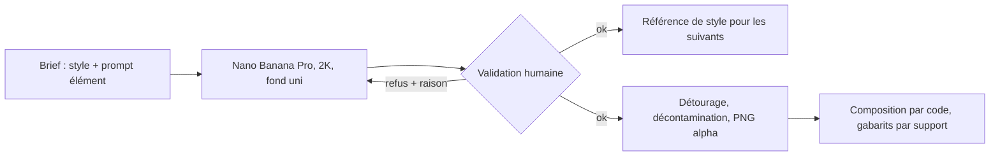

# CMP - Brief de génération des illustrations de Noël 2026

## Rôle
Ce que la conversation de production (ou plus tard l'agent créateur) donne à Nano Banana Pro pour
produire les 18 éléments isolés et les 7 scènes de la décision 15, et comment chaque sortie est
jugée. Le brief ne décide rien : il applique les décisions 14 et 15 et les contraintes de rendu de
[[CMP - Personnalisation par produit]].

## Intention
- **Un seul style pour tout le catalogue** : la signature de la boutique est le rendu, pas le sujet.
- **Des éléments faits pour être placés par le code** : isolés, centrés, sans ombre, sur un fond uni
  éloigné de toute la palette, pour un détourage par réseau et clé de couleur.
- **Lisible à 85 mm** : une fleur doit se reconnaître à sa silhouette, pas à ses détails.

## Diagramme

## 1. Style commun
Préfixe de tous les prompts, en anglais, inchangé :

> gouache illustration, opaque flat pigment, no wash, no gradient, closed bold contours, medium to
> saturated colors, simple bold shapes, no fine detail, no drop shadow, no paper texture, no text,
> no letters, no watermark, children's book illustration style, no realistic face, no recognizable
> character or brand

Suffixe des éléments isolés :

> single object, centered, fully inside the frame with wide margins, flat uniform background
> color #00C853, nothing else in the image

Suffixe des scènes :

> cozy family scene, no people, no animals, the right third of the image is a plain uniform wall in
> color {FOND} with nothing on it, soft even lighting

Paramètres : `gemini-3-pro-image`, `image_size` `2K`, `aspect_ratio` `1:1` pour les éléments et
`4:3` pour les scènes, graine notée à chaque appel. Référence de style : le premier élément validé,
passé en image de référence à tous les appels suivants (3 références de style au plus).

Fond des éléments : vert #00C853, hors de toute la palette. Si un élément contient du vert (feuilles),
le fond passe au magenta #E600E6 pour cet élément, noté dans le journal.

## 2. Palettes (décision 15, fixées le 02/11/2026)
| Destinataire | Fond | Accents | Texte au choix |
|---|---|---|---|
| Mamie | #F3E6D3 | #E07A5F, #8AA587, #D4A537 | #6B4430, #C8453C, #5E8A6E, #2B3A67 |
| Papy | #D6DEE6 | #D4A537, #2E5E4E, #B5533C | #2B3A67, #B5533C, #2E5E4E, #6B4430 |
| Maman | #F2D9DC | #7B3F61, #D8A62A, #5E8A6E | #7B3F61, #6B4430, #5E8A6E, #2B3A67 |
| Papa | #E3DED6 | #2F4FA8, #8A5A3B, #D8A62A | #2B3A67, #8A5A3B, #2F4FA8, #1A1A1A |
| Couple | #F5EFE0 | #7A1E2E, #B8923E, #5E8A6E | #7A1E2E, #6B4430, #5E8A6E, #2B3A67 |
| Famille | #F5EFE0 | #5E8A6E, #C8623C, #D4A537 | #2E5E4E, #6B4430, #C8623C, #2B3A67 |

Les fleurs et les ornements gardent leurs couleurs propres ; seules les scènes prennent la palette.
Contraste : toutes les couleurs de texte dépassent 4,5:1 sur leur fond, sauf le corail #C8453C sur
le crème Mamie (environ 3:1), à réserver aux textes de 4 mm et plus.

## 3. Les douze fleurs de naissance
Un prompt par fleur : « a single {fleur}, {silhouette}, {couleurs} » entre le préfixe et le suffixe.
La colonne « silhouette » dit ce qui rend la fleur reconnaissable à 85 mm ; c'est le critère de
validation.

| Mois | Fleur | Silhouette à obtenir | Couleurs |
|---|---|---|---|
| janvier | œillet | tête ronde ébouriffée aux pétales dentelés, une tige | rose vif, feuilles vert gris |
| février | violette | cinq pétales arrondis, deux en haut, trois en bas, feuille en cœur | violet, cœur jaune |
| mars | jonquille | trompette centrale entourée de six pétales, tige droite | jaune, trompette orangée |
| avril | marguerite | pétales blancs fins et nombreux autour d'un cœur rond | blanc, cœur jaune |
| mai | muguet | tige courbée portant des clochettes blanches, une grande feuille | blanc, feuille vert franc |
| juin | rose | bouton ouvert aux pétales enroulés, une tige avec deux feuilles | rouge ou corail |
| juillet | pied-d'alouette | épi vertical de petites fleurs serrées | bleu, violet |
| août | glaïeul | tige droite avec plusieurs fleurs en trompette étagées | orange, rouge |
| septembre | aster | marguerite à pétales fins et nombreux, plus petite, violette | violet, cœur jaune |
| octobre | souci | tête ronde dense aux pétales serrés | orange vif |
| novembre | chrysanthème | pompon rond très fourni | jaune ou bronze |
| décembre | houx | trois feuilles dentelées brillantes et une grappe de baies | vert foncé, rouge |

Deux fleurs se ressemblent (marguerite et aster) : elles se distinguent par la taille et la couleur ;
la validation vérifie qu'on les reconnaît côte à côte.

## 4. Les six ornements de Noël
| Ornement | Silhouette à obtenir | Couleurs |
|---|---|---|
| boule | sphère avec capuchon et petit ruban, un reflet simple en aplat | rouge, or |
| étoile | étoile à cinq branches, bords francs, un peu épaisse | or, jaune |
| sapin | triangle à trois étages avec un tronc court, trois boules | vert, rouge, or |
| flocon | six branches symétriques, épaisses, sans détail fin | blanc cassé, bleu clair |
| bonhomme de pain d'épice | silhouette brune arrondie, trois boutons, sourire au glaçage, pas de visage réaliste | brun, blanc, rouge |
| cœur de Noël | cœur rouge avec une bordure blanche tricotée simple | rouge, blanc |

Le flocon et le bonhomme sont les plus fragiles sur bois (blanc, détails) : à juger sur l'échantillon.

## 5. La scène : table de goûter
Prompt de base, entre le préfixe et le suffixe de scène :

> a cozy afternoon tea table seen from the front, slightly from above: a round table with a
> tablecloth in {ACCENT1}, a teapot and three cups in {ACCENT2}, a cake on a stand, a small vase,
> a few wooden toys on the floor, a chair on the left, warm interior, wall color {FOND}, floor in
> {ACCENT3}

Six appels, un par palette, même graine, en remplaçant {FOND}, {ACCENT1..3} par les codes de la
section 2. Les six scènes doivent avoir la même composition : seule la palette change.

Calque d'hiver, une fois sur la scène Mamie validée, par édition en second tour :

> add a window on the left wall showing falling snow outside, and a small decorated Christmas tree
> in the left corner; keep everything else exactly the same

Puis recollage par code de la zone éditée sur l'image d'origine (RCH modèles d'images), et le même
calque est reporté sur les cinq autres palettes par le code (recoloration), pas par régénération.

## 6. Procédure
1. Un script par série (fleurs, ornements, scènes), dans `3-systeme/recherches/tests-images/production/`,
   réutilisant `commun.py`. Clé dans `GEMINI_API_KEY`, jamais écrite.
2. Ordre : la rose en premier (sujet simple), validée, devient la référence de style ; puis les onze
   autres fleurs, puis les ornements, puis la scène Mamie, puis les cinq palettes, puis l'hiver.
3. Deux essais par élément, graines 1 et 2 ; un troisième seulement si les deux sont refusés, avec un
   prompt corrigé selon la raison du refus. Pas plus de quatre.
4. Journal `production.json` : élément, prompt complet, graine, fichier, verdict, raison du refus en
   une ligne, date. C'est la preuve d'apport humain ([[SYN - Juridique]]).
5. Validation humaine de chaque sortie, à l'écran puis réduite à 1 004 px de large (85 mm).
6. Les éléments validés passent dans la chaîne de détourage de
   [[RCH - Détourage, nettoyage des bords et agrandissement pour l'impression (02-11-2026)]], sortie
   PNG alpha sRGB 300 DPI dans `production/valides/`.

## 7. Critères de validation
Un élément est validé si tout est vrai :
- reconnaissable à sa silhouette, à 1 004 px de large comme en pleine taille ;
- même matière et même épaisseur de contour que la référence ;
- aucun détail sous 12 px à 1 004 px (1 mm) ;
- pas d'ombre portée, pas de texture de fond, fond uni (écart type sous 3) ;
- pas de texte, de lettre, de visage réaliste, de personnage ou de marque reconnaissable ;
- pour les scènes : le tiers droit est un aplat uni (écart type sous 3), rien n'y est dessiné.
Un refus porte une raison courte parmi : silhouette, matière, détail fin, ombre ou texture, texte,
zone de texte envahie, autre (précisé).

## Entrées et sorties
- Entrées : ce brief, `commun.py`, la clé API, la référence de style une fois validée.
- Sorties : 18 PNG alpha d'éléments, 6 scènes et 1 calque d'hiver en PNG, `production.json`.
- Coût estimé : 36 à 70 appels Nano Banana Pro en 2K, soit 5 à 10 USD (estimé, 0,134 USD l'appel).

## Cas limites
- Le modèle dessine du texte ou un visage : refus, prompt renforcé, nouvelle graine.
- Une fleur n'est pas reconnaissable après quatre essais : on la remplace par la fleur de repli
  (tulipe pour mars, pivoine pour juin, tournesol pour août, dahlia pour septembre), noté dans la
  décision 15 à la revue.
- La scène déborde sur le mur : on repeint la zone par masque (Precise Edit) ou on recadre.
- Dérive de style au fil des appels : on repasse la référence et on régénère les derniers éléments.

## Notes liées
[[15 - Catalogue de Noël 2026, six destinataires, fleurs de naissance et table de goûter, neuf produits]] ·
[[14 - Brief visuel, deux gabarits de design déclinés par titre et par occasion, rendu peint aux formes franches]] ·
[[CMP - Personnalisation par produit]] · [[RCH - Capacités des modèles d'images pour les calques (02-11-2026)]]
