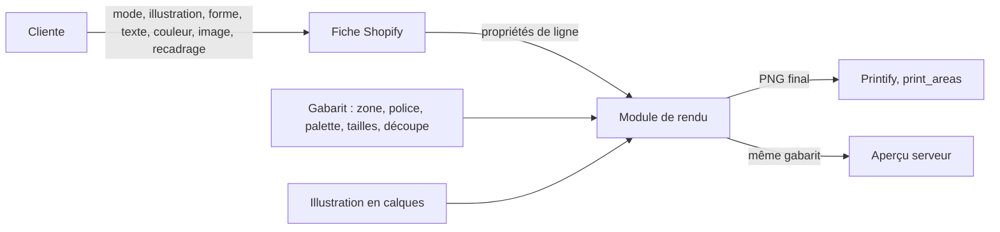

# CMP - Personnalisation par produit

## Rôle
La référence unique de ce que la cliente peut personnaliser sur chaque produit, de ce qui est fixé
par le gabarit, et des limites connues avec leur source. Le thème Shopify, le module de rendu et le
brief du créateur lisent cette note. Elle ne décide rien : chaque ligne renvoie à sa décision ou à sa
recherche, et chaque limite non vérifiée renvoie au registre A VERIFIER.

## Intention
- **Une seule source** pour trois lecteurs (thème, rendu, brief), afin que la fiche produit, le fichier
  imprimé et l'illustration disent la même chose.
- **Séparer ce que la cliente choisit de ce que le gabarit impose.** Tout ce qui n'est pas dans la
  colonne « cliente » est fixé par le gabarit de l'illustration et du support (décision 13).
- **Nommer les limites avant de dessiner.** Un gabarit ne s'écrit qu'avec la zone, la police et la
  palette connues.

## Diagramme

## Les deux modes
| | Nos designs | Page blanche |
|---|---|---|
| Point de départ | une illustration parmi peu de gabarits de design déclinés par destinataire, communs aux trois produits ([[02 - Lancement avec le mug, la boule en cristal et la décoration en bois, trois imprimeurs UE]]) ; sur le gabarit « un symbole au choix par prénom », la cliente choisit aussi un symbole par prénom dans une liste fermée ([[14 - Brief visuel, deux gabarits de design déclinés par titre et par occasion, rendu peint aux formes franches]]) | l'objet vierge ([[01 - Audience visée et nouvelle offre, parents et grands-parents d'abord, nos designs ou la page blanche]]) |
| Image | fixe, en calques (fond, sujet, zones de texte) | envoyée par la cliente : JPG, PNG, HEIC ; 1 200 px minimum sur le petit côté, avertissement sous 2 000 px ; recadrage déplacer et zoomer dans la forme ([[13 - Texte en trois champs facultatifs, couleur du texte en palette, police fixée, page blanche recadrée par la cliente]]) |
| Forme de découpe | fixée par l'illustration | tout, sapin, étoile, rond, fond blanc autour ([[TODO - Personnalisation au choix sur toute la surface du mug, de la boule et de la déco en bois]]) |
| Texte | trois champs facultatifs : titre, prénoms (0 à 6, 15 caractères chacun), phrase ; +1 € dès qu'un champ est rempli ([[13 - Texte en trois champs facultatifs, couleur du texte en palette, police fixée, page blanche recadrée par la cliente]], [[11 - Texte facultatif à 1 €, frais de retour à la charge du client, retours chez Sylvain]]) | identique |
| Couleur du texte | palette de 4 à 6 couleurs propre à l'illustration | palette commune à définir ⚠️ |
| Police | fixée par l'illustration, parmi quatre polices OFL testées sur les accents : Caveat Brush, Kalam, Patrick Hand, Nunito ([[RCH - Rendu du texte, polices et OCR des accents (02-11-2026)]]) | Nunito (bâton, la mieux lue par l'OCR) ⚠️ à confirmer |
| Supplément | prix de base, +1 € texte | +2 €, +1 € texte ([[09 - Établissement des nouveaux prix, alignés sur Cadeau Plus sans faux prix barrés]]) |
| Contrôle avant envoi | vérifications déterministes, OCR, validation humaine ([[FLOW - Personnalisation à la commande]]) | idem, plus contrôle de l'image : résolution, cadrage, contenus interdits, marques et personnages ([[01 - Audience visée et nouvelle offre, parents et grands-parents d'abord, nos designs ou la page blanche]]) |

## Par produit
Dimensions et zones : [[RCH - Contraintes d'impression Printify des trois produits (01-11-2026)]], sauf mention.

### Mug — Standard Mug 11oz, Textildruck Europa
| Point | Cliente | Gabarit | Limite connue |
|---|---|---|---|
| Zone | — | panneau de 2475 × 1155 px (Printify Knowledge Hub), soit environ 210 × 98 mm à 300 DPI, sur un tour de 251 mm (80 mm de diamètre, 95 mm de haut) : environ 40 mm non imprimés sous l'anse | pixels à confirmer par `variants.json` ⚠️ ; couture près de l'anse ; fond perdu au bord |
| Image | illustration ou image envoyée | recomposée pour le bandeau, jamais redimensionnée depuis un autre support ([[SYN - Système]]) | l'anse coupe le visuel : deux faces ou une face décentrée ([[SYN - Système]]) |
| Texte | titre, prénoms, phrase, couleur | position, taille maximale, réduction automatique | 6 prénoms au plus ⚠️ à confirmer |
| Fichier | — | PNG sRGB, taille exacte du placeholder | Printify agrandit seul un fichier trop petit, à éviter |

### Boule — Glass Ornament, Single, Circle, Chill
| Point | Cliente | Gabarit | Limite connue |
|---|---|---|---|
| Zone | — | disque de 76,2 mm, recto seul, dos blanc, impression UV | pixels ⚠️ ; cœur non proposé par Chill |
| Image | illustration ou image envoyée | composition centrée, rien d'important au bord | rendu des couleurs claires et des pixels transparents sur verre ⚠️ commande test |
| Texte | titre, prénoms, phrase, couleur | zone réduite : prénoms en arc ou en liste courte | 6 prénoms ⚠️ probablement moins ; lisibilité d'un texte long sur 76 mm ⚠️ |
| Fichier | — | PNG sRGB, taille exacte du placeholder | — |

### Décoration en bois — Wooden Ornaments, WOYC
| Point | Cliente | Gabarit | Limite connue |
|---|---|---|---|
| Zone | une forme parmi six : cloche 86 × 105, chaussette 86 × 162, sapin 92 × 132, étoile 85 × 97, ovale 85 × 125, cœur 87 × 115 mm | un gabarit par forme, découpé au contour | pixels et découpe exacte ⚠️ ; recto seul, dos aimanté ⚠️ |
| Image | illustration ou image envoyée | recomposée par forme | encre à plat qui ne couvre pas tout le grain : zones claires ou foncées ; sous-couche blanche ⚠️ |
| Texte | titre, prénoms, phrase, couleur | hauteur minimale des lettres 3 à 4 mm (estimé, [[02 - Lancement avec le mug, la boule en cristal et la décoration en bois, trois imprimeurs UE]]) | 6 prénoms ⚠️ ; étoile et cloche laissent peu de place |
| Fichier | — | PNG sRGB, taille exacte du placeholder | — |

## Ce que Printify impose, commun
- Une image par zone, une image différente à chaque commande et par variante ; plusieurs calques
  possibles sur une zone, mais le fichier est fusionné chez nous ([[10 - Notre serveur produit l'image finale, Printify la reçoit par l'API]]).
- Pas de texte rendu par Printify, pas d'aperçu par l'API : l'aperçu est rendu par notre serveur avec
  le même gabarit ([[FLOW - Personnalisation à la commande]]).
- Formats JPEG, PNG, SVG ; 100 Mo au plus ; 300 DPI recommandés.

## Contraintes de rendu probables
Tirées des guides d'imprimeurs et de retours de vendeurs, pas de nos échantillons
([[RCH - Rendu des trois procédés d'impression et planche de test (02-11-2026)]]). À confirmer par la
commande test ([[TODO - Planche de test des trois procédés pour la commande du 05-11]]).

| Contrainte | Mug (sublimation) | Verre (UV, dos blanc) | Bois (encre à plat) | Confiance |
|---|---|---|---|---|
| Trait minimal | 0,5 mm ; 0,6 mm en clair sur foncé | 0,5 mm | 0,6 mm | moyenne |
| Texte minimal (capitale) | 3 mm pour les prénoms, 2,5 mm pour le reste ; police grasse ou demi-grasse | 3 mm et 2,5 mm | 3,5 mm et 3 mm | faible à moyenne |
| Pastels | petites zones entourées de couleurs moyennes, un peu plus saturés que la cible | inconnu | accents seulement, jamais en fond | moyenne |
| Blanc | pas d'encre blanche : réserve toujours entourée de couleur | inconnu | inconnu ; pas de texte blanc sous 4 mm | élevée pour le mug, faible ailleurs |
| Transparence | pas d'alpha partiel ; alpha 0 = céramique | pas d'alpha partiel ; alpha 0 inconnu | pas d'alpha partiel ; halo blanc possible | moyenne |
| Marges | rien d'important à moins de 10 mm des bords latéraux et 5 mm du haut et du bas | 5 mm de zone sûre dans le cercle | 5 mm dans le contour ; éviter le centre si l'aimant le gêne | moyenne |
| Dégradés | pas dans les clairs | à éviter | à éviter | moyenne |
| Fichier | sRGB, PNG 300 DPI | idem | idem | élevée |

## Entrées et sorties
- Entrées : les choix de la cliente en propriétés de ligne (mode, illustration, forme, titre,
  prénom 1 à 6 avec leur symbole le cas échéant, phrase, couleur, image, coordonnées de recadrage) ; le gabarit de l'illustration et
  du support ; l'illustration en calques.
- Sorties : un PNG final par ligne de commande ; un aperçu rendu par le même module.
- Rendu : SVG par resvg, mesure et finalisation par Pillow ([[RCH - Rendu du texte, polices et OCR des accents (02-11-2026)]]).
- Format des propriétés de ligne : à fixer dans [[FLOW - De la personnalisation à la commande]].

## Cas limites
- Aucun champ texte rempli : pas de supplément, le gabarit laisse la zone de texte vide ou la
  remplit par l'élément décoratif prévu par l'illustration.
- Prénom trop long pour la zone : réduction automatique jusqu'à une taille minimale, puis tâche
  humaine ([[FLOW - Personnalisation à la commande]]).
- Image sous 1 200 px : refus à l'envoi, message clair ; entre 1 200 et 2 000 px : avertissement,
  commande acceptée.
- HEIC non converti : échec du rendu, nouvelle tentative, puis tâche humaine.
- Recadrage qui laisse du vide dans la forme : fond blanc, comme autour de la forme.
- Couleur de texte illisible sur une image envoyée : non contrôlé au lancement ⚠️ ; la validation
  humaine le voit.

## Notes liées
[[13 - Texte en trois champs facultatifs, couleur du texte en palette, police fixée, page blanche recadrée par la cliente]] · [[FLOW - Personnalisation à la commande]] · [[FLOW - De la personnalisation à la commande]] · [[MOD - Thème Shopify]] · [[RCH - Contraintes d'impression Printify des trois produits (01-11-2026)]]
