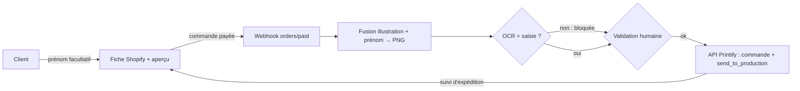

# FLOW - De la commande personnalisée à Printify

## Rôle
Transformer une commande Shopify (illustration choisie + prénom facultatif) en une commande Printify
avec une seule image finale, validée par un humain.

## Intention
- **Le client ne touche qu'au texte.** L'image vient de notre sélection ; le prénom est facultatif.
- **Une seule image part chez Printify.** Le rendu est fait chez nous, donc identique à l'aperçu.
- **Rien ne part sans validation** au lancement ([[03 - Approbation unitaire au lancement, paliers d'autonomie, actions toujours bloquées]]).

## Diagramme

Étapes :
1. **Client** : choisit un produit (une illustration), tape un prénom ou laisse vide, voit l'aperçu
   sur le mockup, coche « j'ai vérifié l'orthographe », paie.
2. **Shopify** : enregistre le prénom en propriété de ligne (`properties: {"Prénom": "…"}`) et envoie
   le webhook `orders/paid`.
3. **Passerelle** : vérifie le HMAC, déduplique par identifiant de ligne, répond en moins de 5 s
   ([[SYN - Système]]).
4. **Script de rendu** : charge l'illustration et son gabarit ; si prénom, l'écrit (police, position,
   taille maximale, réduction si trop long) ; exporte un PNG sRGB à la taille d'impression ; stocke le
   fichier chez nous.
5. **Script de contrôle** : OCR du prénom rendu, comparé à la saisie ; un écart bloque la commande.
6. **Humain** : regarde le PNG et le prénom, valide ou corrige.
7. **Script de publication** : crée la commande Printify avec une ligne `lineItemWithBlueprint`
   (`print_provider_id` du partenaire UE figé, `blueprint_id`, `variant_id`, `quantity`,
   `print_areas: {"front": <URL du PNG>}`, `external_id` = identifiant de ligne Shopify), puis appelle
   `send_to_production` (source : developers.printify.com/openapi.json, lu le 29/10/2026).
8. **Printify → Shopify** : le numéro de suivi est relayé dans Shopify ⚠️ à vérifier (webhook Printify
   d'expédition, puis création du fulfillment Shopify).

Noël 2026 : les étapes 3 à 7 sont faites à la main dans Printify
([[04 - Noël 2026 en test manuel réduit, Fête des grands-mères 2027 pour le système]]).

## Entrées et sorties
| Entrée | Sortie |
|---|---|
| Commande Shopify payée : produit, variante, prénom facultatif, adresse | PNG final stocké chez nous |
| Gabarit de l'illustration (zone, police, taille max) | Commande Printify en production, liée par `external_id` |
| | Numéro de suivi dans Shopify ⚠️ à vérifier |

## Cas limites
- **Prénom vide** : l'illustration de base part sans modification.
- **Prénom trop long** : limite à 15 caractères (estimé) dans le champ ; réduction de taille au rendu.
- **Accents et tirets** (Zoé, Anaïs, Marie-Christine) : police à vérifier ⚠️ sur l'échantillon.
- **Emoji ou caractères hors police** : refusés dans le champ.
- **Webhook reçu deux fois** : `external_id` empêche la double commande.
- **Produit relié par erreur à la synchro Printify** : Printify passerait une commande sans prénom ;
  aucun produit personnalisable n'est relié.
- **Faute du client** : on imprime ce qu'il a saisi et confirmé (case d'orthographe) ; produit
  personnalisé exclu de la rétractation ([[SYN - Juridique]]).

## Notes liées
[[14 - Notre serveur fusionne l'illustration et le prénom, Printify reçoit une image finale]] ·
[[SYN - Système]] · [[SYN - Fournisseurs]] · [[07 - La maquette est le cahier des charges du thème Shopify]]
