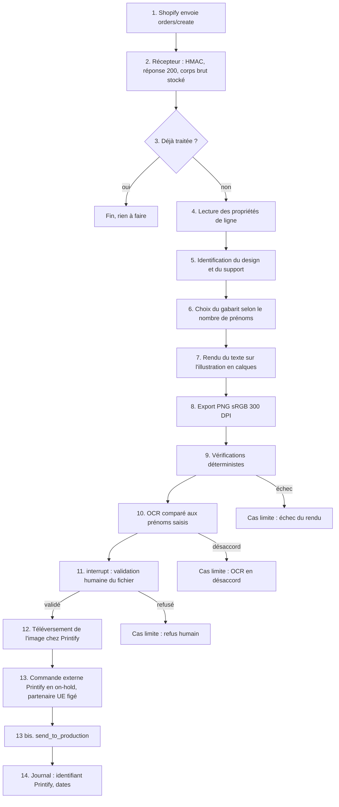

# FLOW - Personnalisation à la commande

## Rôle
Le parcours d'une commande Shopify jusqu'au fichier d'impression envoyé à l'imprimeur. Il commence
au webhook `orders/create` et finit à l'identifiant de commande Printify inscrit au journal.
Cette note décrit le flux fixé par [[08 - Personnalisation à la commande en génération interne, test Printify avant le 5 novembre]].
Elle ne décide rien. Chaque contrainte renvoie à la note qui la justifie.
Le parcours côté cliente, de la fiche au paiement, est dans [[FLOW - De la personnalisation à la commande]].

## Intention
- **Un seul système commande chez l'imprimeur.** Le produit Shopify n'est pas synchronisé avec Printify.
  Sinon Printify importe la commande avec l'image de base, sans prénoms, et il y a deux commandes
  ([[08 - Personnalisation à la commande en génération interne, test Printify avant le 5 novembre]]).
- **Le fichier est contrôlé avant d'être envoyé.** L'erreur de prénom est la première cause de
  mécontentement ([[SYN - Choix de la niche]]). Au lancement, un humain valide chaque fichier
  ([[03 - Approbation unitaire au lancement, paliers d'autonomie, actions toujours bloquées]]).
- **Chaque étape est idempotente et reprend après un crash.** C'est la condition pour garder
  Temporal possible plus tard ([[06 - LangGraph au départ, interface d'images interne avec Nano Banana Pro et Ideogram]]).
- **La fiche produit ne change pas entre Noël et mars.** La version manuelle de Noël et le code
  de mars lisent les mêmes champs ([[04 - Noël 2026 en test manuel réduit, Fête des grands-mères 2027 pour le système]]).

## Diagramme
Flux nominal. Les étapes sont numérotées comme dans le tableau qui suit.

## Étapes
Le système est l'ensemble passerelle Shopify, graphe LangGraph, module de rendu, interface d'images
et passerelle Printify ([[06 - LangGraph au départ, interface d'images interne avec Nano Banana Pro et Ideogram]]).
Les agents ne parlent jamais directement à Shopify ni à Printify ([[SYN - Système]], architecture).

### Déclencheur
| N° | Qui agit | Ce qui se passe | Justification |
|---|---|---|---|
| 1 | Shopify | envoie le webhook `orders/create` au récepteur | [[RCH - API Shopify pour la boutique agentique (22-10-2026)]] |
| 2 | Récepteur | vérifie la signature `X-Shopify-Hmac-SHA256`, stocke le corps brut, répond 200 en moins de 5 secondes, puis traite en asynchrone | [[RCH - API Shopify pour la boutique agentique (22-10-2026)]] |
| 3 | Récepteur | déduplique sur `X-Shopify-Webhook-Id` ; la clé d'idempotence du traitement est l'identifiant de commande Shopify, puis l'identifiant de ligne pour chaque article ; une commande déjà traitée ne relance rien | [[RCH - API Shopify pour la boutique agentique (22-10-2026)]], [[06 - LangGraph au départ, interface d'images interne avec Nano Banana Pro et Ideogram]] |
| 3 bis | Réconciliation nocturne | relit `orders` sur `updated_at` et traite les commandes dont le webhook a été perdu ; les webhooks ne sont pas garantis | [[RCH - API Shopify pour la boutique agentique (22-10-2026)]] |

Les nouvelles tentatives de Shopify sont de 8 sur 4 heures selon la page actuelle, 19 sur 48 heures
selon une page ancienne ; la contradiction n'est pas tranchée ([[SYN - Système]]). La déduplication
rend ce point sans effet sur le flux.

### Entrées
| N° | Qui agit | Ce qui se passe | Justification |
|---|---|---|---|
| 4 | Système | lit les propriétés de ligne de chaque article : nombre de prénoms, puis un prénom par champ | [[08 - Personnalisation à la commande en génération interne, test Printify avant le 5 novembre]] |
| 5 | Système | identifie le design par le metafield `ai.design_id` du produit, ou par le SKU ; identifie le support par la variante | [[03 - Approbation unitaire au lancement, paliers d'autonomie, actions toujours bloquées]], [[RCH - API Shopify pour la boutique agentique (22-10-2026)]] |

La fiche produit porte des champs obligatoires : un sélecteur du nombre de personnes, un champ par
prénom, 15 caractères au plus par prénom, un rappel d'orthographe et d'accents
([[08 - Personnalisation à la commande en génération interne, test Printify avant le 5 novembre]]).
Les prénoms arrivent dans la commande comme propriétés de ligne
([[RCH - Applications de personnalisation Shopify pour Printify et Gelato (29-10-2026)]], Infinite Options).

Format proposé des propriétés de ligne, à valider par Antoine ; Shopify n'impose rien au-delà du nom
`properties[...]` du champ, et un nom sans underscore reste visible de la cliente au panier et au
paiement, ce qui sert la relecture (aide Shopify, lu le 29/10/2026) :
- `Nombre de prénoms` : un entier de 1 à 8.
- `Prénom 1` à `Prénom 8` : une chaîne de 1 à 15 caractères ; les champs au-delà du nombre déclaré sont absents ou vides.
La limite de 15 caractères est appliquée par le thème, pas par Shopify. Le système prend le nombre de
champs remplis comme valeur de référence et journalise tout écart avec
`Nombre de prénoms`. Les autres champs de la maquette, appellation et ligne, suivent le même mécanisme ;
cette note ne les détaille pas ([[FLOW - De la personnalisation à la commande]]).

### Gabarit
| N° | Qui agit | Ce qui se passe | Justification |
|---|---|---|---|
| 6 | Système | choisit le gabarit du support selon le nombre de prénoms : 1-2, 3-4, 5-6, 7-8 | [[08 - Personnalisation à la commande en génération interne, test Printify avant le 5 novembre]], [[SYN - Système]] |

Au départ, un seul support : le bandeau du mug 11 oz, environ 2,4:1, avec la zone de l'anse vide
et des marges d'environ 75 px en haut et en bas ([[SYN - Système]], formats par support).
Le créateur déclare pour chaque support la zone de texte et les quatre gabarits
([[08 - Personnalisation à la commande en génération interne, test Printify avant le 5 novembre]], conséquences).
Les formats carré et portrait s'ajoutent plus tard avec leurs propres gabarits ; un visuel ne se
redimensionne pas d'un support à l'autre, il se recompose ([[SYN - Système]]).

### Rendu
| N° | Qui agit | Ce qui se passe | Justification |
|---|---|---|---|
| 7 | Module de rendu | place les prénoms sur l'illustration en calques (fond, famille, zone réservée aux prénoms), avec la police testée sur les accents, à la taille et à la position du gabarit ; réduit la taille si un prénom dépasse la zone | [[08 - Personnalisation à la commande en génération interne, test Printify avant le 5 novembre]] |
| 8 | Module de rendu | exporte un PNG sRGB à 300 DPI, à la taille de la zone d'impression de l'imprimeur retenu, et le stocke chez soi | [[06 - LangGraph au départ, interface d'images interne avec Nano Banana Pro et Ideogram]], [[05 - Printify en principal avec partenaire UE figé, Gelato en second, franchise de TVA au départ]] |

La taille de la zone est une donnée de configuration par imprimeur. Pour le mug, les sources donnent
2475 × 1155, 2480 × 1146, 2700 × 1120 ou 2625 × 1050 px ⚠️ ; seul le gabarit de l'imprimeur retenu fait foi
([[SYN - Fournisseurs]], fichiers d'impression). Le rendu se fait par Pillow ou par SVG
([[08 - Personnalisation à la commande en génération interne, test Printify avant le 5 novembre]]).

### Contrôle
| N° | Qui agit | Ce qui se passe | Justification |
|---|---|---|---|
| 9 | Système | vérifications déterministes : nombre de prénoms rendus égal au nombre saisi, dimensions et profil du PNG, texte entièrement dans la zone de texte, zone de l'anse vide, hachage du fichier calculé | [[06 - LangGraph au départ, interface d'images interne avec Nano Banana Pro et Ideogram]], [[SYN - Système]] |
| 10 | Système | OCR du texte rendu ; chaque prénom lu est comparé au prénom saisi, accents compris | [[08 - Personnalisation à la commande en génération interne, test Printify avant le 5 novembre]] |
| 11 | Graphe puis humain | `interrupt()` ; Antoine ou Sylvain voit le PNG, les prénoms saisis et le résultat de l'OCR, puis valide ou refuse ; l'état est en Postgres et reprend après un crash | [[03 - Approbation unitaire au lancement, paliers d'autonomie, actions toujours bloquées]], [[06 - LangGraph au départ, interface d'images interne avec Nano Banana Pro et Ideogram]] |

La validation humaine de chaque fichier est le palier « approbation unitaire ». Le passage au palier
par lot suit la règle de la décision 03 : 50 décisions, 95 % approuvées sans modification, zéro incident PI.
Printify impose de son côté une relecture humaine de tout contenu IA ([[SYN - Système]]).

### Envoi
| N° | Qui agit | Ce qui se passe | Justification |
|---|---|---|---|
| 12 | Passerelle Printify | téléverse le PNG final par `POST /uploads/images.json`, par URL ou en base64, et garde l'identifiant d'image renvoyé | API Printify (developers.printify.com, lu le 29/10/2026) |
| 13 | Passerelle Printify | crée une commande externe avec `blueprint_id`, `print_provider_id` du partenaire UE figé, `variant_id` et `print_areas` portant l'image, sans produit créé au préalable ; adresse de la cliente reprise de la commande Shopify ; `external_id` égal à l'identifiant de commande Shopify ; la commande est créée en statut on-hold, pas en production | [[08 - Personnalisation à la commande en génération interne, test Printify avant le 5 novembre]], [[05 - Printify en principal avec partenaire UE figé, Gelato en second, franchise de TVA au départ]], API Printify |
| 13 bis | Passerelle Printify | appelle `send_to_production` sur la commande ; sans cet appel, rien ne part chez l'imprimeur, à condition que le réglage d'approbation de la boutique Printify soit Manual | API Printify ; aide Printify, réglages d'approbation (lu le 29/10/2026) |
| 14 | Système | inscrit l'identifiant Printify, la date de création et la date de passage en production au journal | [[08 - Personnalisation à la commande en génération interne, test Printify avant le 5 novembre]] |

Rien d'officiel ne documente le doublon d'`external_id`. Un projet communautaire testé en octobre 2026
rapporte une réponse 409, code 8503, dont le corps nomme la commande existante ⚠️ source secondaire,
à confirmer le 5 novembre. L'idempotence est donc tenue par le journal : l'identifiant Printify est
enregistré dès la réponse de l'étape 13, et toute nouvelle tentative lit le journal avant de créer quoi
que ce soit ; la 409 n'est qu'un filet de sécurité.

Le réglage d'approbation de la boutique Printify est une donnée de configuration, au même titre que le
partenaire figé. Les options sont Manual, automatique en 1 heure, automatique en 24 heures (par défaut)
ou à heure fixe chaque jour ; la facturation a lieu au passage en production (aide Printify, lu le
29/10/2026). Avec le réglage par défaut, une commande créée par l'API partirait seule après 24 heures,
même sans `send_to_production` (source communautaire ⚠️ à confirmer le 5 novembre). Le flux suppose
donc le réglage Manual.

Le partenaire figé et son pays d'expédition sont une donnée de configuration ; un agent ne peut pas
en changer ([[05 - Printify en principal avec partenaire UE figé, Gelato en second, franchise de TVA au départ]]).
La passerelle a une file d'attente par endpoint et respecte 600 requêtes par minute ([[SYN - Fournisseurs]]).
Le produit Shopify n'est pas relié à Printify en synchronisation automatique ; seul le script commande
([[08 - Personnalisation à la commande en génération interne, test Printify avant le 5 novembre]]).

**Repli Printful si le test du 5 novembre échoue.** Printful accepte un fichier par ligne de commande
([[08 - Personnalisation à la commande en génération interne, test Printify avant le 5 novembre]]).
- Ce qui change : la passerelle fournisseur (étapes 12 à 14, et le passage en production propre à Printify), la configuration de la zone d'impression,
  l'atelier (Lettonie ou Espagne) et le port, chaque mug étant facturé comme un premier article
  ([[05 - Printify en principal avec partenaire UE figé, Gelato en second, franchise de TVA au départ]], [[SYN - Fournisseurs]]).
- Ce qui ne change pas : la fiche produit, les propriétés de ligne, les gabarits, le rendu, le contrôle,
  la validation humaine et le journal (étapes 1 à 11).
- Une application tierce n'est pas le repli ([[08 - Personnalisation à la commande en génération interne, test Printify avant le 5 novembre]]).

## Entrées et sorties
- Entrées : une fiche produit avec ses champs obligatoires et son metafield `ai.design_id` ; une commande
  Shopify avec ses propriétés de ligne ; l'illustration en calques et les gabarits du support ; la
  configuration de l'imprimeur (zone en px, `print_provider_id`).
- Sorties : un PNG par ligne de commande, stocké chez soi ; une commande externe Printify ; une entrée
  de journal par commande.
- Journal par commande ([[08 - Personnalisation à la commande en génération interne, test Printify avant le 5 novembre]]) :
  identifiant de commande et de ligne Shopify ; prénoms saisis tels quels ; gabarit choisi ; police et
  version du gabarit ; hachage du PNG ; résultat de l'OCR, prénom par prénom ; validateur et décision ;
  dates de réception, de rendu, de validation et d'envoi ; identifiant de commande Printify ; état final.
- Les chiffres de vente restent en Postgres ; le journal cite des identifiants, il ne recopie pas les ventes
  ([[_conventions]], section 6).

## Cas limites
Pour chaque cas : ce que fait le système, ce que voit la cliente, ce qui est journalisé.
Le service client est humain au lancement et chaque échange est documenté ; aucun agent n'accorde
un remboursement, une réimpression ni un geste commercial
([[03 - Approbation unitaire au lancement, paliers d'autonomie, actions toujours bloquées]]).

- **Prénom manquant ou invalide** (champ vide, plus de 15 caractères, caractère hors police).
  Système : arrête le flux avant le rendu et ouvre une tâche humaine. Cliente : un humain la contacte
  pour corriger, rien n'est envoyé. Journal : propriétés reçues telles quelles, motif, date.
  La fiche produit rend ce cas rare : les champs sont obligatoires et limités.
- **Échec du rendu** (illustration ou gabarit introuvable, police absente, vérification déterministe
  en échec). Système : nouvelle tentative une fois, puis tâche humaine. Cliente : rien, la commande est
  confirmée côté Shopify et le délai de production court. Journal : étape en échec, message d'erreur, hachage s'il existe.
- **OCR en désaccord** avec un prénom saisi. Système : ne bloque pas seul ; le fichier passe à la
  validation humaine avec le désaccord mis en évidence. Cliente : rien. Journal : prénom saisi, prénom lu, décision humaine.
- **Refus humain.** Système : garde le PNG refusé, relance le rendu après correction du gabarit ou du
  prénom, nouvelle validation. Cliente : un humain la contacte seulement si le prénom saisi est en cause.
  Journal : motif du refus, validateur, hachage du fichier refusé puis du fichier validé.
- **Échec de l'API Printify** (erreur réseau, `THROTTLED`, refus de la commande). Système : nouvelles
  tentatives avec backoff, après lecture du journal ; si une commande Printify existe déjà, la tentative
  reprend à l'étape 13 bis ; après échec persistant, tâche humaine ; aucune seconde commande n'est créée.
  Cliente : rien tant que le délai annoncé tient. Journal : chaque tentative, code de réponse.
- **Commande annulée ou remboursée après envoi** (webhooks `orders/cancelled` et `refunds/create` ;
  un remboursement total déclenche aussi `orders/cancelled`). Système : si la commande Printify est
  encore en on-hold, avant l'étape 13 bis, il appelle `cancel.json` ; cet endpoint n'accepte qu'une
  commande non payée, en statut on-hold ou payment-not-received. Après `send_to_production`, le système
  ouvre une tâche humaine : l'annulation se demande dans le tableau de bord Printify et n'est possible
  que tant que l'imprimeur n'a pas commencé. Cliente : la réponse vient du service client humain.
  Journal : événement Shopify, statut Printify au moment de l'événement, réponse Printify, décision humaine.
  Le remboursement lui-même est une action toujours bloquée pour un agent ([[03 - Approbation unitaire au lancement, paliers d'autonomie, actions toujours bloquées]]).
- **Deux articles personnalisés dans une commande** (duo). Le flux tourne par ligne : un PNG, une
  validation et une ligne Printify par article, sous le même identifiant de commande
  ([[02 - Mug famille illustrée à 24,90 €, panier cible 45 €]]).

## Version manuelle pour Noël 2026
Noël 2026 est un test manuel réduit, 8 à 12 mugs en ligne avant le 15/11/2026
([[04 - Noël 2026 en test manuel réduit, Fête des grands-mères 2027 pour le système]]).
La fiche produit est la même que dans le flux automatisé. Les étapes 1 à 5 se résument à la réception
de la commande dans l'admin Shopify. Les étapes 6 à 14 sont faites à la main par Antoine ou Sylvain :
choix du gabarit, fusion des prénoms sur l'illustration, relecture, commande dans Printify avec le PNG
([[08 - Personnalisation à la commande en génération interne, test Printify avant le 5 novembre]]).

Pour être remplacée par le code sans changer la fiche, la version manuelle respecte déjà :
- les mêmes propriétés de ligne, lues telles quelles, sans champ ajouté dans l'admin ;
- les mêmes quatre gabarits, la même police et la même taille de PNG que le futur rendu ;
- une commande Printify par commande Shopify, jamais par la synchronisation automatique ;
- le même journal, tenu à la main dans un fichier, avec les mêmes champs ;
- la même règle de refus : un fichier douteux est refait, pas envoyé.
Les échantillons de Noël sont commandés avec un fichier rendu par le système, pour tester la chaîne
entière avant la mise en ligne ([[08 - Personnalisation à la commande en génération interne, test Printify avant le 5 novembre]]).
L'automatisation complète vise mars 2027.

## Aperçu client
- Noël 2026 : un mockup statique du design et le rappel d'orthographe sur la fiche
  ([[08 - Personnalisation à la commande en génération interne, test Printify avant le 5 novembre]]).
  Le mockup ne passe jamais par une édition IA de la vue du produit vendu ([[SYN - Système]]).
- Après Noël : un aperçu rendu côté serveur, avec le même gabarit et la même police que le fichier
  final, donc par le même module de rendu que l'étape 7.
- L'aperçu JavaScript dans le navigateur est écarté : lissage, interlettrage et retours à la ligne
  diffèrent du rendu serveur ([[08 - Personnalisation à la commande en génération interne, test Printify avant le 5 novembre]]).

## À vérifier
Les points ouverts de ce flux sont déjà inscrits dans [[A VERIFIER - Points à valider, vérifier, tester]],
section Système. Cette note ne les recopie pas :
- commande externe Printify avec fichier propre à la commande, P1 avant le 05/11 ;
- absence de double commande après découplage de la synchronisation ;
- police et OCR sur é, è, ê, ë, ï, ç, œ et prénoms composés, limite de 15 caractères et réduction automatique ;
- zone d'impression exacte du mug chez l'imprimeur retenu, section Fournisseurs.
Deux points nouveaux à ajouter au registre, à tester le 5 novembre avec la commande externe : Printify
répond-il 409 sur un `external_id` en doublon ; le réglage Manual tient-il pour une commande créée par
l'API, sans départ automatique après 24 heures.

## Notes liées
[[08 - Personnalisation à la commande en génération interne, test Printify avant le 5 novembre]] · [[SYN - Système]] · [[SYN - Fournisseurs]] · [[FLOW - De la personnalisation à la commande]] · notes MOD et CMP à venir (module de rendu, passerelle Printify, récepteur de webhooks, objet Commande)
