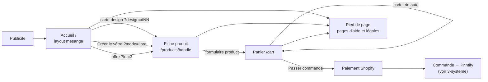

# OVR - Boutique NolaPrint

## Rôle
La boutique en ligne NolaPrint pour Noël 2026 : un thème Shopify maison (sections `np-*`) qui vend
**3 objets personnalisables** (mug, boule de Noël en verre, décoration de sapin en bois) avec
**10 designs** classés en **8 catégories**, ou l'image de la cliente. Les produits, le panier, le paiement
et les remises sont ceux de Shopify ; le thème ajoute l'aperçu en direct, le mug en 3D, les lots, le trio
et l'arrivée estimée.

La maquette HTML du 29-31/10 (`Claude outputs/nolaprint-sans-apercu-en-direct.html`) a servi de cahier
des charges ([[07 - La maquette est le cahier des charges du thème Shopify]]) ; elle n'est plus la
référence. Le code qui fait foi est le dossier du thème.

## Intention
- **Ce que la cliente voit est ce qui est imprimé** : texte posé dans la zone imprimable mesurée sur
  chaque photo, mug en 3D, case « J'ai vérifié l'aperçu et l'orthographe » obligatoire.
- **Une seule liste de designs** (`snippets/np-designs.liquid`) sert l'accueil, la fiche et le JavaScript.
- **Un objet est reconnu par son tag** (`np-mug`, `np-verre`, `np-bois`), pas par son handle.
- **Les règles commerciales vivent dans les réglages du thème** (« NolaPrint : offres et livraison ») :
  suppléments, lots, trio, livraison. Le thème affiche ; Shopify encaisse et remise.
- **Le téléphone d'abord** : le trafic vient des publicités Meta sur mobile ([[SYN - Acquisition]]).

## Diagramme

## Plan du site
| URL | Template | Section(s) | Note |
|---|---|---|---|
| `/` | `index.json` (layout `mesange`) | `np-hero`, `np-trust`, `np-modes`, `np-galerie`, `np-catalogue`, `np-offres`, `np-demo`, `np-faq` | [[MOD - Accueil]] |
| `/products/<handle>` | `product.json` | `np-main-product` | [[MOD - Catalogue et fiche produit]], [[MOD - Mug 3D]] |
| `/cart` | `cart.json` | `np-main-cart` | [[MOD - Panier et commande]] |
| `/collections`, `/collections/<handle>` | `list-collections.json`, `collection.json` | `np-list-collections`, `np-main-collection` | [[MOD - Catalogue et fiche produit]] |
| `/search` | `search.json` | `np-main-search` | [[MOD - Habillage]] |
| `/pages/faq`, `cgv`, `mentions-legales`, `confidentialite`, `cookies`, `livraison-retours` | `page.<nom>.json` | `np-page-content` | [[MOD - Pages légales et rétractation]] |
| `/pages/retractation` | `page.retractation.json` | `np-retractation` | [[MOD - Pages légales et rétractation]] |
| `/pages/contact` | `page.contact.json` | `np-contact` | [[MOD - Pages légales et rétractation]] |
| `/blogs/…` | `blog.json`, `article.json` | `np-main-blog`, `np-main-article` | pas utilisé au lancement |
| page introuvable | `404.json` | `np-404` | [[MOD - Habillage]] |
| boutique fermée | `password.json` (layout `password`) | Horizon d'origine | [[MOD - Thème Shopify]] |

Sur toutes les pages : `np-header` (bande d'annonce, logo, menu, panier) et `np-footer` (contact, aide,
légal, paiements, bannière cookies, puce maquette) : [[MOD - Habillage]], [[MOD - Cookies et consentement]].

## Modules, composants, flux
| Note | Ce qu'elle couvre |
|---|---|
| [[MOD - Accueil]] | les 8 sections de l'accueil |
| [[MOD - Catalogue et fiche produit]] | fiche produit, prix en direct, lot de 3, arrivée estimée, onglets, cartes produit |
| [[MOD - Mug 3D]] | le mug en 3D et sa barre de rotation |
| [[MOD - Panier et commande]] | panier, indications lots et trio, code trio automatique, livraison offerte |
| [[MOD - Pages légales et rétractation]] | FAQ, CGV, mentions, confidentialité, cookies, livraison, contact, rétractation |
| [[MOD - Cookies et consentement]] | bannière du thème ou de Shopify |
| [[MOD - Habillage]] | en-tête, bande d'annonce, pied de page, polices, couleurs, flocons, mode maquette |
| [[MOD - Thème Shopify]] | fichiers, réglages du thème, conventions de code |
| [[CMP - Produit]] | les 3 objets, variantes, prix, délais |
| [[CMP - Illustrations]] | les 10 designs et leurs images |
| [[CMP - Catégories des designs]] | les filtres Tous, Maman, Papa, Mamie, Papy, Couple, Famille, Noël, Amies et fratrie |
| [[CMP - Panier]] | les propriétés de ligne envoyées à Shopify |
| [[FLOW - De la personnalisation à la commande]] | de la carte design au paiement |
| [[FLOW - Lots et trio]] | lot de 3 du même objet, trio un de chaque |
| [[FLOW - Rétractation en ligne]] | le bouton « Renoncer au contrat ici » |
| [[FLOW - Déployer la maquette dans Shopify]] | pousser le thème |
| [[FLOW - Importer les produits par CSV]] | créer ou mettre à jour les produits |

## Invariants
- Prix de la décision 09 (source : CSV v3) : mug 18,45 €, boule 19,95 €, décoration 17,95 € ; texte +1 €,
  « Votre image » +2 € texte inclus ([[CMP - Produit]]).
- Lot de 3 du même objet : remise par article (1,80 / 1,97 / 1,80 €), par remise automatique Shopify ([[12 - Lots de 3 à environ moins 10 %, lot un de chaque sans remise]]).
- Trio (un de chaque) : −5,20 € par code de réduction `TRIO-NOEL` posé par le panier. ⚠️ Écart avec la
  décision 12 (« lot un de chaque sans remise ») : décidé dans le chat le 02/11, pas encore en décision.
- Livraison 4,90 € en France, offerte dès 60 € (réglages du thème).
- Prix barrés : affichés partout où Shopify a un « Prix avant réduction ». ⚠️ La décision 09 dit
  « sans faux prix barrés » : le prix barré doit être le plus bas des 30 jours précédents (art. L112-1-1 Code de la consommation).
- Ajout au panier impossible sans la case « J'ai vérifié l'aperçu » ; avec texte ou image, pas de rétractation (art. L221-28 3°).
- Aucun nom ni prénom du vendeur sur le site ; fabricant affiché : NolaPrint.

## État au 02/11/2026
- Thème poussé et publié sur `04qh0j-2k.myshopify.com`.
- ⚠️ à vérifier : import du CSV v3 (sans lui, la fiche affiche 19,45 / 20,45 € mais le panier facture 18,45 €).
- ⚠️ à faire : code `TRIO-NOEL` dans Shopify, remises automatiques des lots, livraison 4,90 € / 60 €.
- Zones jaunes à compléter : SIREN, adresse de l'entreprise, médiateur, date de mise en ligne.

## Cas limites
- Produit sans tag `np-*` : fiche simple (photo, variante, bouton), sans personnalisation.
- Produits absents (handle différent) : l'accueil affiche les prix de secours des réglages de section.
- Navigateur sans WebGL 2 : la photo du mug remplace la 3D.

## Notes liées
[[OVR - Drop shipping agentique]] · [[MOD - Thème Shopify]] · [[SYN - Juridique]] · [[A VERIFIER - Points à valider, vérifier, tester]]
