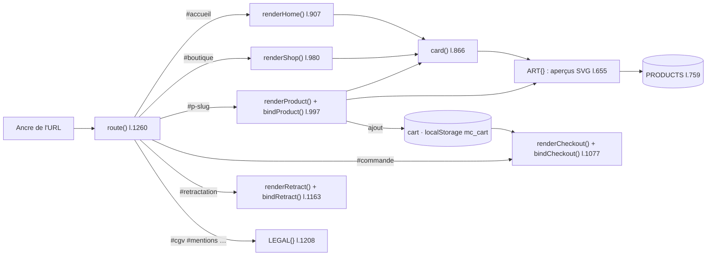

# OVR - Boutique NolaPrint

## Rôle
La maquette complète de la boutique de Noël 2026 : un seul fichier HTML de 1 355 lignes qui affiche
toutes les pages (accueil, catalogue, fiche produit avec aperçu SVG, panier, commande simulée,
rétractation en ligne, pages légales, cookies). Aucun paiement réel, aucun serveur : le panier et
le choix de cookies sont gardés dans le navigateur (`localStorage`).

## Intention
La maquette est le **cahier des charges** de la boutique, pas le site final ([[07 - La maquette est le cahier des charges du thème Shopify]]).
La vraie boutique sera un thème Shopify reconstruit à partir d'elle, ce qui est cohérent avec Shopify et Printify
([[04 - Noël 2026 en test manuel réduit, Fête des grands-mères 2027 pour le système]],
[[05 - Printify en principal avec partenaire UE figé, Gelato en second, franchise de TVA au départ]]).
Ce qui passe tel quel dans le thème : la mise en page, les couleurs, les textes, l'ordre des sections,
les règles visibles par le client (vérification de l'orthographe, mentions légales, délais).
Ce qui est remplacé par Shopify : le routeur par ancre, le panier `localStorage`, la commande simulée,
la bannière cookies (API Customer Privacy) et l'aperçu SVG (app de personnalisation reliée à Printify ⚠️ à choisir).

## Diagramme

## Les étages
| Étage | Lignes | Contenu |
|---|---|---|
| Styles | 11-470 | jetons de couleur `:root`, composants, cases rouges, alternance blanc / bordeaux, bloc « téléphone uniquement » (l.426) |
| Coquille HTML | 473-600 | bandeau défilant, en-tête, `<main id="app">`, pied de page, tiroir panier, bannière cookies, puce « mode maquette » |
| Données | 604-818 | constantes (`NOEL_DEADLINE`, `FREE_SHIP`, frais de port), illustrations `ART`, catalogue `PRODUCTS` (11 produits) |
| Pages | 819-1257 | panier, cartes, accueil, boutique, fiche produit, commande, rétractation, textes légaux |
| Routeur et liaisons | 1259-1355 | `route`, `bindPage`, bandeau, cookies, menu, mode maquette, flocons |

## Modules
| Module | Ce qu'il couvre |
|---|---|
| [[MOD - Accueil]] | couverture, réassurance, catalogue 3 + « Voir plus », démo, avis, Duo, FAQ |
| [[MOD - Catalogue et fiche produit]] | `renderShop`, `card`, `renderProduct`, `bindProduct`, champs de personnalisation |
| [[MOD - Panier et commande]] | tiroir panier, livraison, paiement simulé, délais |
| [[MOD - Pages légales et rétractation]] | CGV, mentions, confidentialité, livraison, FAQ, contact, bouton de rétractation |
| [[MOD - Cookies et consentement]] | bannière, préférences, `mc_consent` |
| [[MOD - Habillage]] | bandeau défilant, en-tête et menu, pied de page, flocons, mode maquette |

Composants : [[CMP - Produit]] · [[CMP - Illustrations]] · [[CMP - Panier]].
Flux : [[FLOW - De la personnalisation à la commande]] · [[FLOW - Rétractation en ligne]] · [[FLOW - Routage par ancre]].

## Invariants
- Tout article porte un texte saisi par le client : c'est ce qui fonde l'exclusion du droit de rétractation (art. L221-28 3°) affichée sur la fiche et au paiement ([[SYN - Juridique]]).
- L'ajout au panier est bloqué tant que la case « J'ai vérifié l'orthographe » n'est pas cochée ; la case se décoche à chaque modification ([[SYN - Choix de la niche]] : erreur de prénom = mug perdu et avis négatif).
- Les prix viennent de `PRODUCTS` : mug 24,90 €, duo 44,90 € ([[02 - Mug famille illustrée à 24,90 €, duo à 44,90 €, panier cible 45 €]]). Livraison 4,90 € en France, offerte dès 49 €, 6,90 € vers BE, LU, DE (estimé).
- Les avis sont des exemples étiquetés « Exemple » : aucun faux avis présenté comme réel.
- Les zones `.todo` (jaune) signalent ce qui est à compléter avant la mise en ligne ; la puce « mode maquette » les masque pour une capture.
- Version ordinateur figée : les ajustements téléphone vivent seulement dans les `@media` de la ligne 426.

## État au 29/10/2026
- Maquette validée visuellement (version 15 publiée). Nom : NolaPrint. Logo : renne au bonnet de Noël.
- Rien n'est sur Shopify. Les illustrations SVG sont à remplacer par les photos des échantillons.
- Zones à compléter : identité du vendeur, SIREN, médiateur, fabricant GPSR, délais réels, pays du partenaire.

## Cas limites
- Navigateur sans `localStorage` (navigation privée stricte) : le panier et le choix de cookies ne sont pas gardés, la page fonctionne quand même.
- Après le 10/12/2026, `daysLeft()` vaut 0 : la pastille de compte à rebours disparaît, mais le bandeau garde « jusqu'au 10 décembre » écrit en dur.
- Ancre inconnue : `render404()`.

## Notes liées
[[OVR - Drop shipping agentique]] · [[SYN - Juridique]] · [[SYN - Acquisition]] · [[04 - Noël 2026 en test manuel réduit, Fête des grands-mères 2027 pour le système]]
