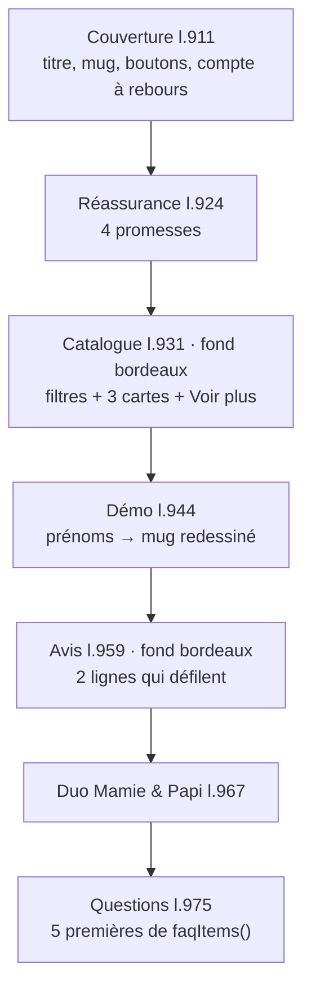

# MOD - Accueil

## Rôle
La page d'arrivée, celle que voit le trafic publicitaire. Elle enchaîne sept sections, de la
promesse jusqu'aux questions, et renvoie vers la fiche du mug ou du Duo.

## Intention
- La page parle à l'acheteuse (une femme adulte qui gère les cadeaux de la famille), pas aux
  grands-parents ([[SYN - Choix de la niche]]). Le titre nomme le produit visible sur l'image, pour
  reprendre le message de la publicité ([[02 - Mug famille illustrée à 24,90 €, duo à 44,90 €, panier cible 45 €]]).
- La version ordinateur est figée ; seul le téléphone s'ajuste (trafic principal attendu sur mobile).
- Les avis défilent sans pause au survol, et sont étiquetés « Exemple » tant qu'il n'y a pas de vrais avis.

## Diagramme

## Fonctions
| Symbole | Rôle | Appelé par | Appelle |
|---|---|---|---|
| `renderHome()` l.907 | construit le HTML des sept sections | [[FLOW - Routage par ancre]] `route` | `daysLeft`, `artFor`, `homeGrid`, `rvCard`, `rvSmall`, `faqItems` |
| `daysLeft()` l.620 | jours avant `NOEL_DEADLINE` (10/12/2026), 0 ensuite | `renderHome` | — |
| `homeGrid(list)` l.906 | les 3 premiers produits de la liste + la carte « Voir plus » | `renderHome`, filtres | [[MOD - Catalogue et fiche produit]] `card`, `moreCard` |
| `moreCard(n)` l.905 | carte « Voir plus » vers `#boutique` | `homeGrid` | — |
| `rvCard(r)` l.903, `rvSmall(r)` l.904 | une carte d'avis longue ou courte, avec l'étiquette « Exemple » | `renderHome` | — |
| `faqItems()` l.878 | les 7 questions ; l'accueil en montre 5 | `renderHome`, `LEGAL.faq` | — |
| `bindPage()` l.1275 | branche les filtres, la démo et le lien « Voir les cadeaux » | `route` | `homeGrid`, [[CMP - Illustrations]] `artFor` |

## Entrées et sorties
- Entrées : `PRODUCTS` ([[CMP - Produit]]), `REVIEWS` et `SHORT_REVIEWS` (avis d'exemple), `NOEL_DEADLINE`.
- Sortie : le HTML injecté dans `<main id="app">`. Liens sortants : `#p-mug-famille-illustree`,
  `#p-duo-mamie-papi`, `#boutique`, `#faq`.
- Filtres : `data-filter` = `all`, `mamie`, `sapin`, `cuisine`, `lots` ; chaque clic refait `homeGrid` avec la liste filtrée.
- Démo : `#demoTitle` et `#demoN0` à `#demoN3` redessinent le mug à chaque frappe, sans rien enregistrer.

## Dans le thème Shopify
| Bloc de la maquette | Devient |
|---|---|
| Couverture, réassurance, Duo | sections du thème, textes repris tels quels |
| Catalogue et filtres | collection Shopify, filtres par tag ⚠️ à vérifier |
| Démo | à décider : reprise en section, ou renvoi vers l'aperçu de l'app de personnalisation ⚠️ |
| Avis | app d'avis vérifiés (Judge.me ou équivalent ⚠️ à choisir) |
| Compte à rebours | section liée à une date de configuration |

## Cas limites
- Après le 10/12/2026 : la pastille disparaît (`d > 0`), mais le bandeau garde « jusqu'au 10 décembre ».
- Un filtre qui donne moins de 3 produits affiche moins de cartes, plus « Voir plus ».
- Démo sans prénom : le mug affiche « Léa » par défaut.
- Le lien « Voir les cadeaux » pointe vers `#catalogue-anchor`, qui n'existe pas ; c'est le clic
  JavaScript qui fait défiler vers `#catalogue`. Sans JavaScript, le lien ne mène nulle part.
- L'en-tête de la FAQ contient un lien vide `` l.976, et le titre « Foire au questions » prend un « x ».

## Notes liées
[[OVR - Boutique NolaPrint]] · [[MOD - Catalogue et fiche produit]] · [[MOD - Habillage]] · [[FLOW - Routage par ancre]]
