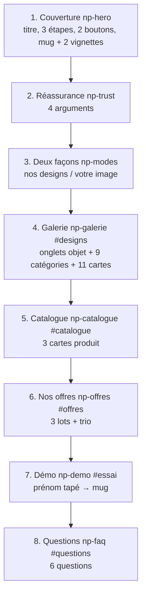

# MOD - Accueil

## Rôle
La page d'arrivée du trafic publicitaire (`/`). Huit sections, de la promesse aux questions, qui
renvoient toutes vers une fiche produit : un design précis (`?design=dNN`), « Votre image » (`?mode=libre`)
ou un lot (`?lot=3`).

## Intention
- Parler à l'acheteuse qui cherche un cadeau pour quelqu'un de sa famille : la galerie se filtre par
  personne ([[CMP - Catégories des designs]]).
- Montrer les deux façons de personnaliser dès le haut : nos designs, ou votre image.
- Chaque bouton mène à une fiche déjà réglée (design choisi, mode, lot), sans étape inutile.
- Surtitre de la couverture retiré le 02/11 à ta demande (réglage vide par défaut).

## Diagramme

## Les sections
| # | Section | Contenu | Liens sortants |
|---|---|---|---|
| 1 | `np-hero` | titre « Le cadeau personnalisé, à votre façon. », texte, étapes 1-2-3 (masquées sur téléphone), boutons « Choisir un design » et « Créer le mien de A à Z », mug `np-mug-d01-hd.jpg` + boule d07 + bois d05, étiquette « Mug personnalisé · prix » | `#designs`, mug `?mode=libre`, mug `?design=d01` |
| 2 | `np-trust` | Livraison offerte dès 60 € · Fabriqué en Europe · 10 designs + création libre · Casse remplacée | — |
| 3 | `np-modes` | Option 1 « Un de nos designs, à votre prénom » · Option 2 « Votre création de A à Z » | `#designs`, mug `?mode=libre` |
| 4 | `np-galerie` | onglets Mugs / Boules de Noël en verre / Décorations en bois, puces de catégorie, 10 cartes design + carte « Créer le vôtre », prix + prix barré sur une ligne | fiche `?design=dNN`, `?mode=libre` |
| 5 | `np-catalogue` | 3 cartes produit (`np-product-card`), ou la liste choisie dans l'éditeur | fiche |
| 6 | `np-offres` | Lot de 3 mugs / boules / décorations (prix lot + prix barré, pastille −X €) et Trio de Noël (51,15 € au lieu de 56,35 €) | fiche `?lot=3`, mug |
| 7 | `np-demo` | 5 designs (d01-d05), champ texte, mug redessiné à chaque frappe | mug `?design=dNN&texte=…` |
| 8 | `np-faq` | 6 questions (personnaliser, image, formes, lave-vaisselle, date Noël, retours) | — |

Textes des blocs : `templates/index.json` ; valeurs par défaut : schéma de chaque section.

## Fonctions et repères
| Symbole | Rôle | Appelé par | Appelle |
|---|---|---|---|
| `np-hero.liquid` l.9-34 | couverture ; étiquette prix l.32 | `index.json` | `all_products['mug-personnalise']` |
| `np-trust.liquid` l.1-17 | 4 blocs icône + titre + texte (max 4) | `index.json` | — |
| `np-modes.liquid` l.9-49 | deux cartes rouges | `index.json` | — |
| `np-galerie.liquid` l.12-81 | onglets l.18, puces l.24-32, prix et prix barré l.45-64, cartes l.67, carte libre l.69 | `index.json` | `np-designs` mode `gallery` |
| `np-catalogue.liquid` l.11-24 | grille produits, message si aucun produit | `index.json` | `np-product-card` |
| `np-offres.liquid` l.21-72 | cartes lots l.24-51, trio l.52-71, note l.73 | `index.json` | réglages `np_lot_off_*`, `np_trio_*` |
| `np-demo.liquid` l.9-34 | scène + 5 vignettes + bouton | `index.json` | `np-name-overlay`, `np-designs` `json` |
| `np-faq.liquid` l.1-8 | `
` par question | `index.json` | — |
| `initGallery(sec)` `np.js` l.52 | onglets et filtres de la galerie | `init()` | — |
| `initDemo(box)` `np.js` l.72 | redessine le prénom, met à jour le lien du bouton | `init()` | `setOverlay`, `withFont` |

## Entrées et sorties
- Entrées : les 3 produits (prix mini, prix barré), réglages du thème (lots, trio, suppléments), textes de `index.json`.
- Sorties : uniquement des liens. La démo n'enregistre rien ; son bouton transmet design et texte à la fiche.

## Cas limites
- Produit absent : la galerie affiche les prix de secours (« Dès 18,45 € », « Dès 19,95 € », « Dès 17,95 € ») ; le catalogue affiche « Les produits arrivent ».
- Lots désactivés (`np_lots_enabled` faux) : la section Offres disparaît entière.
- Remise trio à 0 ou désactivée : la carte trio affiche « 56,35 € les trois », sans prix barré.
- Prix barrés : affichés seulement si le « Prix avant réduction » Shopify est renseigné ⚠️ décision 09.
- Textes de la FAQ et dates de Noël écrits en dur dans `index.json` : à mettre à jour à la main.

## Notes liées
[[CMP - Catégories des designs]] · [[CMP - Illustrations]] · [[FLOW - Lots et trio]] · [[MOD - Habillage]]
