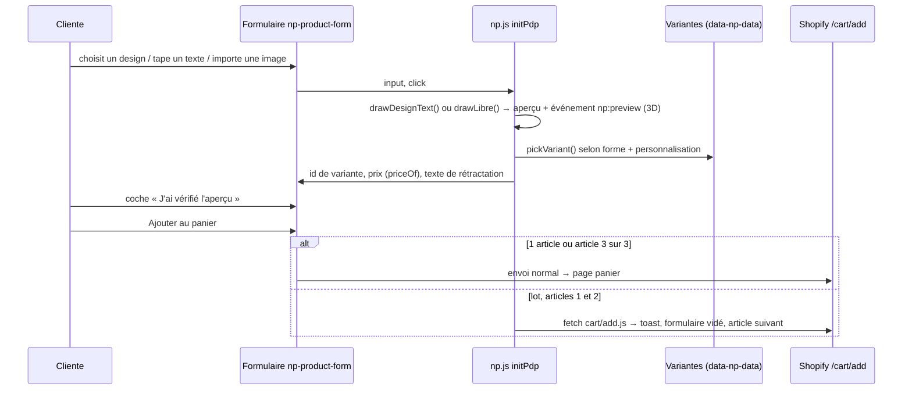

# MOD - Catalogue et fiche produit

## Rôle
La fiche produit (`/products/<handle>`) où la cliente choisit un design ou importe son image, tape son
texte, voit l'aperçu, et ajoute au panier — un article ou un lot de 3. Aussi : les cartes produit
(`np-product-card`), réutilisées sur l'accueil, la collection, la recherche et sous la fiche.

## Intention
- **Ce que vous voyez est imprimé** : aperçu sur la photo (boule, bois) ou en 3D (mug), case obligatoire « J'ai vérifié l'aperçu et l'orthographe ».
- **Le prix suit le choix en direct** : illustration seule → + texte (+1 €) → votre image (+2 €, texte inclus) ; le prix du bouton et du bouton collant changent à chaque frappe.
- **La règle de rétractation s'affiche sous le bouton** et change selon le choix (sans texte : 14 jours ; avec texte ou image : pas de rétractation, art. L221-28 3°).
- **L'arrivée estimée est datée**, à l'heure de Paris, avec une heure limite (14 h).

## Diagramme

## La fiche, de haut en bas
| Bloc | Lignes `np-main-product.liquid` | Détail |
|---|---|---|
| Fil d'Ariane | l.113 | Accueil / collection / produit |
| Scène (photo, canvas, texte SVG, 3D pour le mug) | l.119-128 | voir [[MOD - Mug 3D]] |
| Type, titre, prix, prix barré, mention TVA | l.132-138 | « TTC · TVA non applicable, art. 293 B du CGI » |
| Accroche | l.139 | réglage par objet |
| Blocs d'applications | l.142-144 | ex. message de paiement en plusieurs fois |
| Formule : 1 article ou lot de 3 | l.152-170 | prix du lot + économie ; note « chaque article a son illustration » |
| 1. Personnalisez : « Nos illustrations » / « Votre image » | l.172-182 | prix de chaque mode (+1 €, +2 €) |
| Panneau design : 10 vignettes, champ texte facultatif (+1 €, 15 car.) | l.184-198 | |
| Panneau image : import JPG/PNG 15 Mo, texte inclus, police (4), couleur (5), case droits | l.200-236 | |
| 2. Choisissez la forme (bois seulement) | l.238-256 | 6 formes en icônes |
| Vérifiez et ajoutez : rappel des accents, case, quantité, bouton + prix | l.266-275 | |
| Logos de paiement | l.279-283 | moyens activés dans Shopify |
| Arrivée estimée : Commande · Expédition · Livraison | l.285-292 | dates calculées par `initEta` |
| Cases Fait pour vous · 4,90 € suivi · Pour Noël | l.294-298 | icônes au trait rouge (`np-icon`) ; « Pour Noël » masquée après la date |
| Réassurance (4 lignes) | l.300-305 | paiement, casse, 14 jours, contact |
| Onglets Description / Livraison et retours / Paiement sécurisé | l.309-330 | « Sécurité du produit » repliée dans Description |
| Bouton collant « Personnaliser · prix » (téléphone) | l.332 | masqué quand le formulaire est visible |
| Données JSON pour `np.js` | l.333 | type, variantes, suppléments, designs, formes |
| « Sur nos autres objets » + trio | l.335-361 | prix du trio remisé + barré |
| Fiche simple (produit sans tag `np-*`) | l.363-392 | |

## Fonctions
| Symbole | Rôle | Appelé par | Appelle |
|---|---|---|---|
| `initPdp(root)` `np.js` l.138 | tout le comportement de la fiche | `init()` | les fonctions ci-dessous |
| `kind()` l.183 | `base`, `text` ou `image` selon le mode et le champ texte | `pickVariant`, `priceOf`, `refresh` | — |
| `priceOf(v)` l.186 | prix + supplément si pas d'option « Personnalisation » | `refresh` | — |
| `pickVariant()` l.190 | variante selon forme et personnalisation | `refresh` | — |
| `refresh()` l.195 | id de variante, prix, prix barré, bouton, rétractation, état du lot | saisies, mode, forme, lot | `pickVariant`, `priceOf` |
| `selectDesign(id)` l.243 | change de design (photo, nom, propriétés) | vignettes, `?design=` | `drawDesignText` |
| `drawDesignText()` l.236 | texte sur la photo + compteur | saisie | `setOverlay`, `preview` |
| `setMode(m)` l.320 | bascule design / image, active les bons champs | boutons de mode, `?mode=libre` | `drawDesignText`, `drawLibre`, `refresh` |
| `readFile()` l.333 | vérifie format, poids, définition de l'image | import, glisser-déposer | `drawLibre` |
| `composePrint()` l.254, `drawLibre()` l.296 | image + texte composés puis posés sur l'objet | mode image | `preview` |
| `applyShape(key)` l.368 | photo, texte, zone et vignettes de la forme en bois | choix de forme | `drawDesignText` / `drawLibre` |
| `preview()` l.226 | envoie l'état au mug 3D (`np:preview`) | chaque redessin | [[MOD - Mug 3D]] |
| envoi du formulaire l.396 | lot : ajout en arrière-plan des articles 1 et 2 | bouton | `cart/add.js`, `updateCartCount` |
| `initEta(box)` l.477 | dates Commande / Expédition / Livraison | `init()` | `parisNow` l.454, `addWorkdays` l.464, `rangeLabel` l.471 |
| `initTabs(box)` l.525 | onglets au clic et aux flèches | `init()` | — |
| `np-product-card.liquid` | carte : image, badge « 10 designs + création libre », titre, prix (« Dès » en petit) + prix barré sur une ligne | accueil, collection, recherche, fiche | `np-type` |

## Arrivée estimée
- Jour de départ en fabrication : aujourd'hui si jour ouvré et avant l'heure limite (réglage `cutoff`, 14 h, heure de Paris), sinon jour ouvré suivant.
- Expédition et livraison = départ + délais min-max en jours ouvrés ([[CMP - Produit]]), hors week-ends et jours fériés (`HOLIDAYS` l.450, jusqu'à fin 2027).
- Recalcul chaque minute, au retour sur l'onglet et au retour arrière.
- Exemple mesuré le 02/11 à 17 h (mug) : Commande 2 nov. · Expédition 5 – 6 nov. · Livraison 13 – 20 nov.

## Entrées et sorties
- Adresse : `?design=d03`, `?mode=libre`, `?texte=Léa`, `?lot=3` règlent la fiche au chargement ; l'adresse suit ensuite le design et le mode.
- Sortie : formulaire Shopify `product` avec l'id de variante et les propriétés de ligne ([[CMP - Panier]]).

## Cas limites
- « Votre image » sans image : envoi bloqué, message « Importez votre image… ».
- Image < 800 px de côté : avertissement de flou ; > 15 Mo ou autre format : refusée.
- Lot : la quantité est forcée à 1 par article ; au 3e article, envoi normal vers le panier. Recharger la page en cours de lot repart à l'article 1 (les articles déjà ajoutés restent au panier).
- Fuseau du téléphone différent : les dates restent à l'heure de Paris.
- Sans JavaScript : prix et dates de départ du Liquid (« 7 à 12 jours ouvrés »), pas d'aperçu.

## Notes liées
[[CMP - Produit]] · [[CMP - Panier]] · [[MOD - Mug 3D]] · [[FLOW - De la personnalisation à la commande]] · [[FLOW - Lots et trio]]
