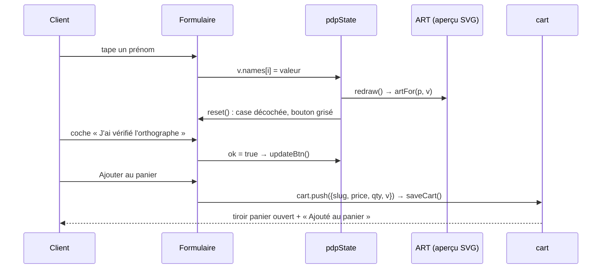

# MOD - Catalogue et fiche produit

## Rôle
La page « Les cadeaux » (`#boutique`), qui affiche les 11 produits en cartes, et la fiche produit
(`#p-<slug>`), où le client saisit ses prénoms, voit l'aperçu se redessiner, confirme l'orthographe
et ajoute au panier.

## Intention
- **Aucune erreur de prénom imprimée.** Le bouton d'ajout reste grisé tant que la case
  « J'ai vérifié l'orthographe » n'est pas cochée, et toute modification la décoche. Une erreur coûte
  un mug et un avis négatif ([[SYN - Choix de la niche]]).
- **Le texte saisi fonde l'exclusion de rétractation.** La fiche l'annonce avant l'achat
  (art. L221-28 3°), avec le remplacement gratuit en cas de casse ([[SYN - Juridique]]).
- **Les mentions GPSR sont prévues dès la maquette** (fabricant, personne responsable UE, avertissements),
  car elles sont obligatoires sur chaque fiche ([[SYN - Modèle économique]]).
- Plus d'étiquette « Personnalisable » sur les cartes ni de pastille « Aperçu en direct » sur la fiche :
  retirées le 29/10/2026 à ta demande.

## Diagramme

## Fonctions
| Symbole | Rôle | Appelé par | Appelle |
|---|---|---|---|
| `renderShop()` l.980 | grille des 11 produits | [[FLOW - Routage par ancre]] `route` | `card` |
| `card(p)` l.866 | carte produit : illustration, badge, nom, première phrase, prix | `renderShop`, `homeGrid`, `renderProduct` | [[CMP - Illustrations]] `artFor`, `eur` |
| `renderProduct(slug)` l.997 | fiche : aperçu, prix, champs, case d'orthographe, quantité, délais, mentions, « Souvent offert avec » | `route` | `bySlug`, `fieldHTML`, `artFor`, `addWorkdays`, `fmtDay`, `card`, `render404` |
| `fieldHTML(f, v)` l.988 | un champ selon son type : `select`, `text` ou `names` (liste de prénoms) | `renderProduct`, `rebuildFields` | `esc` |
| `bindProduct()` l.1038 | branche les événements de la fiche | `route` | `redraw`, `reset`, `updateBtn`, `bindNames`, [[CMP - Panier]] `saveCart`, `openCart`, `toast` |
| `redraw()` (interne) | remplace le SVG de `#pdpArt` | saisie, ajout ou retrait de prénom | `artFor` |
| `reset()` (interne) | décoche la case et regrise le bouton | toute modification | `updateBtn` |
| `updateBtn()` (interne) | active le bouton si case cochée et champs remplis ; met à jour le prix × quantité | `reset`, case, quantité | — |
| `bindNames()` / `rebuildFields()` (internes) | « + Ajouter un prénom » et « Retirer le dernier », dans les bornes `min`/`max` | `bindProduct` | `fieldHTML`, `redraw`, `reset` |

## Entrées et sorties
- Entrée : le slug de l'ancre, et le produit correspondant dans `PRODUCTS` ([[CMP - Produit]]),
  dont `fields` (champs) et `def` (valeurs de départ).
- État : `pdpState = {slug, qty, ok, v}`, recréé à chaque ouverture de fiche (rien n'est gardé si on revient).
- Sortie : une ligne `{slug, price, qty, v}` ajoutée à `cart`, avec les prénoms nettoyés (espaces retirés, vides supprimés).
- Délais affichés : livraison France entre aujourd'hui + 5 et + 10 jours ouvrés (estimé, `todo` visible).
- « Souvent offert avec » : jusqu'à 4 produits qui partagent une catégorie (`cat`).

## Règle de remplissage
| Champ `names` | Bouton actif si |
|---|---|
| `min` = `max` (ex. lot de 4 boules) | tous les prénoms sont remplis |
| `min` = 1 (ex. mug) | au moins 1 prénom rempli |
| `min` = 0 (ex. tablier) | aucun prénom exigé |

Tout champ `text` doit être non vide. Quantité entre 1 et 20.

## Dans le thème Shopify
| Bloc de la maquette | Devient |
|---|---|
| Grille et cartes | collection Shopify, carte produit du thème |
| Champs et aperçu SVG | app de personnalisation reliée à Printify ⚠️ à choisir ; l'aperçu doit rester exact |
| Case d'orthographe | à reproduire dans l'app ou en propriété de ligne obligatoire ⚠️ à vérifier |
| Délais | calculés par Shopify ou l'app, sur le délai réel mesuré |
| Mentions GPSR | métachamps produit, remplis avec le partenaire Printify |

## Cas limites
- Slug inconnu : `render404()`.
- Prénom trop long : bloqué par `maxlength` (10 ou 12 caractères selon le produit) ; la taille du texte
  dans le SVG se réduit avec `fit()`.
- Espaces en début ou fin de prénom : visibles dans l'aperçu, retirés seulement à l'ajout au panier.
- Le délai affiché ne vaut que pour la France ; BE, LU et DE ne sont calculés qu'à la commande.

## Notes liées
[[CMP - Produit]] · [[CMP - Illustrations]] · [[CMP - Panier]] · [[FLOW - De la personnalisation à la commande]] · [[MOD - Accueil]]
