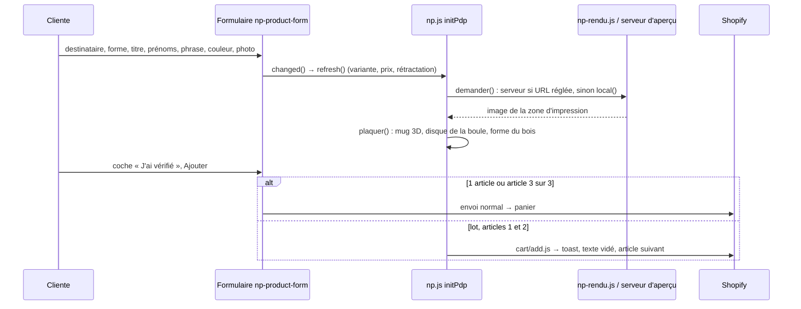

# MOD - Catalogue et fiche produit

## Rôle
La fiche produit (`/products/<handle>`) des 9 produits de Noël 2026 (3 objets × gabarit A, gabarit B, page
blanche). La cliente y choisit le destinataire, la forme (bois), tape son texte ou importe sa photo, voit
l'aperçu sur l'objet et ajoute au panier, un article ou un lot de 3. Aussi : les cartes produit
(`np-product-card`).

## Intention
- **Ce que vous voyez est imprimé** : aperçu sur l'objet (3D pour le mug), case obligatoire « J'ai vérifié
  l'aperçu et l'orthographe ». Toute modification décoche la case (`changed()` l.707).
- **Le prix suit le choix en direct** (conversation du 02/11) : sans texte, puis +1 € dès qu'un champ est rempli.
  Le prix du bouton et du bouton collant changent à chaque frappe.
- **La fiche part pré-remplie** avec l'exemple de la carte (« Mamie », Léa · Hugo · Jade) : la cliente modifie
  au lieu de partir d'une page vide.
- **La règle de rétractation s'affiche sous le bouton** et change selon le choix (sans texte : 14 jours ; avec
  texte ou photo : pas de rétractation, art. L221-28 3°).
- **L'arrivée estimée est datée**, à l'heure de Paris, avec une heure limite (14 h).
- **Prix barrés honnêtes** : la carte affiche le « Prix avant réduction » de Shopify seulement s'il existe
  (art. L112-1-1 : le plus bas des 30 jours précédents).

## Prix (CSV `nolaprint-produits-v4-noel-2026-ACTIFS.csv`, relevé le 03/11)
| Produit | Sans texte | Avec texte |
|---|---|---|
| Mug, gabarits A et B | 18,45 € | 19,45 € |
| Mug, votre image | 20,45 € | 21,45 € |
| Boule, gabarits A et B | 19,95 € | 20,95 € |
| Boule, votre image | 21,95 € | 22,95 € |
| Décoration en bois, A et B (6 formes × 6 destinataires) | 17,95 € | 18,95 € |
| Décoration en bois, votre image | 19,95 € | 20,95 € |

Sans option « Texte » dans les variantes (anciens produits), le thème ajoute `np_text_extra` (100 centimes).
⚠️ Le 02/11, « Votre image » valait +2 € texte inclus ; dans le v4, la photo est un produit à part et son texte
coûte +1 € (points ouverts du LISEZMOI Noël v2).

## Diagramme

## La fiche, de haut en bas (`np-main-product.liquid`)
| Bloc | Lignes | Détail |
|---|---|---|
| Scène : photo, plaque d'aperçu, 3D (mug) | l.214-219 | `data-np-3d` sur le mug ; « Forme : … » sur le bois |
| Onglets « Le jardin » ou « Le sapin » / « Votre photo » | l.254-261 | boutons dans la même fiche, ou liens entre produits |
| Formule : 1 article ou lot de 3 | l.270-284 | prix du lot et économie ([[FLOW - Lots et trio]]) |
| Pour qui ? (6 destinataires) | l.290 | pastille « Article N sur 3 » en lot |
| Choisissez la forme (bois) | l.305-318 | 6 formes |
| Votre image (page blanche) | l.320-367 | photo, forme, recadrage, fond ; hors de cette note |
| Votre texte (facultatif, +1 €) | l.369-426 | titre, 0 à 6 prénoms avec symbole (A), phrase, couleur en palette |
| Vérifiez et ajoutez : case, quantité, bouton + prix | l.428-440 | |
| Logos de paiement | l.442-444 | moyens activés dans Shopify |
| Arrivée estimée : Commande · Expédition · Livraison | l.447-453 | `initEta`, jours calendaires pour la livraison |
| Cases Fait pour vous · livraison · Pour Noël | l.455-460 | icônes au trait rouge (`np-icon`) ; « Pour Noël » masquée après sa date |
| Réassurance | l.462 | |
| Onglets Description / Livraison et retours / Paiement sécurisé | l.471-492 | `initTabs` |
| Bouton collant « Personnaliser · prix » (téléphone) | l.494 | masqué quand le formulaire est visible |
| Données JSON pour `np.js` | l.502 | variantes, palettes, symboles, plats, masques, `extra`, `apercu` |
| « Sur nos autres objets » + trio | l.589 | prix du trio remisé et barré |
| Fiche simple (produit sans tag NolaPrint) | l.603 | |

## Fonctions (`np.js`)
| Symbole | Rôle | Appelé par | Appelle |
|---|---|---|---|
| `initPdp(root)` l.188 | tout le comportement de la fiche ; état `st` (destinataire, déclinaison, forme, textes, couleur, photo) | `init()` | les fonctions ci-dessous |
| `buildTitre()` l.243, `renderPrenoms()` l.287, `renderCouleurs()` l.344 | champs du texte selon le gabarit et le destinataire | `setDest`, `setMode` | — |
| `hasText()` l.354, `pickVariant()` l.355 | variante selon forme × destinataire × texte | `refresh`, `updateUrl` | — |
| `refresh()` l.368 | id de variante, prix (+ `extra` si besoin), prix barré, bouton, rétractation, état du lot | `changed`, lot | `pickVariant` |
| `updateUrl()` l.386 | `?variant=`, `?noel=1` pour le mug aux ornements | `setDest`, forme | `pickVariant` |
| `plaquer(img)` l.635 | mug : `np:print` vers la 3D ; boule : disque ; bois : masque × grain | `local`, `demander`, `repli` | [[MOD - Mug 3D]] |
| `repli()` l.664, `local()` l.677, `demander()` l.690 | aperçu : serveur, sinon `NPRendu.rendre()`, sinon plat sans texte | `changed` (400 ms ou 60 ms) | `plaquer` |
| `changed()` l.707 | décoche la vérification, `refresh`, relance l'aperçu | toute saisie | `refresh`, `demander` |
| `setDest(d)` l.715 | destinataire, exemple, palette | radios « Pour qui ? » | `appliquerDemo` |
| `writeProps()` l.745 | propriétés de ligne (`_apercu_id`, `_apercu_url`, `_version`…) | envoi | — |
| envoi du formulaire l.786 | contrôles (photo, droits, case), lot : articles 1 et 2 par `cart/add.js` | bouton | `cart/add.js`, `updateCartCount` |
| `appliquerDemo()` l.818, `setMode(m)` l.849 | exemple de départ ; bascule jardin ou sapin / votre photo | onglets, `?photo=1` | `renderPrenoms`, `changed` |
| `initEta(box)` l.927 | dates Commande / Expédition (jours ouvrés) / Livraison (jours calendaires) | `init()` | `parisNow`, `addWorkdays`, `addDays`, `rangeLabel` |
| `initTabs(box)` l.979 | onglets au clic et aux flèches | `init()` | — |

## Arrivée estimée
- Départ en fabrication : aujourd'hui si jour ouvré et avant `cutoff` (14 h, heure de Paris), sinon le jour
  ouvré suivant. Jours fériés : `HOLIDAYS` l.899, jusqu'à fin 2027.
- Expédition : départ + délais en jours ouvrés. Livraison : départ + délais en **jours calendaires**
  (`data-jours="calendaires"`), calés sur une vraie commande (passée le 02/11, livrée du 13 au 15/11 ; source :
  commentaire de `initEta`).
- Recalcul chaque minute, au retour sur l'onglet et au retour arrière.

## Entrées et sorties
- Adresse : `?variant=`, `?pour=mamie`, `?noel=1`, `?lot=3`, `?photo=1` règlent la fiche au chargement.
  `?design=` et `?mode=libre` (version du 02/11) n'existent plus.
- Sortie : formulaire Shopify `product` avec l'id de variante et les propriétés de ligne ([[CMP - Panier]]).

## Cas limites
- La fiche pré-remplie compte le texte (+1 €) dès l'ouverture ⚠️ (point ouvert du 03/11).
- « Le goûter » (B) n'a plus d'onglet depuis le 03/11 : on y arrive par sa carte de l'accueil ;
  `?modele=gouter` ouvre le jardin.
- Changer de forme en bois coupe les prénoms au-delà du `n_max` de la forme.
- Lot : quantité forcée à 1 par article. Recharger la page en cours de lot repart à l'article 1 (les articles
  déjà ajoutés restent au panier).
- Sans JavaScript : prix et délais du Liquid, pas d'aperçu.

## Notes liées
[[MOD - Mug 3D]] · [[FLOW - Lots et trio]] · [[CMP - Produit]] · [[CMP - Panier]] · [[FLOW - Des éléments d'Antoine aux visuels de la boutique]]
