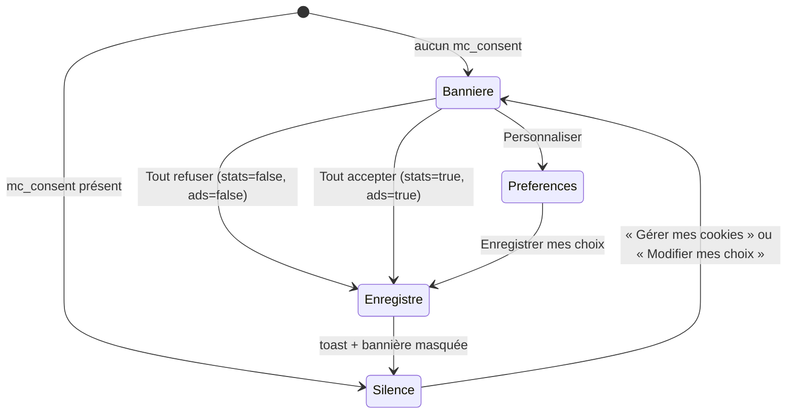

# MOD - Cookies et consentement

## Rôle
La bannière de cookies affichée à la première visite, avec trois choix (Tout refuser, Personnaliser,
Tout accepter), le panneau de préférences par catégorie, et la réouverture depuis le pied de page ou
la page Cookies.

## Intention
- **Refuser aussi simplement qu'accepter** : « Tout refuser » est au premier niveau et a le même style
  que « Tout accepter », comme l'exige la CNIL ([[SYN - Juridique]], [[SYN - Acquisition]]).
- **Le pixel Meta et l'API Conversions ne partent qu'avec l'accord** : la bannière est prête pour la
  publicité Meta du test de Noël ([[04 - Noël 2026 en test manuel réduit, Fête des grands-mères 2027 pour le système]]).
- Les cookies nécessaires (panier, sécurité) sont toujours actifs et ne demandent pas d'accord.

## Diagramme

## Fonctions
| Symbole | Rôle | Appelé par | Appelle |
|---|---|---|---|
| bannière `#cookie` (HTML, après le tiroir panier) | texte, préférences `#ckPrefs` masquées, trois boutons | démarrage si aucun choix | — |
| `showCookies()` l.1304 | réaffiche la bannière, coche les cases selon le choix gardé | « Gérer mes cookies » (pied de page), `#cookieAgain` ([[MOD - Pages légales et rétractation]]) | `store.get` |
| `saveConsent(stats, ads)` l.1305 | garde `{stats, ads, at}` dans `mc_consent`, masque la bannière, toast | les trois boutons | `store.set`, `toast` |
| `#ckCustom` (écouteur) | 1er clic : ouvre les préférences ; 2e clic : enregistre les cases | clic | `saveConsent` |

## Entrées et sorties
- Entrée : `mc_consent` dans `localStorage` (via `store`, protégé par try/catch).
- Sortie : `mc_consent = {stats: bool, ads: bool, at: date ISO}`. Rien d'autre : la maquette ne charge
  aucun pixel ni outil de mesure.

## Dans le thème Shopify
| Bloc de la maquette | Devient |
|---|---|
| Bannière et préférences | bannière de consentement Shopify (API Customer Privacy) ou app dédiée ⚠️ à choisir |
| `mc_consent` | consentement Shopify, transmis au pixel Meta, à l'API Conversions et au Consent Mode v2 de Google |
| Page Cookies | page du thème, tableau repris |

## Cas limites
- Sans `localStorage`, le choix n'est pas gardé : la bannière revient à chaque visite.
- Le choix n'expire jamais ; la CNIL recommande de redemander après une durée limitée ⚠️ à vérifier (6 ou 13 mois).
- Aucun pixel n'est branché : la bannière ne bloque ni ne débloque rien pour l'instant.
- La bannière couvre le bas de l'écran sur téléphone tant qu'aucun choix n'est fait.

## Notes liées
[[MOD - Pages légales et rétractation]] · [[SYN - Juridique]] · [[SYN - Acquisition]] · [[MOD - Habillage]]
