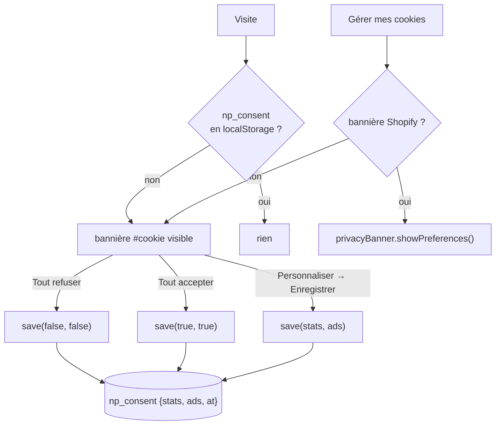

# MOD - Cookies et consentement

## Rôle
La bannière « Vos cookies, votre choix » : Tout refuser · Personnaliser · Tout accepter, avec trois
catégories (Nécessaires, toujours actifs ; Mesure d'audience ; Publicité : pixel Meta, API Conversions,
Google Ads). Le lien « Gérer mes cookies » (page Cookies et confidentialité) la rouvre.

## Intention
- **Refuser aussi simple qu'accepter** : deux boutons de même poids, comme le demande la CNIL ([[SYN - Juridique]]).
- **Laisser la main à Shopify si sa bannière est activée** : « Gérer mes cookies » ouvre alors les préférences Shopify (`window.privacyBanner`).
- La bannière n'apparaît qu'une fois ; le choix est daté.

## Diagramme

## Fonctions
| Symbole | Rôle | Appelé par | Appelle |
|---|---|---|---|
| `#cookie` `np-footer.liquid` l.52-69 | bannière, 3 interrupteurs, 3 boutons | toutes les pages | — |
| `showCookies()` `np.js` l.572 | rouvre la bannière avec le choix déjà fait | « Gérer mes cookies » | `store.get` |
| `save(stats, ads)` `np.js` l.573 | enregistre `np_consent`, ferme, affiche « Préférences enregistrées » ou « Cookies refusés » | 3 boutons | `store.set`, `toast` |
| boutons `[data-np-cookies]` `np.js` l.580-584 | préférences Shopify si présentes, sinon bannière du thème | page Cookies, confidentialité | `showCookies` |
| `store` `np.js` l.7 | lecture / écriture `localStorage` protégée | — | — |

## Entrées et sorties
- Entrée : clic de la visiteuse. Sortie : `localStorage.np_consent = {stats, ads, at}`.

## Cas limites
- ⚠️ Le choix de la bannière du thème n'est **pas transmis** à l'API Customer Privacy de Shopify : il ne bloque ni ne débloque les pixels branchés dans Shopify. Avant de brancher le pixel Meta ou Google, activer la bannière Shopify (ou une app de consentement) ([[TODO - Choisir les apps de rétractation et de consentement]], [[TODO - Brancher le suivi des visiteurs]]).
- Si la bannière Shopify est activée en plus, deux bannières peuvent s'afficher ⚠️ à vérifier, masquer alors celle du thème.
- Navigation privée stricte : le choix n'est pas gardé, la bannière revient à chaque visite.

## Notes liées
[[MOD - Pages légales et rétractation]] · [[MOD - Habillage]] · [[SYN - Juridique]]
