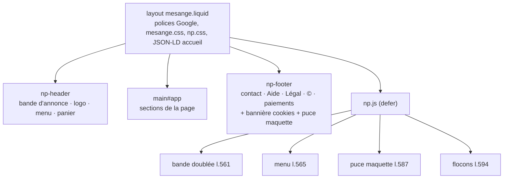

# MOD - Habillage

## Rôle
Tout ce qui entoure les pages : la bande d'annonce qui défile, l'en-tête (logo, menu, panier), le pied
de page, les polices et couleurs, les flocons, la puce « mode maquette », la page 404 et la recherche.

## Intention
- **Ambiance Noël sobre** : rouge airelle `#C1121F`, bordeaux pour les sections pleines, blanc partout, flocons discrets.
- **Typographie lisible** : Nunito Sans pour les titres, Inter pour le texte, Young Serif pour le logo (refonte du 02/11).
- **En-tête collant**, menu replié en burger sur téléphone ; compteur du panier toujours visible.
- **Rien d'agressif** : flocons et défilement coupés si la visiteuse limite les animations.

## Diagramme

## Éléments
| Élément | Fichier, lignes | Détail |
|---|---|---|
| Bande d'annonce | `np-header.liquid` l.19-26 | 6 messages (réglages `ann_1` à `ann_6`) : 10 designs, votre image, lot de 3 −10 %, fabriqué en Europe, article abîmé refait, livraison offerte dès 60 € ; doublés en JS pour défiler sans fin |
| Logo | `np-header.liquid` l.30-33 | renne au bonnet de Noël (SVG) + « NolaPrint » en Young Serif |
| Menu | `np-header.liquid` l.37-44 | Mugs · Boules de Noël · Décorations en bois · Nos designs · Créer le vôtre · Questions |
| Panier | `np-header.liquid` l.45-48 | icône + compteur `#cartCount` (mis à jour après un ajout de lot) |
| Pied de page | `np-footer.liquid` l.10-50 | e-mail, délai de réponse, liens Aide et Informations légales, © année en cours, logos de paiement |
| Puce maquette | `np-footer.liquid` l.71, `np.js` l.587 | montre ou cache les zones jaunes `.todo` ; choix gardé (`np_hide_todo`) |
| Flocons | `np.js` l.594 | canvas plein écran, ≤ 70 flocons, désactivés si « réduire les animations » |
| Page 404 | `np-404.liquid` | « Page introuvable » + retour à l'accueil |
| Recherche | `np-main-search.liquid` | champ, nombre de résultats, cartes produit |
| Marges des pages simples | `np.css` bloc Panier | `.page` : 16 px de chaque côté sur téléphone (02/11) |

## Couleurs et polices
| Jeton (`mesange.css` l.3-11) | Valeur | Usage |
|---|---|---|
| `--berry` | #C1121F | boutons, prix, icônes |
| `--berry-deep`, `--band` | #9D0E19 | bande d'annonce |
| fond des sections pleines | #6E0B15 | galerie des designs (`.sec-bdx`), pied de page |
| `--ink` | #2A1B1D | texte |
| `--green` | #1E6B45 | « Pour : », remises, réussite |
| `--gold` | #D4A72C | contour de focus |
| `--todo-bg` | #FFF4CC | zones à compléter |
| `--font-display` | Nunito Sans | titres, boutons, prix |
| `--font-body` | Inter | texte |
| logo | Young Serif | |
| polices de personnalisation | Dancing Script, Fredoka, Playfair Display italique, Caveat, Figtree | designs et « Votre image » |

## Entrées et sorties
- Réglages de l'en-tête (produits des liens, 6 messages) et du pied de page (e-mail, délai de réponse) dans l'éditeur de thème.

## Cas limites
- Les messages par défaut de la bande d'annonce commencent par un emoji (🎨 🖼️ 🎁 📦 ✨ 🚚), contrairement aux cases de la fiche passées en icônes au trait ⚠️ à harmoniser si voulu.
- La puce maquette s'affiche aussi pour les clientes tant qu'elle est dans le pied de page ⚠️ à retirer avant la mise en ligne.
- Produit d'un lien du menu renommé : choisir le produit dans les réglages de l'en-tête.

## Notes liées
[[MOD - Thème Shopify]] · [[MOD - Cookies et consentement]] · [[MOD - Pages légales et rétractation]]
