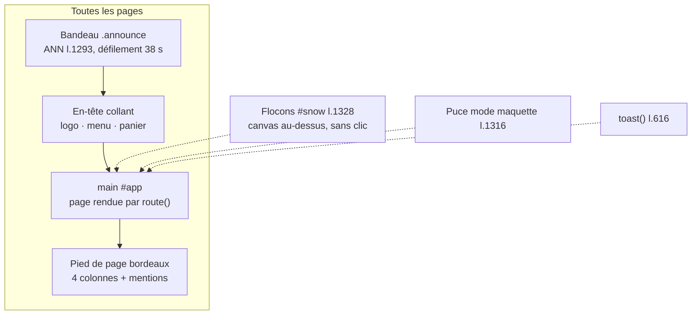

# MOD - Habillage

## Rôle
Tout ce qui entoure les pages et reste visible partout : le bandeau d'annonces qui défile, l'en-tête
collant (logo renne, menu, panier), le pied de page bordeaux, les flocons, le toast et la puce
« mode maquette ». Plus les jetons de couleur et de police qui donnent l'identité NolaPrint.

## Intention
- **Identité de Noël sobre** : rouge et bordeaux en alternance avec le blanc, police Young Serif pour les
  titres et Figtree pour le texte, logo renne qui rit au bonnet de Noël, flocons discrets. Thème clair
  seulement, quel que soit le réglage du système (le mode sombre donnait un fond bordeaux illisible).
- **Le bandeau ne s'arrête jamais**, ni au survol ni au toucher, et chaque message porte un emoji.
- **Les flocons et les défilements s'arrêtent** si le visiteur a demandé à limiter les animations.
- **Le mode maquette** montre ou masque d'un clic les zones à compléter, pour faire des captures propres.

## Diagramme

## Fonctions
| Symbole | Rôle | Appelé par | Appelle |
|---|---|---|---|
| `ANN` l.1293 + IIFE | 6 messages dupliqués une fois pour une boucle sans saut (`translateX(-50%)`) | démarrage | — |
| `#menuBtn` (écouteur) l.1317 | ouvre ou ferme le menu sous 860 px, met à jour `aria-expanded` | clic | — |
| `#cartBtn`, `#closeCart`, `#scrim`, Échap l.1318-1319 | ouvrent ou ferment le tiroir panier | clic, clavier | [[CMP - Panier]] `openCart`, `closeCart` |
| `#mockChip` (écouteur) l.1320 | ajoute ou retire `body.hide-todo` | clic | — |
| flocons (IIFE) l.1328 | canvas plein écran, au plus 90 flocons, étoiles pour les plus gros | démarrage, sauf `prefers-reduced-motion` | `requestAnimationFrame` |
| `toast(msg)` l.616 | message en bas d'écran pendant 2,6 s | ajout au panier, cookies, formulaires | — |

## Entrées et sorties
- Entrées : `ANN` (textes du bandeau), `FREE_SHIP` (seuil cité), les jetons `:root` l.13-24.
- Sorties : aucune donnée. Le menu, le pied de page et le bandeau renvoient vers les ancres des autres modules.

## Jetons de l'identité
| Jeton | Valeur | Usage |
|---|---|---|
| `--berry` | `#C1121F` | rouge principal, boutons |
| `--band` / `--berry-deep` | `#9D0E19` | bandeau, survol |
| bordeaux `.sec-bdx`, pied de page | `#6E0B15` | sections alternées |
| `--green` | `#1E6B45` | compteur du panier, badges « signature » |
| `--gold` | `#D4A72C` | contour de focus clavier |
| `--font-display` / `--font-body` | Young Serif / Figtree | titres / texte |

## Dans le thème Shopify
| Bloc de la maquette | Devient |
|---|---|
| Bandeau | barre d'annonces du thème, messages en réglage |
| En-tête, menu, panier | en-tête du thème, menu Shopify |
| Pied de page | pied de page du thème avec les liens légaux et « Renoncer au contrat ici » |
| Jetons de couleur et polices | réglages du thème (couleurs, typographie) |
| Flocons | script du thème, désactivable après Noël |
| Mode maquette | supprimé : sert seulement à la maquette |

## Cas limites
- Le `<title>`, le libellé du logo (`aria-label`) et le pied de page portent encore « Mésange & Cie ».
- Les dates du bandeau (« 10 décembre ») et le prix du Duo (« 44,90 € ») sont écrits en dur, sans lien
  avec `NOEL_DEADLINE` ni `PRODUCTS`.
- Des styles ne servent plus (`.live-label`, `.tag-perso`, `.news`, `.perso`, `.steps`, `.cover-sprig`).
- Sous 860 px, le menu ouvert reste ouvert si on fait défiler ; il se ferme au changement de page (`route`).

## Notes liées
[[OVR - Boutique NolaPrint]] · [[MOD - Accueil]] · [[MOD - Pages légales et rétractation]] · [[MOD - Cookies et consentement]]
