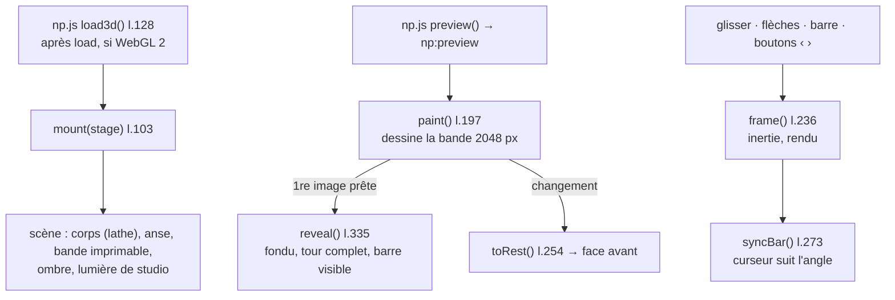

# MOD - Mug 3D

## Rôle
Sur la fiche du mug, la photo devient un **mug en 3D** dès le chargement : la cliente le fait tourner au
doigt, à la souris, aux flèches du clavier ou avec la **barre directionnelle** sous l'image, et voit son
illustration, son texte ou son image sur tout le tour.

## Intention
- Montrer tous les côtés avant d'acheter : un tour complet automatique à l'apparition.
- Revenir face avant à chaque modification, pour que la cliente voie tout de suite ce qu'elle change.
- Ne jamais bloquer : la photo reste affichée pendant le chargement et sert de secours sans WebGL 2.
- Le défilement vertical de la page reste libre (seul le glisser horizontal tourne le mug).
- Barre directionnelle ajoutée le 02/11 à ta demande.

## Diagramme

## Fonctions
| Symbole | Rôle | Appelé par | Appelle |
|---|---|---|---|
| réglages l.13-28 | dimensions (R 41 mm, H 98,5 mm), bande imprimable 80 × 212 mm, `DESIGN_SIDES` (côté imprimé), `REST` (pose de repos) | — | — |
| `bodyGeometry()` l.34, `handleGeometry()` l.47 | corps tourné et anse | `mount` | Three.js |
| `studio()` l.75, `contactShadow()` l.92 | reflets de l'émail, ombre sous le mug | `mount` | Three.js |
| `mount(stage)` l.103 | crée le canvas, la scène, la barre, les écouteurs | `np.js load3d` | tout le reste |
| `paint()` l.197 | bande : illustration `-flat` au côté visible (anse à droite) + texte ; ou image de la cliente sur toute la zone + texte ; pointillé « Votre image ici » si vide | événement `np:preview` | `label` l.172, `hint` l.188 |
| `frame(now)` l.236 | une image par mouvement (pas de boucle permanente), inertie | `kick` l.251 | `syncBar` |
| `turnTo(to, ms)` l.253, `toRest()` l.254 | rotation animée, retour face avant | flèches, barre, `paint` | `kick` |
| barre `bar` l.263, `syncBar()` l.273 | curseur −180° à +180° (0 = face avant) + boutons ‹ › (±45°) ; le curseur suit le glisser | `reveal`, `frame` | `turnTo` |
| écouteurs canvas l.297-322 | glisser (pointeur), flèches gauche / droite | la cliente | `kick`, `turnTo` |
| `resize()` l.324 | suit la taille de la case photo | ResizeObserver | — |
| `reveal()` l.335 | fondu photo → 3D, tour complet après 0,9 s, barre visible | `paint` | `turnTo` |

## Entrées et sorties
- Entrée : `stage.npPreview` (mode, design, texte, police, image, texte libre, couleur), envoyé par `np.js preview()` l.226.
- Sortie : rendu seulement. Rien n'est envoyé à Shopify ni à Printify : le fichier d'impression est produit par le serveur ([[10 - Notre serveur produit l'image finale, Printify la reçoit par l'API]]).
- CSS : bloc « Mug en 3D » et « Barre directionnelle » de `np.css`.

## Cas limites
- Pas de WebGL 2 ou contexte perdu : photo + aperçu 2D, barre masquée.
- « Réduire les animations » activé : pas de tour automatique, rotations instantanées.
- Illustration lente à charger : la 3D s'affiche quand même après 4 s.
- Côté imprimé : un seul côté (`DESIGN_SIDES = [0.75]`) ⚠️ le fichier envoyé à Printify doit suivre ce choix.
- Zone d'impression estimée d'après les photos ⚠️ à recaler sur le blueprint Printify 1016.
- « Votre image » sur tout le tour recadre fort une photo 4:3 (environ la moitié de la hauteur perdue).

## Notes liées
[[MOD - Catalogue et fiche produit]] · [[CMP - Illustrations]] · [[10 - Notre serveur produit l'image finale, Printify la reçoit par l'API]]
