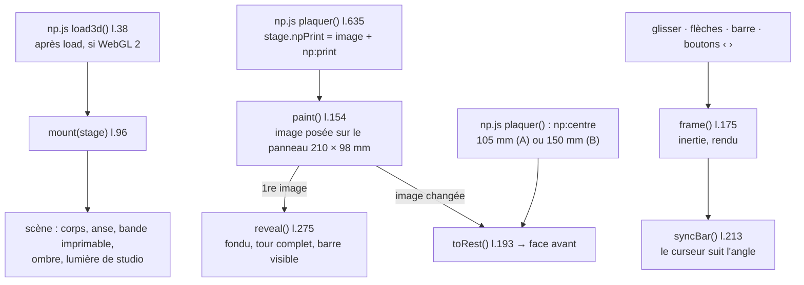

# MOD - Mug 3D

## Rôle
Sur la fiche du mug, la photo devient un **mug en 3D** dès le chargement. La cliente le fait tourner au doigt,
à la souris, aux flèches du clavier ou avec la **barre directionnelle** sous l'image, et voit sa
personnalisation sur tout le tour.

## Intention
- Montrer tous les côtés avant d'acheter : un tour complet automatique à l'apparition (conversation du 02/11).
- Revenir face avant à chaque modification, pour que la cliente voie tout de suite ce qu'elle change.
- **Aucun texte n'est dessiné par la 3D** (décisions 08 et 10). La texture est l'image de la zone d'impression :
  celle du serveur d'aperçu dès qu'il est branché, sinon celle de `np-rendu.js`, sinon le plat sans texte
  ([[FLOW - Des éléments d'Antoine aux visuels de la boutique]]).
- Ne jamais bloquer : la photo reste affichée pendant le chargement et sert de secours sans WebGL 2.
- Le défilement vertical de la page reste libre : seul le glisser horizontal tourne le mug.

## Diagramme

## Fonctions
| Symbole | Rôle | Appelé par | Appelle |
|---|---|---|---|
| réglages l.14-21 | mug R 41 mm, H 98,5 mm ; bande 98 mm de haut ; panneau `PRINT_W` 210 mm centré à l'opposé de l'anse ; texture 2048 px sur le tour (7,95 px/mm) ; `REST` pose de repos | — | — |
| `bodyGeometry()` l.27, `handleGeometry()` l.40 | corps tourné et anse | `mount` | Three.js |
| `studio()` l.68, `contactShadow()` l.85 | reflets de l'émail, ombre sous le mug | `mount` | Three.js |
| `mount(stage)` l.96 | canvas, scène, caméra calée sur les photos (anse à droite), barre, écouteurs | `np.js load3d` l.38, chargement du module | tout le reste |
| `paint()` l.154 | fond blanc, puis `stage.npPrint` posé sur le panneau ; sous l'anse, rien | événement `np:print` | `reveal`, `toRest`, `kick` |
| `offDe()` l.170, écouteur `np:centre` l.212 | point du panneau face à soi au repos : 105 mm (milieu, gabarit A), 150 mm (« Le goûter », B) | `np.js plaquer` | `toRest` |
| `frame(now)` l.175, `kick()` l.190 | une image par mouvement (pas de boucle permanente), inertie | glisser, `turnTo` | `syncBar` |
| `turnTo(to, ms)` l.192, `toRest()` l.193 | rotation animée, retour face avant | flèches, barre, `paint` | `kick` |
| barre l.202-236, `syncBar()` l.213 | curseur −180° à +180° (0 = face avant), boutons ‹ › de ±45° ; suit le glisser | `reveal`, `frame` | `turnTo` |
| écouteurs canvas l.237-261 | glisser (pointeur), flèches gauche / droite | la cliente | `kick`, `turnTo` |
| `resize()` l.264 | suit la taille de la case photo | ResizeObserver | — |
| `reveal()` l.275 | fondu photo → 3D, aide « Faites tourner le mug », tour complet après 0,9 s | `paint` | `turnTo` |

## Entrées et sorties
- Entrées : `stage.npPrint` (canvas ou image de la zone d'impression, 2475 × 1155 px au format du serveur) et
  `stage.dataset.npCentre`, posés par `np.js plaquer()` l.635.
- Sortie : rendu seulement. Rien n'est envoyé à Shopify ni à Printify.

## Cas limites
- Pas de WebGL 2 ou contexte perdu : la photo et l'aperçu à plat restent, barre masquée.
- « Réduire les animations » activé : pas de tour automatique, rotations instantanées.
- Panneau de 210 × 98 mm pris au gabarit (2475 × 1155 px). L'API renvoie 2244 × 945 px pour le placeholder
  du mug ⚠️ (registre, ligne « Placeholders de l'API différents de `gabarits.json` »).
- Un seul côté imprimé : le panneau. Il n'y a plus de réglage `DESIGN_SIDES` (version du 02/11).

## Notes liées
[[MOD - Catalogue et fiche produit]] · [[FLOW - Des éléments d'Antoine aux visuels de la boutique]] · [[10 - Notre serveur produit l'image finale, Printify la reçoit par l'API]]
