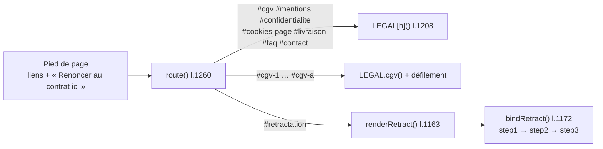

# MOD - Pages légales et rétractation

## Rôle
Les pages obligatoires et d'aide, rangées dans l'objet `LEGAL` : CGV, mentions légales,
confidentialité, cookies, livraison et retours, FAQ, contact. Plus la fonction de rétractation en ligne
(`#retractation`), atteinte par le lien « Renoncer au contrat ici » présent dans le pied de page de chaque page.

## Intention
- **Tout ce que la loi impose est présent dès la maquette**, avec des zones `todo` pour ce qui manque
  (identité, SIREN, médiateur) ([[SYN - Juridique]]).
- **Le bouton de rétractation est obligatoire depuis le 19/06/2026** pour toute vente qui ouvre ce droit :
  bouton nommé, identification, confirmation, accusé de réception horodaté
  ([[RCH - Retours et remboursements (28-10-2026)]]). Même si les articles personnalisés en sont exclus,
  la fonction existe pour les cas non couverts et pour répondre article par article.
- **Les textes juridiques ne sont jamais écrits par un agent** ([[03 - Approbation unitaire au lancement, paliers d'autonomie, actions toujours bloquées]]) :
  ce sont des modèles à faire relire par un avocat avant la mise en ligne.
- **TVA** : franchise en base, mention « TVA non applicable, art. 293 B du CGI » partout où un prix
  apparaît ([[RCH - TVA (28-10-2026)]]).

## Diagramme

## Fonctions
| Symbole | Rôle | Appelé par | Appelle |
|---|---|---|---|
| `T(s)` l.1207 | entoure un texte manquant d'une zone `todo` jaune | toutes les pages `LEGAL` | — |
| `LEGAL.cgv()` | 13 articles + formulaire type de rétractation en annexe ; sommaire par ancres `#cgv-1` à `#cgv-a` | `route` | `T`, `eur` |
| `LEGAL.mentions()` | éditeur (EI), hébergeur Shopify, propriété intellectuelle, signalement | `route` | `T` |
| `LEGAL.confidentialite()` | responsable, données et durées, destinataires, droits RGPD | `route` | `T` |
| `LEGAL["cookies-page"]()` | tableau des catégories de cookies, bouton « Modifier mes choix » | `route` | `T` ; [[MOD - Cookies et consentement]] `showCookies` via `bindPage` |
| `LEGAL.livraison()` | délais, dates limites de Noël (10/12 France, 04/12 BE-LU-DE), frais, casse, changement d'avis | `route` | `T`, `eur` |
| `LEGAL.faq()` | les 7 questions de `faqItems()` | `route` | `faqItems` |
| `LEGAL.contact()` | formulaire nom, e-mail, commande, message, photo | `route` | `bindPage` (toast « Message envoyé ») |
| `renderRetract()` l.1163 | page « Renoncer au contrat » : avertissement sur les articles personnalisés, 3 étapes | `route` | — |
| `bindRetract()` l.1172 | étape 1 identité et commande ; étape 2 récapitulatif et « Confirmer ma rétractation » ; étape 3 accusé horodaté, référence `RT-` | `route` | `esc` |

## Entrées et sorties
- Entrées : `FREE_SHIP`, `SHIP_FR`, `SHIP_EU` pour les prix cités ; `faqItems()` pour la FAQ.
- Sortie : du HTML statique. La rétractation et le contact n'envoient rien : l'accusé de réception
  est seulement affiché.

## Ce que les CGV fixent
| Article | Contenu |
|---|---|
| 2 | le client est responsable de l'orthographe ; contenus illicites ou protégés refusés |
| 6 | fabrication 2-5 jours ouvrés + transport 3-5 en France (estimé) ; livraison au plus tard à 30 jours |
| 7 | pas de rétractation pour un article personnalisé (L221-28 3°) ; sinon 14 jours, frais de retour à la charge du client |
| 8 | casse ou défaut refait sans frais ; garantie légale de conformité de 2 ans ⚠️ encadré du décret 2022-946 à reprendre mot pour mot |
| 10 | médiateur de la consommation ⚠️ à choisir |

## Dans le thème Shopify
| Bloc de la maquette | Devient |
|---|---|
| CGV, mentions, confidentialité, livraison | pages Shopify et politiques de la boutique, textes repris après relecture d'un avocat |
| FAQ, contact | pages du thème ; formulaire de contact Shopify |
| Rétractation en ligne | app Shopify dédiée ou développement ⚠️ à choisir ([[RCH - Retours et remboursements (28-10-2026)]]) |
| Lien « Renoncer au contrat ici » | dans le pied de page du thème, sur toutes les pages |

## Cas limites
- Une ancre `#cgv-N` ouverte directement charge les CGV puis défile jusqu'à l'article.
- Les mentions légales et le pied de page citent encore « Mésange & Cie » comme marque.
- Le formulaire de rétractation accepte n'importe quel numéro : aucune vérification de la commande ni du délai de 14 jours.
- Le formulaire de contact accepte une photo mais ne l'envoie nulle part.

## Notes liées
[[SYN - Juridique]] · [[FLOW - Rétractation en ligne]] · [[MOD - Cookies et consentement]] · [[MOD - Habillage]]
