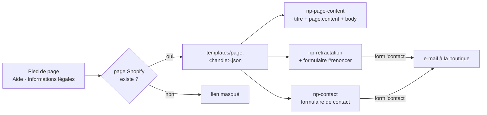

# MOD - Pages légales et rétractation

## Rôle
Les pages d'aide et les pages légales, toutes liées depuis le pied de page : FAQ, expédition et
livraison, retours et remboursements (avec « Renoncer au contrat ici »), contact, CGV, mentions
légales, confidentialité, cookies. Le texte vit dans le template JSON de chaque page (réglage `body`),
le titre vient du réglage `heading` ou du titre de la page Shopify.

## Intention
- **Des textes simples et complets**, réécrits le 02/11, qui reprennent les décisions : texte facultatif à 1 €, frais de retour à la charge du client, retours chez nous ([[11 - Texte facultatif à 1 €, frais de retour à la charge du client, retours chez Sylvain]]).
- **Rétractation d'abord par e-mail**, et le formulaire légal « Renoncer au contrat ici » en bas de la page Retours (obligatoire depuis le 19/06/2026, ordonnance n° 2026-2) ([[FLOW - Rétractation en ligne]]).
- **Aucun nom ni prénom du vendeur** sur le site ; seules les mentions légales demanderont l'identité ⚠️.
- Zones jaunes `.todo` pour ce qui manque : SIREN, adresse de l'entreprise (jamais le domicile), téléphone, médiateur, date de mise en ligne.

## Diagramme

## Les pages
| Page (handle) | Template | Section | Contenu (titres) |
|---|---|---|---|
| Questions fréquentes (`faq`) | `page.faq.json` | `np-page-content` | 13 questions : personnaliser, texte obligatoire ?, image, formes, lave-vaisselle, accents, offres, date Noël, livraison, retour, colis cassé, paiement, envoi direct |
| Expédition et livraison (`livraison-retours`) | `page.livraison-retours.json` | `np-page-content` | délais, commander pour Noël, frais, plusieurs colis, offrir directement, suivi, adresse, colis abîmé / en retard / perdu, contact |
| Retours et remboursements (`retractation`) | `page.retractation.json` | `np-retractation` | en bref, article cassé ou mal imprimé, 14 jours pour les articles sans texte, articles personnalisés, garanties légales, annuler ou modifier ; puis « Renoncer au contrat ici » |
| Nous contacter (`contact`) | `page.contact.json` | `np-contact` | intro, formulaire (nom, e-mail, n° de commande, message), coordonnées |
| Conditions générales de vente (`cgv`) | `page.cgv.json` | `np-page-content` | 13 articles (vendeur, produits, prix et offres, commande, paiement, fabrication et livraison, rétractation, garanties, service client, médiation, données, contenus du client, droit applicable) + formulaire type de rétractation |
| Mentions légales (`mentions-legales`) | `page.mentions-legales.json` | `np-page-content` | éditeur, hébergement, médiation, propriété intellectuelle, signaler un contenu |
| Politique de confidentialité (`confidentialite`) | `page.confidentialite.json` | `np-page-content` | responsable, données, bases légales, destinataires, cookies (`#cookies`), sécurité, droits, mineurs, modifications |
| Cookies (`cookies`) | `page.cookies.json` | `np-page-content` | résumé + bouton « Gérer mes cookies » |
| Page par défaut | `page.json` | `np-page-content` | toute autre page Shopify |

Prévu dans le pied de page mais pas encore créé : Suivi de commande (`suivi-de-commande`), Conditions d'utilisation (`conditions-utilisation`) ([[TODO - Page Suivi de commande]], [[TODO - Page Conditions d'utilisation]]).

## Fonctions
| Symbole | Rôle | Appelé par | Appelle |
|---|---|---|---|
| `np-page-content.liquid` l.1-8 | fil d'Ariane, H1, `page.content`, `body` | `page.*.json` | — |
| `np-retractation.liquid` l.13-35 | section `#renoncer` : nom, e-mail, n° de commande, articles ; message de confirmation daté | `page.retractation.json` | `form 'contact'` |
| `np-contact.liquid` l.6-19 | formulaire de contact, message « Merci… sous 48 heures ouvrées » | `page.contact.json` | `form 'contact'` |
| `np-url.liquid` | URL d'une page d'aide, ou ancre de secours sur l'accueil | en-tête (« Questions ») | — |
| `np-breadcrumbs-ld.liquid` | fil d'Ariane en données structurées (SEO) | pages, fiche, collection | — |
| `np-footer.liquid` l.20-39 | liens Aide et Informations légales, affichés seulement si la page existe | toutes les pages | `pages[handle]` |

## Entrées et sorties
- Entrées : contenu HTML des templates (modifiable dans l'éditeur de thème), pages Shopify existantes.
- Sorties : e-mails du formulaire de contact Shopify (objet « Rétractation : renonciation au contrat » pour la rétractation).

## Cas limites
- Page Shopify absente : le lien du pied de page disparaît, sans erreur.
- Accusé de réception automatique de la rétractation : pas encore branché (zone jaune) ⚠️ obligatoire avant la mise en ligne ([[TODO - Choisir les apps de rétractation et de consentement]]).
- Les textes citent des montants et dates (4,90 €, 60 €, 8 décembre…) écrits en dur : à reprendre si les réglages changent.
- Identité du vendeur, SIREN, médiateur : en attente de la micro-entreprise ([[TODO - Déclarer la micro-entreprise sur le guichet unique]]).

## Notes liées
[[FLOW - Rétractation en ligne]] · [[MOD - Cookies et consentement]] · [[SYN - Juridique]] · [[RCH - Retours, rétractation et abus (30-10-2026)]]
