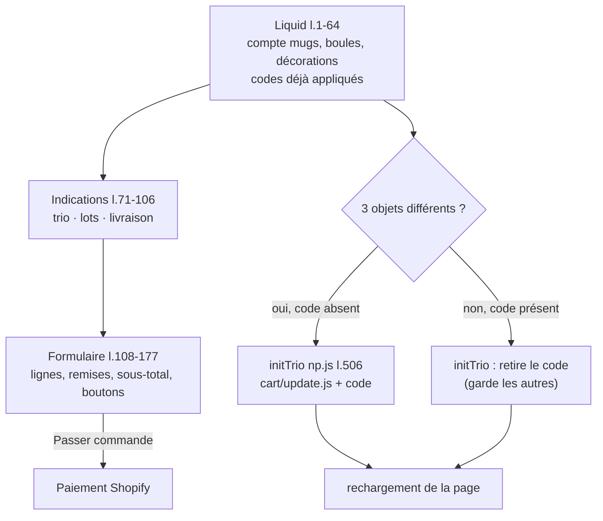

# MOD - Panier et commande

## Rôle
La page panier (`/cart`) : les articles avec leur personnalisation, les indications pour profiter
d'une offre, la jauge de livraison offerte, les remises et le bouton « Passer commande » vers le
paiement Shopify. Le paiement lui-même est celui de Shopify (rien de maison).

## Intention
- **Relire avant de payer** : chaque ligne montre l'objet, la variante, le design, le texte, l'image importée et sa règle de rétractation.
- **Pousser au panier moyen sans forcer** : « Encore 2 mugs pour le prix lot », « Ajoutez une boule : −5,20 € avec le trio », « Plus que X € pour la livraison offerte ».
- **La remise trio se pose toute seule** quand le mug, la boule et la décoration sont dans le panier, et s'enlève sinon.
- Lisible sur téléphone : marges de 16 px, ligne d'article sur 2 colonnes sous 560 px (corrigé le 02/11).

## Diagramme

## La page, de haut en bas
| Bloc | Lignes `np-main-cart.liquid` | Détail |
|---|---|---|
| Comptage et codes | l.1-64 | `q_mug`, `q_verre`, `q_bois` ; `trio_types` (0-3) ; `trio_applied`, `other_codes` |
| Fil d’Ariane, titre | l.65-67 | |
| Panier vide | l.68-69 | « Votre panier est vide » + « Voir les designs » |
| Trio | l.72-91 | 3 objets : « Trio de Noël : −5,20 € … appliqués » ; 2 objets : « Ajoutez <l'objet manquant> » + lien |
| Lots | l.92-96 | « Encore N <objet> pour le prix lot » + lien `?lot=3`, de 1 à 2 articles du même objet |
| Livraison offerte | l.97-106 | reste à payer + jauge, ou « Livraison offerte » |
| Lignes d'article | l.128-166 | vignette du design (et de la forme), options, propriétés visibles, lien vers l'image importée, rétractation, quantité, prix barré si remise, remise du lot, « Supprimer » |
| Remises, sous-total, mention TVA | l.168-170 | |
| Mettre à jour · Passer commande | l.171 | |
| Logos de paiement | l.172-175 | |

## Fonctions
| Symbole | Rôle | Appelé par | Appelle |
|---|---|---|---|
| bloc Liquid l.1-64 | quantités par objet, état du trio | rendu de la page | `np-type` |
| `` l.73 | transmet code, état voulu, état actuel, autres codes | — | `initTrio` |
| `initTrio(el)` `np.js` l.506 | ajoute ou retire le code trio par `cart/update.js` (`discount` = liste de codes), recharge si Shopify l'a accepté ; une tentative par état (garde en `sessionStorage`) | `init()` | — |
| `updateCartCount()` `np.js` l.120 | compteur du panier dans l'en-tête après un ajout en arrière-plan | lot sur la fiche | `/cart.js` |
| icônes `np-icon` (gift, truck) | indications au trait rouge | l.75, l.89, l.93-95, l.101, l.104 | — |

## Entrées et sorties
- Entrées : `cart` Shopify, réglages `np_lots_enabled`, `np_lot_off_*`, `np_trio_*`, `np_free_ship`.
- Sorties : mise à jour des quantités (`updates[]`), suppression (`url_to_remove`), code trio, envoi vers le paiement (`checkout`).

## Cas limites
- Code `TRIO-NOEL` absent de Shopify : Shopify le refuse, rien ne se recharge, l'indication dit « appliqués au paiement » sans remise ⚠️ à créer.
- La cliente tape `TRIO-NOEL` à la main sans les 3 objets : Shopify l'accepte ⚠️ prévoir un minimum d'achat sur le code.
- Le panier retire le code trio dès qu'un des 3 objets part ; les autres codes de la cliente restent.
- Lots : la remise vient d'une remise automatique Shopify ⚠️ à créer (3 remises « Montant fixe sur des produits », quantité minimale 3).
- Article sans tag `np-*` : vignette Shopify, pas de règle de rétractation affichée.

## Notes liées
[[CMP - Panier]] · [[FLOW - Lots et trio]] · [[FLOW - De la personnalisation à la commande]] · [[MOD - Pages légales et rétractation]]
