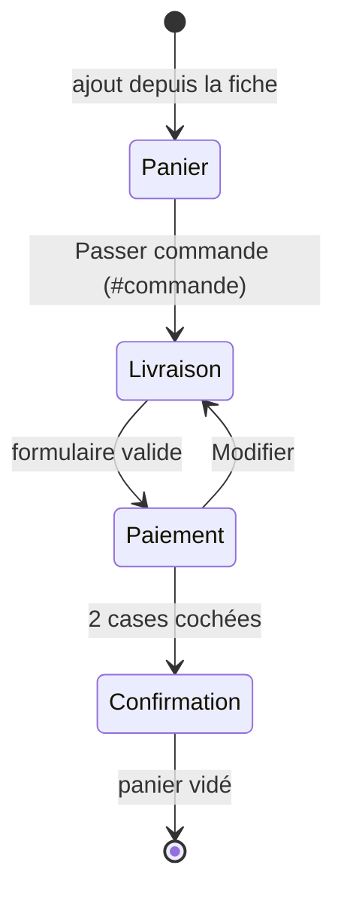

# MOD - Panier et commande

## Rôle
Le tiroir panier (ouvert depuis l'en-tête ou après un ajout) et la commande en trois étapes
(`#commande`) : livraison, paiement simulé, confirmation avec les délais. Aucun paiement réel.

## Intention
- **Monter le panier vers 45 €.** La barre « Plus que X € pour la livraison offerte » pousse vers le
  seuil de 49 €, et le Duo à 44,90 € en approche ([[02 - Mug famille illustrée à 24,90 €, panier cible 45 €]]).
- **Conformité au moment de payer** : bouton « Commander avec obligation de paiement », acceptation des
  CGV, rappel de l'exclusion de rétractation, mention TVA non applicable art. 293 B ([[SYN - Juridique]],
  [[05 - Printify en principal avec partenaire UE figé, Gelato en second, franchise de TVA au départ]]).
- **Deuxième contrôle de l'orthographe** avant de payer : une case de plus, sur tous les prénoms de la commande.
- **Montrer les délais après le paiement**, et non avant : ils ont été retirés de la page d'accueil à ta demande.
- **Aucune vraie carte** : la carte de test 4242 est en lecture seule.

## Diagramme

## Fonctions
| Symbole | Rôle | Appelé par | Appelle |
|---|---|---|---|
| `renderCart()` l.833 | contenu du tiroir : lignes, quantités, barre de livraison offerte, sous-total | [[CMP - Panier]] `saveCart`, démarrage | `bySlug`, `artFor`, `persText`, `subtotal`, `count` |
| `persText(p, v)` l.824 | résumé lisible de la personnalisation (« Mamie · Léa, Hugo · Noël 2026 ») | `renderCart`, `renderSummary` | — |
| `openCart()` / `closeCart()` l.855-856 | ouvre ou ferme le tiroir et le voile | bouton panier, ajout, Échap, `route` | — |
| écouteur `[data-inc]`, `[data-dec]`, `[data-del]` l.857 | + / − / Supprimer sur une ligne | clic | `saveCart`, `route` si `#commande` |
| `renderCheckout()` l.1077 | squelette : étapes, zone, récapitulatif ; message si panier vide | `route` | — |
| `bindCheckout()` l.1160 | démarre la commande en France | `route` | `renderSummary`, `coShipping` |
| `shipping(country, st)` l.1083 | France : 4,90 €, offerte dès 49 € ; BE, LU, DE : 6,90 € | `renderSummary`, `coPayment` | — |
| `renderSummary()` l.1084 | récapitulatif : lignes, livraison, total | `bindCheckout`, `coShipping` | `persText`, `shipping`, `artFor` |
| `coShipping()` l.1099 | étape 1 : e-mail, nom, adresse, pays, case « cadeau » | `bindCheckout`, « Modifier » | `renderSummary`, `coPayment` |
| `coPayment()` l.1118 | étape 2 : carte de test, cases orthographe et CGV | `coShipping` | `shipping`, `coDone` |
| `coDone()` l.1139 | étape 3 : numéro de commande, délais, « avant Noël », vide le panier | `coPayment` | `deliveryWindow`, `fmtDay`, `saveCart` |
| `deliveryWindow(country)` l.1094 | fabrication + 2 à + 5 jours ouvrés, transport 3-5 (FR) ou 5-7 (UE) | `coDone` | `addWorkdays` |

## Entrées et sorties
- Entrée : `cart` ([[CMP - Panier]]), `FREE_SHIP` = 49, `SHIP_FR` = 4,90, `SHIP_EU` = 6,90 (estimé).
- État de la commande : `coData = {country, mail, first, last, addr, zip, city}`, en mémoire seulement.
- Sortie : un écran de confirmation avec un numéro `MC-` + 6 chiffres aléatoires. Rien n'est envoyé ni enregistré.

## Dans le thème Shopify
| Bloc de la maquette | Devient |
|---|---|
| Tiroir panier et barre de livraison offerte | tiroir du thème + seuil de livraison gratuite Shopify |
| Étapes Livraison et Paiement | checkout Shopify et Shopify Payments |
| Case « J'ai vérifié l'orthographe » au paiement | ⚠️ à vérifier : le checkout Shopify ne s'édite pas en plan Basic ; la case reste sur la fiche ou le panier |
| Frais de port | profils d'expédition Shopify (100 au plus, [[SYN - Fournisseurs]]) |
| Écran de délais | page de remerciement et e-mail de confirmation, avec les délais mesurés |

## Cas limites
- Panier vide sur `#commande` : message et lien vers `#boutique`.
- Le « + » du tiroir n'a pas de plafond, alors que la fiche limite à 20.
- Le même produit avec la même personnalisation ajouté deux fois donne deux lignes, pas une ligne en quantité 2.
- La case « C'est un cadeau envoyé directement » n'est ni gardée ni utilisée.
- Dans `coDone`, la date limite « avant Noël » est la même pour la France et l'UE (deux branches identiques).
- Le préfixe `MC-` des numéros de commande (et l'exemple `MC-123456` du formulaire de rétractation) vient de l'ancien nom Mésange & Cie.

## Notes liées
[[CMP - Panier]] · [[FLOW - De la personnalisation à la commande]] · [[MOD - Pages légales et rétractation]] · [[MOD - Catalogue et fiche produit]]
