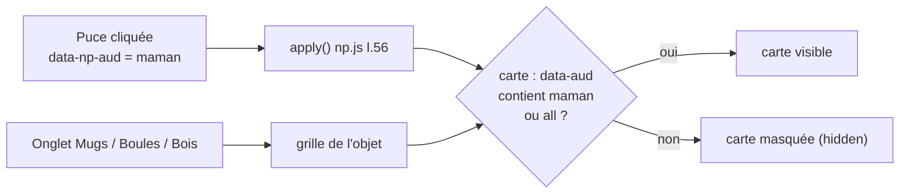

# CMP - Catégories des designs

## Rôle
Les filtres de la galerie « Nos designs » de l'accueil : **Tous · Maman · Papa · Mamie · Papy · Couple ·
Famille · Noël · Amies et fratrie**. Un clic n'affiche que les designs pensés pour cette personne,
sur l'objet choisi dans les onglets au-dessus (Mugs, Boules de Noël en verre, Décorations en bois).

## Intention
- La cliente arrive avec une personne en tête (« un cadeau pour ma mère ») : le filtre lui montre
  directement le design qui lui correspond ([[01 - Audience visée et nouvelle offre, parents et grands-parents d'abord, nos designs ou la page blanche]]).
- Parents et grands-parents d'abord (Maman, Papa, Mamie, Papy), couple et famille ensuite.
- Un design peut appartenir à **plusieurs catégories** (ex. « Mon premier Noël » est dans Noël et Famille).
- La carte **« Créer le vôtre de A à Z »** (votre image) apparaît dans **toutes** les catégories.
- Les catégories sont **les mêmes sur les 3 objets** : les 10 designs existent sur le mug, la boule et la décoration.

## Diagramme

## Les catégories
| Puce | Valeur `data-np-aud` | Designs affichés | Cartes (designs + « Créer le vôtre ») |
|---|---|---|---|
| Tous | `all` | les 10 | 11 |
| Maman | `maman` | d01 Maman d'amour | 2 |
| Papa | `papa` | d02 Super Papa | 2 |
| Mamie | `mamie` | d03 Mamie chérie | 2 |
| Papy | `papy` | d04 Le meilleur Papy | 2 |
| Couple | `couple` | d05 Toi & moi | 2 |
| Famille | `famille` | d06 Notre famille, d08 Mon premier Noël, d10 Frères & sœurs | 4 |
| Noël | `noel` | d07 Joyeux Noël, d08 Mon premier Noël | 3 |
| Amies et fratrie | `amis` | d09 Meilleures amies, d10 Frères & sœurs | 3 |

## Chaque design et ses catégories
| Id | Design | « Pour : » sur la carte | Catégories (`auds`) | Texte à remplacer |
|---|---|---|---|---|
| d01 | Maman d'amour | Maman | maman | Votre prénom |
| d02 | Super Papa | Papa | papa | Votre prénom |
| d03 | Mamie chérie | Mamie | mamie | Votre prénom |
| d04 | Le meilleur Papy | Papy | papy | Votre prénom |
| d05 | Toi & moi | Couple | couple | Vos prénoms |
| d06 | Notre famille | Famille | famille | Vos prénoms |
| d07 | Joyeux Noël | Noël | noel | Votre prénom |
| d08 | Mon premier Noël | Bébé et parents | noel, famille | Votre prénom |
| d09 | Meilleures amies | Amies | amis | Vos prénoms |
| d10 | Frères & sœurs | Frères et sœurs | amis, famille | Vos prénoms |

Source : `snippets/np-designs.liquid` l.15 (`names`), l.16 (`auds`), l.17 (`fors`), l.18 (`phs`).

## Par objet
| Onglet | Image de chaque carte | Lien de la carte | Prix affiché |
|---|---|---|---|
| Mugs | `np-mug-<id>-s.jpg` | `/products/mug-personnalise?design=<id>` | prix mini du mug + prix barré s'il existe |
| Boules de Noël en verre | `np-verre-<id>-s.jpg` | `/products/boule-de-noel-verre-personnalisee?design=<id>` | idem boule |
| Décorations en bois | `np-bois-<id>-s.jpg` (forme cœur) | `/products/decoration-bois-personnalisee?design=<id>` | idem décoration |
| (les 3) carte « Créer le vôtre » | `np-<objet>-vierge-s.jpg` | `…?mode=libre` | prix mini + « Votre image » (+2 €) |

## Fonctions et repères
| Symbole | Rôle | Appelé par | Appelle |
|---|---|---|---|
| puces `data-np-aud` `np-galerie.liquid` l.24-32 | les 9 boutons de filtre, `aria-pressed` | la cliente | `initGallery` |
| onglets `np-tab` `np-galerie.liquid` l.18-22 | choix de l'objet, `aria-selected` | la cliente | `initGallery` |
| `auds` `np-designs.liquid` l.16 | catégories de chaque design, séparées par une espace | mode `gallery` l.24 | — |
| carte `data-aud` `np-designs.liquid` l.28 | porte les catégories du design | `np-galerie.liquid` l.67 | — |
| carte libre `data-aud="all"` `np-galerie.liquid` l.69 | toujours visible | — | — |
| `initGallery(sec)` `np.js` l.52 | branche onglets et puces ; le filtre s'applique aux 3 grilles à la fois | `init()` l.546 | `apply` |
| `apply()` `np.js` l.56 | masque les cartes hors catégorie | clic sur une puce | — |

## Entrées et sorties
- Entrée : un clic sur une puce. État gardé en mémoire de la page seulement (`aud`), remis à « Tous » au rechargement.
- Sortie : attribut `hidden` sur les cartes `.np-dcard`. Aucune URL, aucun cookie.
- Changer d'onglet garde le filtre en cours (il s'applique aux 3 grilles).

## Ajouter ou modifier une catégorie
1. Ajouter la puce dans `np-galerie.liquid` (l.24-32) : `data-np-aud="<valeur>"` + libellé.
2. Ajouter `<valeur>` aux designs concernés dans `auds` (`np-designs.liquid` l.16), séparée par une espace.
3. Mettre à jour cette note et la liste de la section « Deux façons » (`np-modes.liquid` l.25).

## Cas limites
- « Bébé et parents » (d08) n'a pas de puce à lui : on le trouve dans Noël et Famille.
- Pas de puce Amis seule ni Fratrie seule : les deux sont réunies dans « Amies et fratrie ».
- Sans JavaScript : les puces ne font rien, les 11 cartes restent visibles.
- Sur téléphone, la rangée de puces défile horizontalement (`.chips` en `nowrap`, mesange.css l.468).
- Les tags produit Shopify (`maman`, `papa`…) ne servent pas aux filtres : ils servent au SEO et à la recherche.

## Notes liées
[[CMP - Illustrations]] · [[MOD - Accueil]] · [[SYN - Choix de la niche]]
