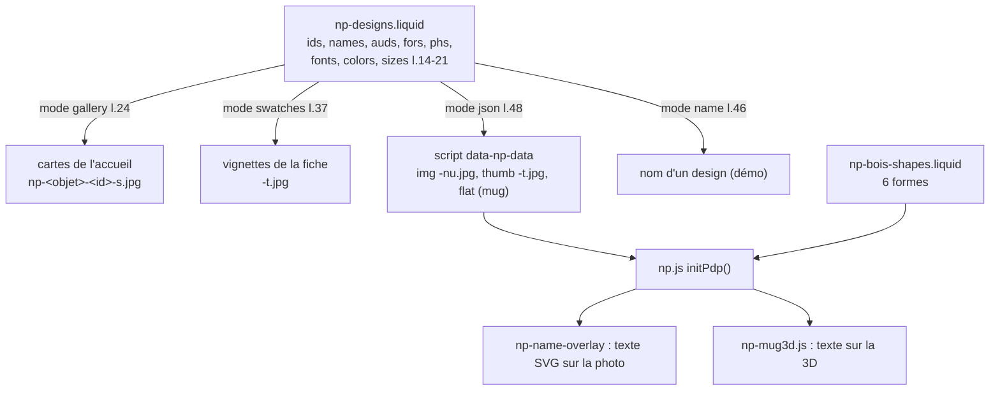

# CMP - Illustrations

## Rôle
Les **10 designs** NolaPrint (illustrations d'Antoine + emplacement du texte) et toutes leurs images,
sur les 3 objets. Un seul fichier, `snippets/np-designs.liquid`, les décrit ; l'accueil, la fiche produit,
la démo et le JavaScript lisent tous cette liste.

## Intention
- **Une seule source** : ajouter ou renommer un design se fait à un seul endroit (une valeur par liste, l.14-21).
- **Le même design sur les 3 objets** : la cliente peut offrir le même visuel en mug, boule et décoration (trio, lots).
- **La photo sans texte + le texte de la cliente** : la fiche affiche `-nu.jpg` (illustration seule) et pose
  le texte par-dessus, à l'endroit mesuré, dans la police et la couleur du design.
- Un champ vide affiche « Votre prénom » en transparence : rien n'est imprimé sans texte.

## Diagramme

## Les 10 designs
| Id | Nom | Pour | Catégories | Texte à remplacer | Police | Couleur | Taille |
|---|---|---|---|---|---|---|---|
| d01 | Maman d'amour | Maman | maman | Votre prénom | Dancing Script | #7A3F52 | 104 |
| d02 | Super Papa | Papa | papa | Votre prénom | Fredoka | #1F3A5F | 92 |
| d03 | Mamie chérie | Mamie | mamie | Votre prénom | Playfair Display italique | #6B3A2A | 92 |
| d04 | Le meilleur Papy | Papy | papy | Votre prénom | Playfair Display italique | #2F4F3F | 92 |
| d05 | Toi & moi | Couple | couple | Vos prénoms | Dancing Script | #7A1630 | 104 |
| d06 | Notre famille | Famille | famille | Vos prénoms | Caveat | #4A3B32 | 116 |
| d07 | Joyeux Noël | Noël | noel | Votre prénom | Dancing Script | #2F6B4F | 104 |
| d08 | Mon premier Noël | Bébé et parents | noel, famille | Votre prénom | Playfair Display italique | #2C3E66 | 92 |
| d09 | Meilleures amies | Amies | amis | Vos prénoms | Caveat | #2E7D78 | 116 |
| d10 | Frères & sœurs | Frères et sœurs | amis, famille | Vos prénoms | Fredoka | #24375A | 92 |

Catégories détaillées : [[CMP - Catégories des designs]]. Polices chargées par Google Fonts dans
`layout/mesange.liquid` l.7 et `layout/theme.liquid`.

## Les images
| Suffixe | Exemple | Taille | Sert à |
|---|---|---|---|
| `-s.jpg` | `np-mug-d01-s.jpg` | 480 | carte de l'accueil, avec « Votre prénom » |
| `-t.jpg` | `np-verre-d03-t.jpg` | 200 | vignette de la fiche, du panier, de l'offre |
| `-nu.jpg` | `np-bois-d05-nu.jpg` | 1000 | fond de la fiche produit, illustration sans texte |
| `-hd.jpg` | `np-mug-d01-hd.jpg` | 1000 | couverture de l'accueil, image de partage (`meta-tags.liquid` l.80-87) |
| `-flat.jpg` | `np-mug-d07-flat.jpg` | — | illustration à plat pour le mug 3D (mug seulement), reconstruite depuis les photos ⚠️ à remplacer par les PNG d'Antoine |
| `vierge` | `np-mug-vierge.jpg`, `-s`, `-t` | 1000 / 480 / 200 | objet blanc pour « Votre image » |
| formes en bois | `np-bois-<forme>-<id>-nu.jpg`, `-t.jpg`, `np-bois-<forme>-vierge.jpg` | 1000 / 200 | les 5 formes autres que le cœur (sapin, etoile, cloche, chaussette, ovale) |
| offres | `np-offre-lot-<objet>.jpg`, `np-offre-trio.jpg`, `-t` | 1200 × 900 / 240 | cartes « Nos offres » et choix « Lot de 3 » |

En tout 232 fichiers `np-*` dans `assets/` (compté le 02/11).

## Fonctions et repères
| Symbole | Rôle | Appelé par | Appelle |
|---|---|---|---|
| listes `np-designs.liquid` l.14-21 | id, nom, catégories, « Pour », texte, police, couleur, taille | les 4 modes | — |
| mode `gallery` l.24 | 10 cartes de l'accueil, lien `?design=<id>` | `np-galerie.liquid` l.67 | — |
| mode `swatches` l.37 | 10 vignettes boutons `data-np-design` | `np-main-product.liquid` (bloc « Illustration ») | — |
| mode `name` l.46 | nom d'un design d'après son id | `np-demo.liquid` l.27 | — |
| mode `json` l.48 | données pour `np.js` (et `flat` pour le mug) | `np-main-product.liquid` (script `data-np-data`), `np-demo.liquid` l.30 | — |
| `np-name-overlay.liquid` l.13-27 | SVG du texte : arc sur le mug, droit sur la boule et le bois | fiche, démo | `setOverlay()` `np.js` l.28 |
| `np-bois-shapes.liquid` | images et zones d'impression des 6 formes | fiche de la décoration | `applyShape()` `np.js` l.368 |

## Ajouter un design
1. Ajouter une valeur à chaque liste de `np-designs.liquid` l.14-21 (dans le même ordre).
2. Déposer ses images : mug `-s -t -nu -hd -flat`, boule `-s -t -nu -hd`, bois `-s -t -nu -hd`
   + `-nu -t` pour chacune des 5 autres formes.
3. Lui donner ses catégories ([[CMP - Catégories des designs]]).
4. Pousser le thème ([[FLOW - Déployer la maquette dans Shopify]]).

## Cas limites
- Image manquante : la carte ou la vignette s'affiche cassée, rien ne le signale ⚠️ à vérifier avant chaque ajout.
- Texte trop long : la taille se réduit pour tenir dans la largeur imprimable (`maxlen`) ; 15 caractères au maximum (réglage `text_max`).
- Les photos `-flat` du mug sont reconstruites : léger flou possible en 3D tant que les fichiers d'Antoine ne sont pas là.

## Notes liées
[[CMP - Catégories des designs]] · [[CMP - Produit]] · [[MOD - Catalogue et fiche produit]] · [[MOD - Mug 3D]]
