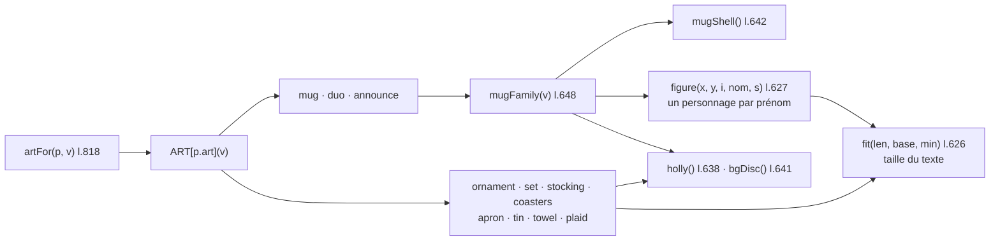

# CMP - Illustrations

## Rôle
Les dessins SVG de chaque produit, générés à la volée avec les prénoms et textes du client. Un dessin
par clé `art` d'un produit, tous dans un carré `viewBox="0 0 400 400"`. Ils servent d'aperçu sur la fiche,
de vignette dans les cartes, le panier et le récapitulatif, et d'image sur la couverture.

## Intention
- **Montrer exactement le texte saisi** : le client voit son prénom sur le produit avant de payer.
- **Illustrations originales, provisoires** : elles évitent toute image protégée et seront remplacées par
  les photos des échantillons et les maquettes Printify (commentaire l.624) ([[07 - La maquette est le cahier des charges du thème Shopify]]).
- Le dessin n'est pas le fichier d'impression : le fichier réel viendra de l'app de personnalisation.

## Diagramme

## Interfaces
| Symbole | Rôle | Appelé par | Appelle |
|---|---|---|---|
| `artFor(p, v)` l.818 | dessin du produit `p` avec `v`, ou ses valeurs `def` | `card`, `renderProduct`, `redraw`, `renderCart`, `renderSummary`, `renderHome`, démo | `ART[p.art]` |
| `ART` l.655 | 11 fonctions `v => "<svg…>"` | `artFor` | les aides ci-dessous |
| `mugFamily(v)` l.648 | mug avec titre, ligne en capitales, 1 à 4 personnages, houx | `ART.mug`, `ART.duo` | `mugShell`, `figure`, `holly`, `fit` |
| `figure(x, y, i, name, s)` l.627 | un petit personnage et son prénom ; couleurs tirées de `SKIN`, `SHIRT`, `HAIR` selon `i` | `mugFamily` | `fit`, `esc` |
| `fit(len, base, min)` l.626 | taille du texte : `base` jusqu'à 9 caractères, puis `base × 9 / len`, jamais sous `min` | tous les dessins | — |
| `mugShell(content)`, `holly()`, `bgDisc()` | corps du mug, branche de houx, ombre au sol | les dessins | — |

## Exemple avec des valeurs
Mug, titre « Mamounette » (10 caractères), prénoms Léa, Hugo, Inès :
- taille du titre : `fit(10, 34, 20)` = 34 × 9 / 10 = **30,6** ;
- 3 prénoms, donc échelle `s` = 0,9 et pas horizontal 168 / 3 = 56 ; personnages centrés en x = 128, 184, 240 ;
- couleurs : Léa `SKIN[0]` et `SHIRT[0]`, Hugo `SKIN[1]` et `SHIRT[1]`, Inès `SKIN[2]` et `SHIRT[2]`.

## Dans le thème Shopify
| Bloc de la maquette | Devient |
|---|---|
| Aperçu sur la fiche | aperçu de l'app de personnalisation, sur le vrai visuel ⚠️ à choisir |
| Vignettes des cartes et du panier | photos produit et vignettes de l'app |
| Image de couverture | photo de l'échantillon du mug famille illustrée |

## Cas limites
- 5 prénoms ou plus : seuls les 4 premiers sont dessinés sur le mug (6 sur le plaid).
- Prénom vide : ignoré par `filter(Boolean)` ; aucun prénom sur le mug, aucun personnage.
- Tout texte passe par `esc()` : un `<` ou un `&` saisi s'affiche sans casser le SVG.
- Le texte peut déborder du mug si un prénom de 12 lettres larges tombe à la taille minimale ⚠️ non testé.

## Notes liées
[[CMP - Produit]] · [[MOD - Catalogue et fiche produit]] · [[MOD - Accueil]]
