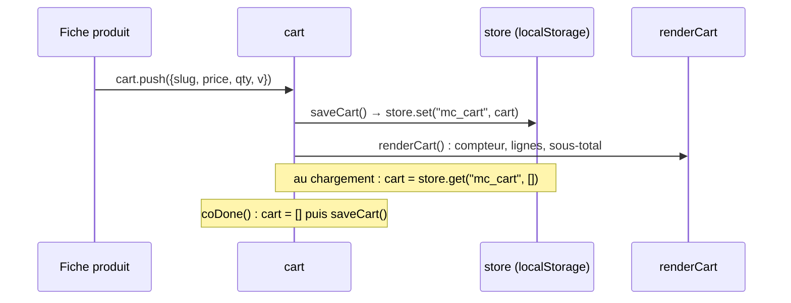

# CMP - Panier

## Rôle
Le panier de la maquette : un tableau `cart` de lignes `{slug, price, qty, v}`, gardé dans le
navigateur sous la clé `mc_cart`. Il survit au rechargement de la page et se vide à la confirmation
de commande.

## Intention
- **Chaque ligne garde sa personnalisation** (`v`) : deux mugs pour deux grands-mères différentes sont
  deux lignes distinctes, chacune avec ses prénoms.
- **Le prix est copié dans la ligne** au moment de l'ajout, comme le ferait un panier réel.
- **Aucune donnée ne quitte le navigateur** : c'est une maquette ; le vrai panier sera celui de Shopify
  ([[07 - La maquette est le cahier des charges du thème Shopify]]).

## Diagramme

## Interfaces
| Symbole | Rôle | Appelé par | Appelle |
|---|---|---|---|
| `store.get(k, d)` / `store.set(k, v)` l.608-611 | lecture et écriture JSON dans `localStorage`, dans un try/catch | `cart`, cookies | — |
| `cart` l.820 | les lignes du panier | tout le module panier et commande | — |
| `saveCart()` l.821 | enregistre et redessine le tiroir | ajout, + / − / Supprimer, `coDone` | `store.set`, `renderCart` |
| `subtotal()` l.822 | somme de `price × qty` | `renderCart`, `renderSummary`, `coPayment` | — |
| `count()` l.823 | nombre d'articles, affiché sur le bouton panier | `renderCart` | — |

## Exemple avec des valeurs
- Un mug seul : sous-total 24,90 € ; « Plus que **24,10 €** pour la livraison offerte » ; barre remplie à 24,90 / 49 = **51 %** ;
  livraison France 4,90 €, total **29,80 €**.
- Un mug + un Duo : 24,90 + 44,90 = **69,80 €** ; livraison offerte en France ; vers la Belgique, + 6,90 € = **76,70 €**.

## Dans le thème Shopify
| Bloc de la maquette | Devient |
|---|---|
| `cart` et `mc_cart` | panier Shopify (Cart API / Ajax du thème) |
| `v` (personnalisation) | propriétés de ligne, posées par l'app de personnalisation et transmises à Printify ⚠️ à vérifier |
| `price` copié dans la ligne | prix du produit Shopify au moment du checkout |

## Cas limites
- Sans `localStorage`, le panier vit seulement le temps de la page.
- Si un produit est retiré de `PRODUCTS`, une ligne déjà gardée avec son slug ferait échouer `bySlug` (aucune protection) ⚠️ à vérifier.
- Un prix modifié dans `PRODUCTS` ne met pas à jour les lignes déjà dans le panier.
- La clé `mc_cart` vient de l'ancien nom Mésange & Cie.

## Notes liées
[[MOD - Panier et commande]] · [[MOD - Catalogue et fiche produit]] · [[CMP - Produit]]
