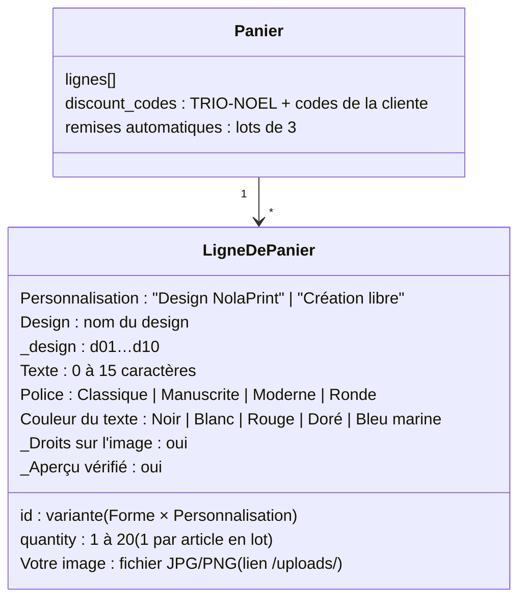

# CMP - Panier

## Rôle
La forme d'une ligne de panier NolaPrint : la variante Shopify (objet, forme, niveau de personnalisation)
et les **propriétés de ligne** qui décrivent ce qu'il faut imprimer. C'est ce que le serveur lit ensuite
dans la commande pour fabriquer le fichier envoyé à Printify ([[FLOW - De la commande personnalisée à Printify]]).

## Intention
- **Tout ce qui sert à l'impression voyage avec la ligne** : design, texte, police, couleur, image.
- **Les propriétés qui commencent par `_`** sont techniques ou juridiques : invisibles pour la cliente au panier et au paiement, visibles dans la commande.
- Deux lignes identiques sauf le texte restent deux lignes distinctes (Shopify sépare les lignes par propriétés).

## Diagramme

## Propriétés
| Propriété | Mode | Valeurs | Obligatoire | Source (`np-main-product.liquid`) |
|---|---|---|---|---|
| `id` | les deux | id de variante choisi par `pickVariant()` | oui | l.148 |
| `quantity` | les deux | 1-20 ; forcée à 1 en lot | oui | l.270 |
| `Personnalisation` | les deux | `Design NolaPrint` ou `Création libre` | oui | l.150 |
| `Design` | design | nom, ex. « Mamie chérie » | oui | l.189 |
| `_design` | design | `d01` à `d10` | oui | l.190 |
| `Texte` | les deux | texte de la cliente, 15 caractères au plus | non (+1 € en mode design) | l.196, l.215 |
| `Votre image` | image | fichier, 15 Mo, JPG ou PNG | oui | l.207 |
| `Police` | image | Classique (Playfair), Manuscrite (Dancing), Moderne (Figtree), Ronde (Fredoka) | oui | l.219 |
| `Couleur du texte` | image | Noir #222222, Blanc #FFFFFF, Rouge #C1121F, Doré #C8901E, Bleu marine #1F3A5F | oui | l.230 |
| `_Droits sur l'image` | image | `oui` (case « Je certifie avoir les droits… ») | oui | l.235 |
| `_Aperçu vérifié` | les deux | `oui` (case « J'ai vérifié l'aperçu et l'orthographe ») | oui | l.268 |

La forme de la décoration en bois est portée par la variante (option « Forme »), pas par une propriété.

## Affichage au panier
- Options de variante (Forme, Personnalisation), puis chaque propriété non vide sans `_` (sauf `Personnalisation`) ; l'image importée devient « image importée ✓ » cliquable (`np-main-cart.liquid` l.144-155).
- Vignette : `np-<objet>-[<forme>-]<_design>-t.jpg`, ou l'objet vierge en mode image.
- Règle de rétractation : « Article personnalisé : pas de rétractation » dès qu'il y a un texte ou une image.

## Cas limites
- Panier modifié dans un autre onglet : les quantités affichées peuvent être en retard jusqu'au rechargement.
- Le fichier importé est hébergé par Shopify ; son lien est dans la commande ⚠️ à vérifier : durée de conservation chez Shopify.
- Les noms de propriétés sont lus par le serveur : les renommer casse la fabrication ([[FLOW - De la commande personnalisée à Printify]]).

## Notes liées
[[MOD - Panier et commande]] · [[MOD - Catalogue et fiche produit]] · [[FLOW - De la commande personnalisée à Printify]]
