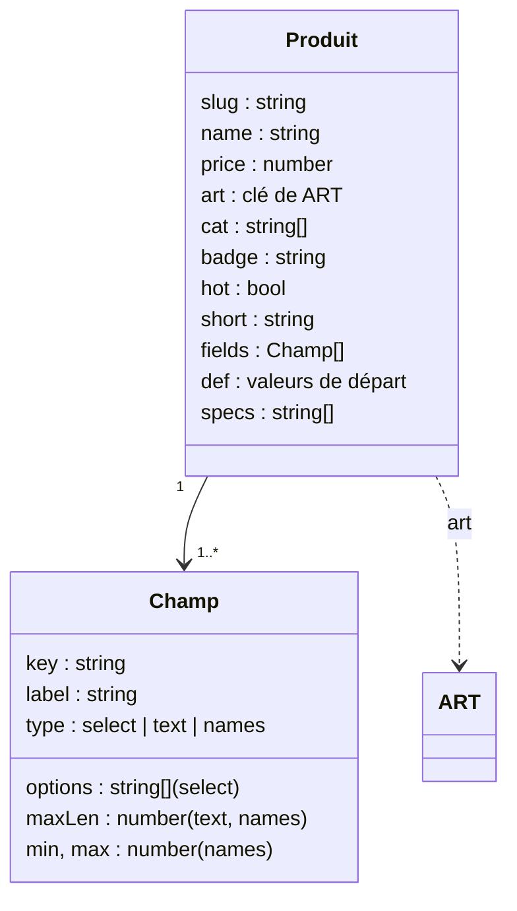

# CMP - Produit

## Rôle
Le catalogue de la maquette : le tableau `PRODUCTS` (l.759), 11 objets qui disent tout d'un produit
(nom, prix, catégories, badge, texte, champs de personnalisation, valeurs de départ, caractéristiques).
Toutes les pages le lisent ; rien ne l'écrit.

## Intention
- **Un seul endroit pour les prix et les textes**, pour que la maquette serve de cahier des charges aux
  fiches Shopify ([[07 - La maquette est le cahier des charges du thème Shopify]]).
- **Chaque produit est personnalisé par un texte du client** : c'est la condition de l'exclusion de
  rétractation ([[SYN - Juridique]]).
- **Prix de maquette** : le mug et le Duo suivent la décision 02 ; les autres prix sont estimés, à recalculer
  sur les coûts réels Printify ([[02 - Lancement avec le mug, la boule en cristal et la décoration en bois, trois imprimeurs UE]]).

## Diagramme

## Les 11 produits
| slug | Nom | Prix | `cat` | Champs |
|---|---|---|---|---|
| `mug-famille-illustree` | Mug famille illustrée | 24,90 € | mamie, cuisine | appellation, 1-4 prénoms, ligne |
| `duo-mamie-papi` | Duo Mamie & Papi | 44,90 € | mamie, lots | 2 appellations, 1-4 prénoms, ligne |
| `boule-ceramique-famille` | Boule de Noël de la famille | 16,90 € | sapin | nom de famille, 0-4 prénoms, année |
| `boules-famille` | Lot de 4 boules | 54,90 € | sapin, lots | 4 prénoms, année |
| `chaussette-prenom` | Chaussette au prénom | 24,90 € | sapin | prénom |
| `sous-verres-famille` | Sous-verres, lot de 4 | 19,90 € | cuisine, mamie | 4 prénoms |
| `tablier-cuisine` | Tablier « La cuisine de… » | 29,90 € | cuisine, mamie | appellation, 0-4 prénoms |
| `boite-gouter` | Boîte à goûters | 27,90 € | cuisine, mamie | appellation |
| `torchon-recette` | Torchon « La recette de… » | 17,90 € | cuisine | appellation, recette |
| `plaid-famille` | Plaid de la famille | 49,90 € | mamie, lots | titre, 0-6 prénoms, année |
| `mug-annonce` | Mug « Tu vas être… » | 24,90 € | mamie | appellation, ligne |

Seuls le mug et le Duo portent `hot: true` (badge vert). Appellations : `TITLES_GM` (Mamie, Mamy, Mémé,
Mamounette, Nona, Grand-mère) et `TITLES_GP` (Papi, Papy, Pépé, Papounet, Nono, Grand-père). Prénoms
d'exemple : `DEMO` (Léa, Hugo, Inès, Noé, Chloé, Élio).

## Interfaces
| Symbole | Rôle | Appelé par | Appelle |
|---|---|---|---|
| `PRODUCTS` l.759 | le catalogue | `renderShop`, `homeGrid`, `renderProduct`, `bindPage` (filtres) | — |
| `bySlug(s)` l.817 | trouve un produit par son slug | `renderProduct`, `renderCart`, `renderSummary`, `bindProduct` | — |
| `artFor(p, v)` l.818 | dessine le produit avec les valeurs `v`, ou `p.def` | partout où un produit s'affiche | [[CMP - Illustrations]] `ART[p.art]` |

## Dans le thème Shopify
| Champ de la maquette | Devient |
|---|---|
| `slug`, `name`, `price`, `short`, `specs` | handle, titre, prix, description, caractéristiques du produit Shopify |
| `cat` | tags ou collections |
| `badge`, `hot` | métachamp ou tag affiché par le thème |
| `fields`, `def` | options de l'app de personnalisation, transmises à Printify ⚠️ à choisir |
| `art` | remplacé par les photos des échantillons et les maquettes Printify |
| mentions GPSR | métachamps produit (non présents dans `PRODUCTS`, saisis dans la fiche) |

## Cas limites
- Les prix autres que le mug et le Duo ne viennent d'aucune décision ni d'aucun coût mesuré ⚠️ à vérifier.
- L'assiette est absente, conformément à la décision 02. La boîte à goûters a un contact alimentaire non
  prouvé (zone `todo` dans `specs`).
- Le produit n'a pas de variante (couleur, taille) : un seul prix par produit.

## Notes liées
[[MOD - Catalogue et fiche produit]] · [[CMP - Illustrations]] · [[CMP - Panier]] · [[SYN - Choix de la niche]]
