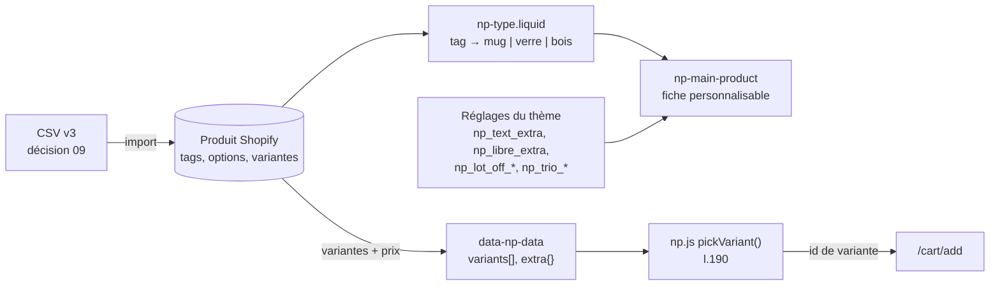

# CMP - Produit

## Rôle
Les **3 produits Shopify** de la boutique, leurs variantes et leurs prix, et la façon dont le thème les
reconnaît. Ce sont de vrais produits Shopify, créés par import CSV ([[FLOW - Importer les produits par CSV]]).

## Intention
- **Le prix suit ce que la cliente choisit** : une variante par niveau de personnalisation
  (illustration seule, + texte, votre image), pour que Shopify encaisse le bon montant sans app.
- **Le tag décide de la fiche** : `np-mug`, `np-verre` ou `np-bois` donne la fiche personnalisable ;
  sans tag, fiche simple.
- **Un seul fournisseur, Printify, partenaires UE figés** ([[05 - Printify seul fournisseur avec partenaire UE figé, franchise de TVA au départ]]).

## Diagramme

## Les 3 objets
| | Mug | Boule de Noël en verre | Décoration de sapin en bois |
|---|---|---|---|
| Handle | `mug-personnalise` | `boule-de-noel-verre-personnalisee` | `decoration-bois-personnalisee` |
| Titre | Mug personnalisé avec votre prénom ou votre image | Boule de Noël en verre personnalisée | Décoration de sapin en bois personnalisée |
| Type | Mug | Boule de Noël | Décoration en bois |
| Tag thème | `np-mug` | `np-verre` | `np-bois` |
| Options | Personnalisation | Personnalisation | Forme × Personnalisation |
| Formes | — | — | Cœur, Sapin, Étoile, Cloche, Chaussette de Noël, Ovale |
| Imprimeur (GPSR) | Textildruck Europa, Allemagne (blueprint 1016) | Chill, Pays-Bas | WOYC, Italie |
| Caractéristiques | céramique blanche 33 cl, lave-vaisselle et micro-ondes | verre cristal | bois massif, dos aimanté |

Source imprimeurs : [[RCH - Relevé connecté du catalogue Printify UE (29-10-2026)]] et [[MOD - Thème Shopify]].
Fabricant affiché sur la fiche : NolaPrint (sans nom de fournisseur).

## Prix (TTC, TVA non applicable art. 293 B du CGI)
| Variante « Personnalisation » | Mug | Boule | Décoration (toutes formes) |
|---|---|---|---|
| Illustration seule | 18,45 € | 19,95 € | 17,95 € |
| Illustration + texte | 19,45 € | 20,95 € | 18,95 € |
| Votre image (texte inclus) | 20,45 € | 21,95 € | 19,95 € |

Source : CSV v3, [[09 - Établissement des nouveaux prix, alignés sur Cadeau Plus sans faux prix barrés]].
Si les variantes « Personnalisation » n'existent pas encore, le thème ajoute lui-même les suppléments des
réglages : `np_text_extra` = 100 (+1 €), `np_libre_extra` = 200 (+2 €) ; dans ce cas seul l'affichage
change, le panier facture la variante de base ⚠️.

## Offres
| Offre | Règle | Montant | Où c'est appliqué |
|---|---|---|---|
| Lot de 3 du même objet | dès 3 articles du même produit | −1,80 € par mug (`np_lot_off_mug` = 180), −1,97 € par boule (197), −1,80 € par décoration (180) → 49,95 / 53,94 / 48,45 € | remise automatique Shopify « Montant fixe sur des produits » |
| Trio de Noël | un mug + une boule + une décoration | −5,20 € (`np_trio_off` = 520), 56,35 € → 51,15 € | code `TRIO-NOEL` (`np_trio_code`) posé par le panier |

Détail : [[FLOW - Lots et trio]].

## Livraison et délais
| | Mug | Boule | Décoration |
|---|---|---|---|
| Expédition (jours ouvrés) | 2-3 | 2-3 | 2-3 |
| Livraison (jours ouvrés) | 7-12 | 12-32 | 7-12 |
| « Pour Noël, commandez avant le » | 08/12/2026 | 10/11/2026 | 08/12/2026 |

Source : réglages de la section `np-main-product` (valeurs par défaut, `templates/product.json` ne les change pas) ⚠️ délais à mesurer sur les échantillons.
Livraison France : 4,90 € (`np_ship_price` = 490), offerte dès 60 € (`np_free_ship` = 6000).

## Fonctions et repères
| Symbole | Rôle | Appelé par | Appelle |
|---|---|---|---|
| `np-type.liquid` | renvoie `mug`, `verre`, `bois` ou rien, d'après les tags | fiche, cartes, panier | — |
| boucle des options `np-main-product.liquid` l.51-58 | repère les options « Forme » et « Personnalisation » | fiche | — |
| calcul des prix `np-main-product.liquid` l.61-82 | prix illustration, texte, image ; suppléments de secours | fiche | réglages `np_text_extra`, `np_libre_extra` |
| `pickVariant()` `np.js` l.190 | choisit la variante selon forme et personnalisation | `refresh()` | — |
| `priceOf(v)` `np.js` l.186 | prix affiché, supplément ajouté s'il n'y a pas d'option « Personnalisation » | `refresh()` | — |

## Cas limites
- CSV v3 pas encore importé : variantes absentes, prix affichés corrects mais panier facturé au prix de base ⚠️ à vérifier.
- La colonne « Variant Compare At Price » est vide dans le CSV v3 : un import en écrasement peut effacer les prix barrés.
- Handle renommé : les liens de l'en-tête, de l'accueil et du trio retombent sur les URL par défaut ; il faut choisir le produit dans les réglages des sections.
- Variante épuisée : bouton « Épuisé ».

## Notes liées
[[MOD - Catalogue et fiche produit]] · [[FLOW - Importer les produits par CSV]] · [[FLOW - Lots et trio]] · [[SYN - Fournisseurs]]
