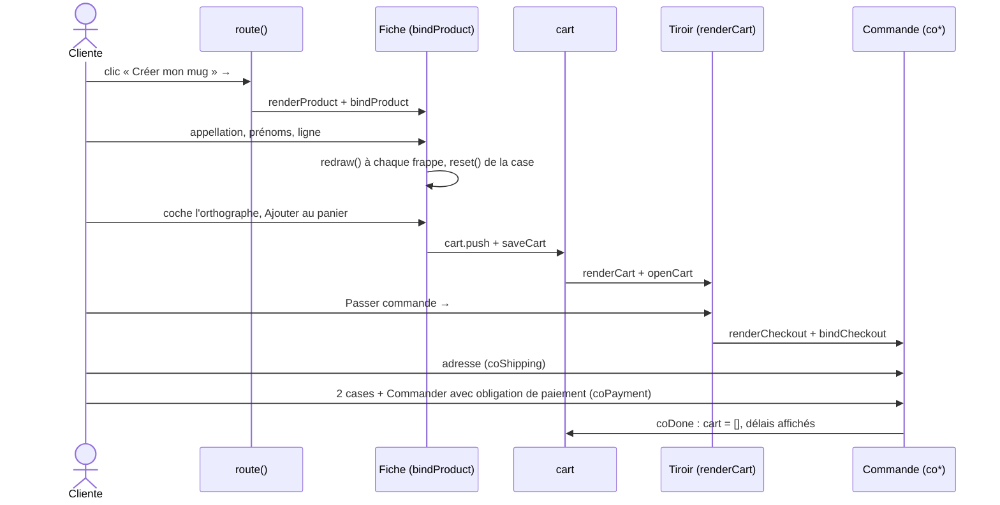

# FLOW - De la personnalisation à la commande

## Rôle
Le parcours d'achat complet, du clic sur « Créer mon mug » jusqu'à l'écran de confirmation avec les
délais. C'est le parcours que la publicité de Noël doit faire réussir.

## Intention
- **Deux contrôles de l'orthographe** : sur la fiche, avant l'ajout au panier, puis au paiement, sur
  toute la commande. Une faute de prénom est le défaut le plus coûteux ([[SYN - Choix de la niche]]).
- **Le moins d'étapes possible** entre la publicité et le paiement : la couverture mène directement à la
  fiche du mug ([[MOD - Accueil]]).

## Diagramme

## Étapes
| N° | Qui agit | Ce qui se passe | Code |
|---|---|---|---|
| 1 | Cliente | clique « Créer mon mug » sur la couverture (ou une carte du catalogue) | lien `#p-mug-famille-illustree` |
| 2 | Maquette | l'ancre change ; la fiche est construite avec les valeurs de départ (Mamie, Léa, Hugo, Inès, Noël 2026) | `route` → `renderProduct`, `bindProduct` |
| 3 | Cliente | saisit l'appellation, les prénoms et la ligne ; ajoute ou retire un prénom | `fieldHTML`, `bindNames` |
| 4 | Maquette | à chaque frappe : aperçu redessiné, case d'orthographe décochée, bouton grisé | `redraw`, `reset`, `updateBtn` |
| 5 | Cliente | coche « J'ai vérifié l'orthographe », choisit la quantité (1 à 20) | `updateBtn` |
| 6 | Cliente | clique « Ajouter au panier · 24,90 € » | `submit` |
| 7 | Maquette | prénoms nettoyés, ligne ajoutée, panier enregistré, tiroir ouvert, toast | `cart.push`, `saveCart`, `openCart`, `toast` |
| 8 | Cliente | voit la barre « Plus que 24,10 € pour la livraison offerte » ; peut ajouter le Duo ou continuer | `renderCart` |
| 9 | Cliente | clique « Passer commande » | lien `#commande` → `route` |
| 10 | Maquette | étape 1 Livraison, récapitulatif à droite (France par défaut) | `renderCheckout`, `bindCheckout`, `coShipping`, `renderSummary` |
| 11 | Cliente | remplit e-mail, nom, adresse, pays ; le récapitulatif recalcule la livraison | `coShipping` → `renderSummary` |
| 12 | Maquette | étape 2 Paiement : carte de test, rappel de l'exclusion de rétractation | `coPayment` |
| 13 | Cliente | coche l'orthographe et les CGV, clique « Commander avec obligation de paiement » | `coPayment` |
| 14 | Maquette | étape 3 : numéro `MC-`, frise des délais, « avant Noël » si la livraison tombe avant le 24/12, panier vidé | `coDone`, `deliveryWindow` |

## Entrées et sorties
- Entrée : un produit de `PRODUCTS` et les textes saisis.
- Sortie dans la maquette : un écran de confirmation, rien d'enregistré.
- Sortie dans la boutique réelle : une commande Shopify avec les propriétés de ligne, transmise à
  Printify ⚠️ à vérifier avec l'app de personnalisation ([[07 - La maquette est le cahier des charges du thème Shopify]]).

## Cas limites
- Retour sur la fiche après l'ajout : la saisie repart des valeurs de départ (`pdpState` recréé).
- Changement de quantité dans le tiroir pendant l'étape 1 : `route` reconstruit la commande et
  `bindCheckout` remet `coData` à zéro ; la saisie d'adresse est perdue.
- Bouton « Modifier » à l'étape 2 : retour à l'étape 1 avec les champs remplis.
- Panier vidé dans un autre onglet : la commande en cours n'est pas prévenue.

## Notes liées
[[MOD - Catalogue et fiche produit]] · [[MOD - Panier et commande]] · [[CMP - Panier]] · [[FLOW - Routage par ancre]]
