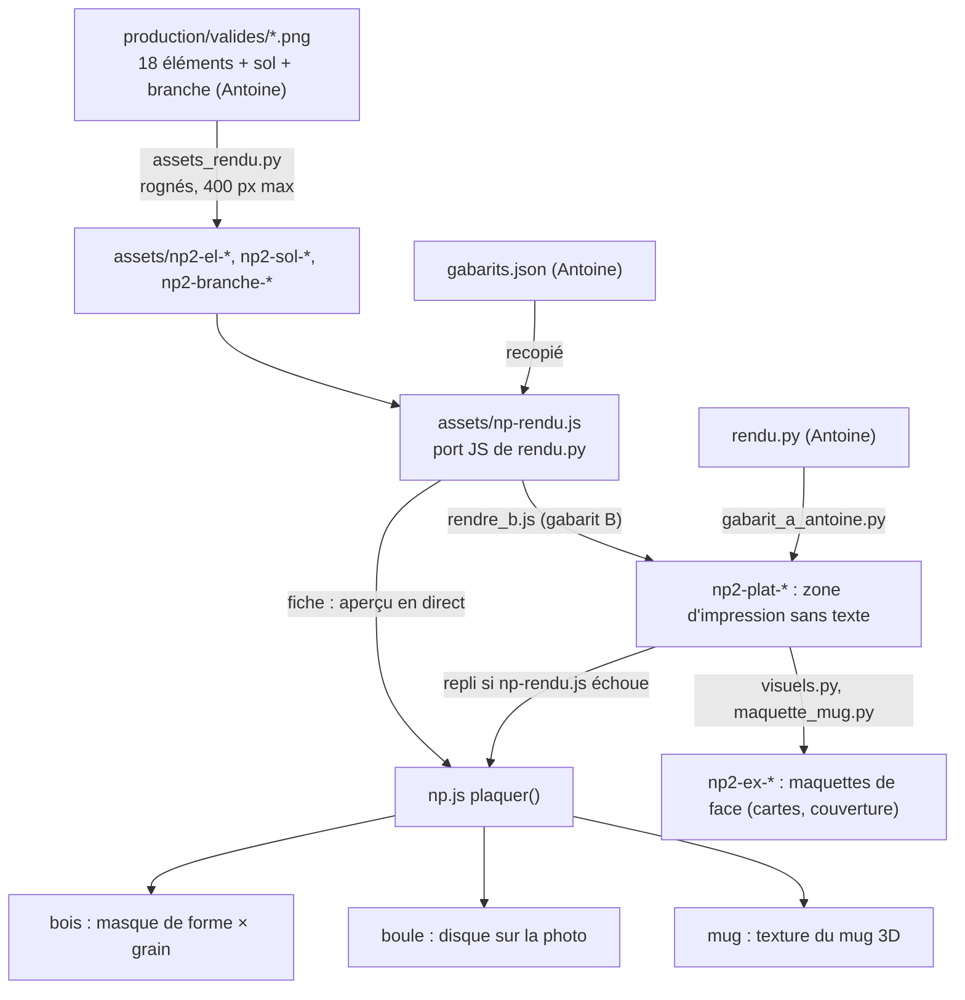

# FLOW - Des éléments d'Antoine aux visuels de la boutique

> ⚠️ **À vérifier par Antoine avant validation.** Le rendu tient, mais plusieurs choix d'intégration
> sont les miens et pas les siens (section « Écarts »). La page blanche (« Votre photo ») est hors
> relecture : jugée parfaite le 03/11.

## Rôle
Décrire comment les éléments validés d'Antoine (`3-systeme/recherches/tests-images/production/`, branche
`antoine`) sont devenus les images et l'aperçu du thème `~/Documents/nolaprint-theme` (v8 du 03/11/2026)
sur les trois objets : mug 3D, boule en verre, décoration en bois.

## Intention
- Montrer les vrais éléments d'Antoine sur la boutique avant que son serveur d'aperçu soit branché.
- Garder les placements de son module : `gabarits.json` est recopié tel quel dans `assets/np-rendu.js`
  (comparé le 03/11, seul le champ `_doc` manque).
- Dès que l'URL du serveur est réglée (Paramètres du thème › NolaPrint : aperçu), l'image du serveur
  remplace tout ce qui est décrit ici (décisions 08 et 10).

## Diagramme

## Étapes
1. **Antoine** valide les éléments peints dans `production/valides/` (fleurs du mois, ornements, sol et
   branche en trois morceaux gauche · tuile · droite) et les placements dans `gabarits.json`.
2. **Sylvain (avec le chat)** copie les éléments dans le thème par `_outils-visuels/assets_rendu.py` :
   rognage au pixel opaque (alpha > 8), réduction à 400 px au plus (sol et branche : 100 px de haut),
   renommage `pied-alouette → pied-dalouette`, `pain-epice → pain-depice`, `coeur → coeur-noel`.
   Les polices Caveat Brush et Nunito sont copiées depuis `rendu/fonts/`.
3. **Sylvain (avec le chat)** porte `rendu.py` en JavaScript (`assets/np-rendu.js`, source dans
   `_outils-visuels/np-rendu.src.js`) : mêmes grilles (`grille_A`, `repartir`), même bande de sol ou de
   branche, mêmes ficelles accrochées au premier pixel opaque, même ajustement du texte par pas de 0,1 mm.
4. **Sylvain (avec le chat)** génère les visuels fixes :
   - gabarit A : `gabarit_a_antoine.py` appelle directement `rendu.rendre()` d'Antoine ;
   - gabarit B : `rendre_b.js` passe par `np-rendu.js` (scène et motif provisoires, voir Écarts) ;
   - `np2-plat-<objet>-<a|b>-<dest>-<base|noel>` : mug 1238 × 578, boule 900 × 900 (PNG), bois cœur 820 × 1084 ;
   - `np2-ex-*` (1000 px) et `-s` (480 px) : maquettes avec l'exemple « Mamie », Léa · Hugo · Jade.
5. **Le navigateur** (fiche produit) compose la zone d'impression avec `NPRendu.rendre()` à chaque saisie,
   puis `np.js plaquer()` la pose sur l'objet :
   - **mug** : texture du mug 3D (`np-mug3d.js`), panneau 210 × 98 mm centré à l'opposé de l'anse,
     texture de 2048 px sur le tour (7,95 px/mm) ;
   - **boule** : image coupée au disque `[497,4 ; 493,8 ; r 317,6]` de la photo vierge 1000 px, sans reflet ;
   - **bois** : image en « cover » dans la boîte de la forme, coupée par `np2-bois-<forme>-masque.png`,
     puis multipliée sur la photo vierge (le grain du bois reste visible).
6. **Les maquettes** (accueil, offres, images produits) : mug par lancer de rayons sur la photo
   `np-mug-vierge.jpg` (`maquette_mug.py`, caméra calée à 0,2 px près, ombrage de la photo conservé,
   2 mm de blanc sous la lèvre) ; boule avec reflet du verre ; bois multiplié par le grain.

## Écarts avec le module d'Antoine (à trancher par Antoine)
| # | Ce que j'ai fait | Ce que fait rendu.py | Effet |
|---|---|---|---|
| 1 | Éléments réduits à 400 px au plus, sol et branche à 100 px de haut | part des `valides/` en pleine taille (663 à 1745 px de large) | aperçu et maquettes moins nets au zoom |
| 2 | `tulipe.png` non intégrée (18 éléments sur 19) | présente dans `valides/` et `brief.py` | absente de la boutique |
| 3 | Texte dessiné par le canvas du navigateur (`fillText`) | mesure Pillow, rendu resvg | crénage et lissage un peu différents de l'impression |
| 4 | Pas d'`eviter_titre` : à Noël sur le mug, seul le décalage fixe de 4 mm | descend la grille jusqu'à sortir la branche du titre (mug, bois) | la branche peut toucher le titre dans l'aperçu |
| 5 | Pas de `rogner_au_cercle` sur la boule | ramène chaque zone de texte dans le cercle utile | texte qui peut déborder du disque dans l'aperçu |
| 6 | L'aperçu ne refuse jamais : il réduit encore et signale | `TacheHumaine` (prénom illisible, couleur hors palette, N trop grand) | la cliente voit un rendu que le serveur refusera |
| 7 | Gabarit B : table du goûter et motif théière-tasse **dessinés par code** (`visuels.gouter`, `assets_rendu.motif`) | scènes recolorées `scene-<dest>-seed1-recolor.png`, `hiver-recolle` à Noël | provisoire, à remplacer par ses scènes |
| 8 | Boule et bois, gabarit A : **un seul ornement centré** dans les visuels fixes (`syms[:1]`) | grille jusqu'à `n_max` | les cartes montrent 1 symbole, la fiche en permet plus |
| 9 | Cœur en bois : dessin réduit à 78 % et descendu de 23 mm (aperçu et maquettes) | zone de titre estimée à y 7 mm, sur le trou du ruban | contournement en attendant le gabarit de découpe |
| 10 | Symboles des exemples choisis par moi (ex. Mamie : rose, tournesol, muguet ; Noël : boule, étoile, sapin) | — | à remplacer par ses choix s'il en a |

## Entrées et sorties
- Entrées : `production/valides/*.png`, `gabarits.json`, `rendu/rendu.py`, `rendu/fonts/` (Antoine) ; photos
  vierges `np-*-vierge.jpg` du thème.
- Sorties : `assets/np2-el-*`, `np2-sol-*`, `np2-branche-*`, `np2-plat-*`, `np2-ex-*`, `np2-scene-*`,
  `np2-motif-*`, `np2-bois-<forme>-masque|contour.png`, `np-rendu.js`, `np-font-*.ttf`.
- Rien n'est envoyé à Printify : l'aperçu n'est jamais le fichier d'impression (décision 10).

## Cas limites
- `np-rendu.js` en échec : repli sur `np2-plat-*` sans texte. Sur le bois, le plat est celui du cœur, quelle
  que soit la forme choisie ⚠️ à vérifier.
- Remplacer un visuel : même nom de fichier, puis `shopify theme push --only "assets/np2-*"`.
- Pages blanches (« Votre photo ») : hors de ce flux, inchangées.

## Notes liées
[[MOD - Mug 3D]] · [[MOD - Catalogue et fiche produit]] · [[CMP - Illustrations]] ·
[[CMP - Brief de génération des illustrations de Noël 2026]] · [[A VERIFIER - Points à valider, vérifier, tester]]
