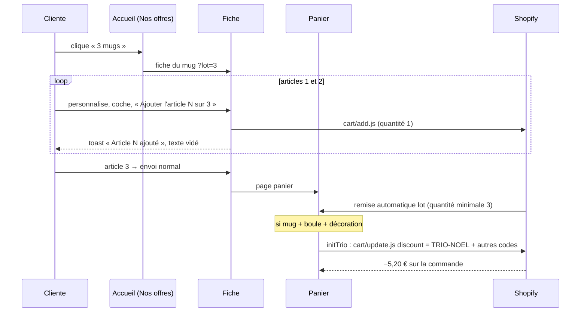

# FLOW - Lots et trio

## Rôle
Les deux offres de la boutique, de la carte de l'accueil jusqu'à la remise au paiement :
- **Lot de 3** : 3 articles, chacun avec son destinataire, sa forme et son texte, remisés par article.
- **Trio de Noël** : un mug + une boule + une décoration, −5,20 € sur la commande.

## Intention
- Gâter toute la famille en une commande : chaque article du lot garde sa propre personnalisation.
- Le thème montre l'offre ; **Shopify applique la remise** (remise automatique pour les lots, code pour le trio),
  pour que le prix payé soit sûr.
- ⚠️ Trio remisé à −5,20 € depuis le 02/11 (demande faite dans le chat), alors que la décision 12 le voulait
  « sans remise » : à acter par une décision (13 bis proposée dans le LISEZMOI Noël v2).

## Diagramme

## Étapes
### Lot de 3
1. **Choisir** (cliente) : carte « Lot de 3 » de l'accueil (`?lot=3`), ou option « Lot de 3 » sur la fiche
   (`np.js` l.742).
2. **Personnaliser 3 fois** (cliente) : la pastille « Article 1 sur 3 » avance ; quantité forcée à 1.
3. **Ajouter** (thème) : articles 1 et 2 par `cart/add.js` en arrière-plan, article 3 par l'envoi normal (l.786).
4. **Remiser** (Shopify) : remise automatique, quantité minimale 3.
5. **Rappeler** (panier, l.109-112) : avec 1 ou 2 articles, « Encore N article(s) ».

### Trio de Noël
1. **Voir l'offre** (cliente) : carte « Le trio de Noël » (51,15 € au lieu de 56,35 €), ou ligne « Un mug, une
   boule et une décoration » sous chaque fiche (l.589).
2. **Remplir le panier** (cliente) : un de chaque objet, dans n'importe quel ordre. Avec 2 objets sur 3, le panier
   dit lequel ajouter.
3. **Poser le code** (thème, `initTrio` l.960) : ajoute `TRIO-NOEL` aux codes déjà saisis et recharge si Shopify
   l'accepte ; le retire si un objet part. Une seule tentative par état et par tranche de 100 s.
4. **Remiser** (Shopify) : code « Montant fixe sur la commande » 5,20 €, combinable avec les remises produit.

## ⚠️ Deux règles de lot dans le code
| Où | Règle affichée | Réglage |
|---|---|---|
| Fiche (l.66-84, l.169-170), « Nos offres » | remise fixe par article dès 3 **du même objet** : mug 1,80 €, boule 1,97 €, bois 1,80 € → 49,95 / 53,94 / 48,45 € | `np_lot_off_mug`, `np_lot_off_verre`, `np_lot_off_bois` |
| Panier (l.109-112) | **−10 %** sur chaque article dès 3, **mug, boule ou décoration au choix** | `np_lot_pct` |

Le LISEZMOI Noël v2 fait créer 3 remises à montant fixe par collection : c'est la règle de la fiche. Le message du
panier ne correspond donc pas à la remise réellement appliquée. À trancher : une seule règle, puis aligner le
panier, la fiche et les remises Shopify.

## À créer dans Shopify (LISEZMOI Noël v2, étape 2.3)
| Remise | Type | Réglage |
|---|---|---|
| Lot mugs | automatique, montant fixe sur des produits, appliqué à chaque article | collection Mugs, quantité minimale 3, 1,80 €, combinable |
| Lot boules | idem | collection Boules de Noël, 1,97 € |
| Lot décorations | idem | collection Décorations en bois, 1,80 € |
| `TRIO-NOEL` | code, montant fixe sur la commande | 5,20 €, combinable avec les remises produit, minimum d'achat 50 € |

Montants modifiables dans les réglages du thème (`np_lot_off_*`, `np_trio_off`, `np_trio_code`) : il faut les
changer aussi dans Shopify.

## Entrées et sorties
- Entrées : réglages du thème, remises Shopify, contenu du panier (comptes `q_mug`, `q_verre`, `q_bois`).
- Sorties : lignes de panier (une par article), codes de réduction du panier.

## Cas limites
- Remises pas créées dans Shopify : l'offre s'affiche mais rien n'est déduit ⚠️ à créer avant la mise en ligne.
- Lot + trio : 3 mugs + 1 boule + 1 décoration → remise lot sur les mugs + trio, si les remises sont combinables.
- La cliente tape `TRIO-NOEL` sans les 3 objets : accepté par Shopify dès 50 € d'achat ⚠️.
- Code refusé par Shopify : pas de rechargement, pas de boucle.

## Notes liées
[[MOD - Catalogue et fiche produit]] · [[MOD - Panier et commande]] · [[MOD - Accueil]] · [[12 - Lots de 3 à environ moins 10 %, lot un de chaque sans remise]]
