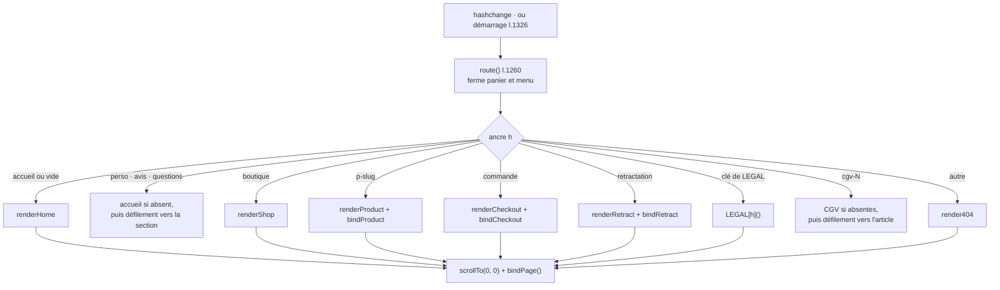

# FLOW - Routage par ancre

## Rôle
Comment la maquette passe d'une page à l'autre sans serveur : l'ancre de l'URL (`#accueil`,
`#p-duo-mamie-papi`, `#cgv`…) choisit la page à construire dans `<main id="app">`.

## Intention
- **Un seul fichier, aucune dépendance** : la maquette s'ouvre partout (artifact, fichier local) et
  chaque page a une adresse qu'on peut partager.
- **Provisoire** : dans le thème, chaque page sera une vraie URL Shopify
  ([[07 - La maquette est le cahier des charges du thème Shopify]]).

## Diagramme

## Étapes
| N° | Qui agit | Ce qui se passe | Code |
|---|---|---|---|
| 1 | Visiteur | clique un lien `#…` (menu, carte, bouton, pied de page) ou ouvre une adresse avec une ancre | `hashchange` l.1290 ; `route()` au démarrage l.1326 |
| 2 | Maquette | lit l'ancre sans `#` (`accueil` par défaut), ferme le tiroir panier et le menu mobile | `route` l.1260 |
| 3 | Maquette | construit la page selon le tableau ci-dessous et l'injecte dans `#app` | fonctions `render*`, `LEGAL` |
| 4 | Maquette | pages avec formulaire : branche leurs événements | `bindProduct`, `bindCheckout`, `bindRetract` |
| 5 | Maquette | remonte en haut et branche les éléments communs (filtres, démo, contact, « Modifier mes choix », liens `data-scroll`) | `scrollTo(0, 0)`, `bindPage` l.1275 |

| Ancre | Page |
|---|---|
| `#accueil` ou rien | accueil |
| `#perso`, `#avis`, `#questions` | section de l'accueil (défilement, sans remonter en haut) |
| `#boutique` | les cadeaux |
| `#p-<slug>` | fiche produit (404 si le slug est inconnu) |
| `#commande` | commande |
| `#retractation` | rétractation en ligne |
| `#cgv`, `#mentions`, `#confidentialite`, `#cookies-page`, `#livraison`, `#faq`, `#contact` | pages de `LEGAL` |
| `#cgv-1` … `#cgv-13`, `#cgv-a` | article des CGV |

## Dans le thème Shopify
| Maquette | Devient |
|---|---|
| `#accueil`, `#boutique`, `#p-<slug>` | `/`, `/collections/all`, `/products/<handle>` |
| `#commande` | `/cart` puis checkout Shopify |
| pages `LEGAL`, `#retractation` | `/pages/…` et `/policies/…`, app de rétractation |
| `#perso`, `#avis`, `#questions` | ancres internes de la page d'accueil du thème |

## Cas limites
- Cliquer deux fois le même lien (« Avis » après avoir fait défiler) ne fait rien : l'ancre ne change
  pas, donc `hashchange` ne se déclenche pas.
- Revenir à `#accueil` depuis une section de l'accueil reconstruit la page : la démo repart de Léa et Hugo.
- `#catalogue-anchor` n'est jamais mis dans l'URL : le clic est intercepté par `data-scroll`. S'il y
  arrivait, `route` afficherait la page 404.
- Chaque `route` appelle `bindPage` sur une page neuve : les anciens écouteurs disparaissent avec l'ancien HTML.

## Notes liées
[[OVR - Boutique NolaPrint]] · [[FLOW - De la personnalisation à la commande]] · [[FLOW - Rétractation en ligne]] · [[MOD - Habillage]]
