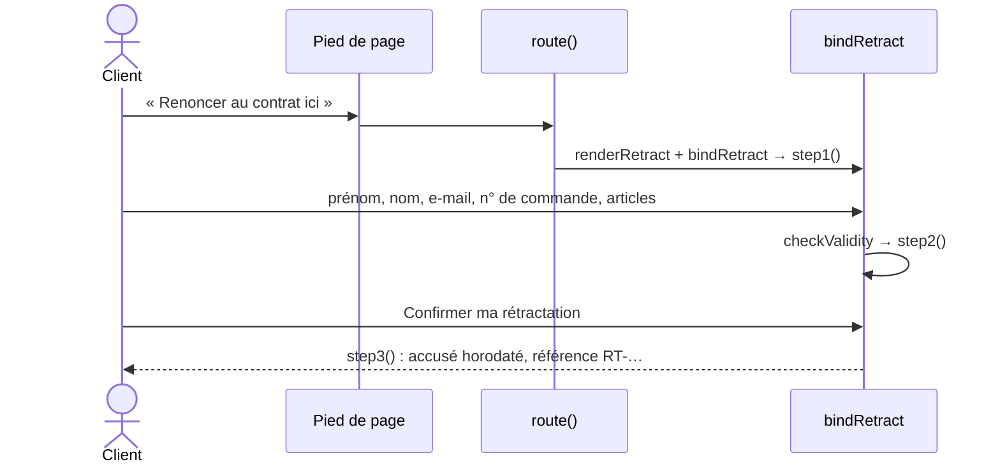

# FLOW - Rétractation en ligne

## Rôle
Le parcours du bouton « Renoncer au contrat ici » : du lien dans le pied de page jusqu'à l'accusé de
réception horodaté, en trois étapes.

## Intention
- **Respecter la fonction de rétractation obligatoire depuis le 19/06/2026** : bouton clairement nommé,
  identification du client, bouton « Confirmer ma rétractation », accusé de réception immédiat et
  horodaté ([[RCH - Retours et remboursements (28-10-2026)]]).
- **Prévenir avant, ne pas bloquer** : la page rappelle que les articles personnalisés sont exclus,
  mais laisse envoyer la demande ; la réponse se fait article par article.
- **Un humain décide du remboursement**, jamais un agent ([[03 - Approbation unitaire au lancement, paliers d'autonomie, actions toujours bloquées]]).

## Diagramme

## Étapes
| N° | Qui agit | Ce qui se passe | Code |
|---|---|---|---|
| 1 | Client | clique « Renoncer au contrat ici » (pied de page de chaque page) ou « Rétractation » (colonne Aide) | lien `#retractation` |
| 2 | Maquette | page avec l'avertissement sur les articles personnalisés et la frise des 3 étapes | `route` → `renderRetract` l.1163 |
| 3 | Client | remplit prénom, nom, e-mail, numéro de commande (obligatoires) et articles concernés (facultatif) | `step1` dans `bindRetract` l.1172 |
| 4 | Maquette | refuse si un champ obligatoire manque (message du navigateur), sinon passe à l'étape 2 | `reportValidity`, `step2` |
| 5 | Client | relit le récapitulatif ; « Modifier » ou « Confirmer ma rétractation » | `step2` |
| 6 | Maquette | affiche l'accusé : date et heure complètes, référence `RT-` + horodatage en base 36, adresse e-mail de la copie | `step3` |
| 7 | Vendeur (hors maquette) | répond sous 48 h : adresse de retour pour les articles éligibles, ou refus motivé pour les personnalisés ; rembourse sous 14 jours | ⚠️ processus à écrire |

## Entrées et sorties
- Entrée : les 5 champs du formulaire.
- Sortie dans la maquette : l'accusé affiché ; rien n'est envoyé ni enregistré.
- Sortie exigée en production : un e-mail d'accusé sur un support durable, et une trace de la demande
  ([[RCH - Retours et remboursements (28-10-2026)]]).

## Dans le thème Shopify
| Étape de la maquette | Devient |
|---|---|
| 1 à 6 | app Shopify de rétractation ou développement dédié ⚠️ à choisir |
| Accusé affiché | e-mail automatique horodaté |
| 7 | processus manuel au lancement, documenté pour le futur agent de service client (décision 03) |

## Cas limites
- Numéro de commande inventé : accepté, aucune vérification.
- Demande hors délai de 14 jours : acceptée par la maquette ; le tri se fait à l'étape 7.
- Article personnalisé : demande acceptée à l'envoi, refusée à l'étape 7 avec la raison (art. L221-28 3°).
- Retour arrière du navigateur : les étapes ne changent pas l'ancre, donc on quitte la page de
  rétractation ; l'accusé affiché est perdu.

## Notes liées
[[MOD - Pages légales et rétractation]] · [[RCH - Retours et remboursements (28-10-2026)]] · [[SYN - Juridique]] · [[FLOW - Routage par ancre]]
