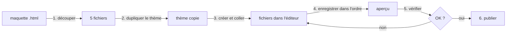

# FLOW - Déployer la maquette dans Shopify

## Rôle
Les étapes pour passer du fichier HTML de la maquette à la page d'accueil Shopify, et pour redéployer après une modification.

## Intention
Rejouable sans réfléchir : chaque mise à jour de la maquette repasse par ces étapes.

## Diagramme

## Étapes
1. **Découper la maquette** (Claude) : `<style>` → `mesange.css`, `<script>` → `mesange.js`,
   le corps sans le script → `sections/mesange.liquid` + ``. Le layout et `index.json` sont fixes.
2. **Dupliquer le thème** (Mateo) : Boutique en ligne → Thèmes → ⋯ → Dupliquer, puis « Modifier le code » sur la copie.
3. **Créer les fichiers** (Mateo) : clic droit sur le dossier → New file, coller le contenu.
   `templates/index.json` existe déjà : tout effacer (y compris le commentaire `/* … */` de Horizon), puis coller.
4. **Enregistrer dans l'ordre** (Mateo) : `mesange.css` → `mesange.js` → section → layout → `index.json` en dernier,
   parce que `index.json` référence la section et le layout. Un onglet barré = fichier pas encore enregistré.
5. **Vérifier** (Mateo) : Thèmes → ⋯ → Aperçu, sur ordinateur et téléphone.
6. **Publier** (Mateo) : bouton Publier sur la copie.

Pour une mise à jour : modifier la maquette, puis refaire l'étape 1 et recoller seulement les fichiers changés (souvent CSS ou JS).

## Entrées et sorties
- Entrée : `Claude outputs/maquette-mesange-noel.html`.
- Sortie : la page d'accueil Shopify affiche la maquette.

## Cas limites
- Code collé deux fois dans `index.json` : JSON invalide, l'éditeur affiche des erreurs (vu le 29/10/2026).
- Enregistrer `index.json` avant la section ou le layout : Shopify refuse, la section n'existe pas encore.
- Le « 3 » jaune sur le layout = avertissements Theme Check (polices distantes), pas des erreurs.

## Notes liées
[[MOD - Thème Shopify]] · [[OVR - Boutique NolaPrint]]
