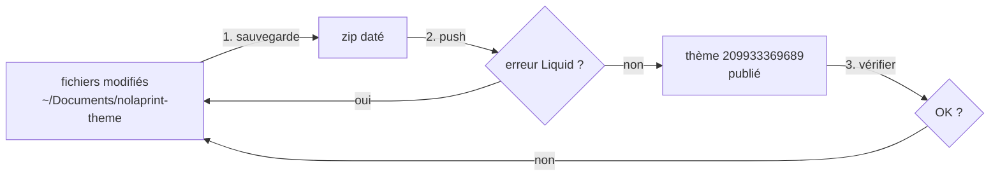

# FLOW - Déployer la maquette dans Shopify

## Rôle
Envoyer le thème local `~/Documents/nolaprint-theme` sur la boutique avec Shopify CLI, en une commande.
Depuis la refonte du 30/10/2026, cette commande remplace le copier-coller dans l'éditeur de code
(ancienne méthode : la sauvegarde `_sauvegarde-avant-refonte-2026-10-30.zip`).

## Intention
Le thème est modifié en fichiers sur le Mac, puis poussé tel quel : rien n'est retapé dans l'admin.
Rejouable à chaque modification.

## Diagramme


## Étapes
1. **Sauvegarder**  : avant une grosse modification, zipper les fichiers touchés à la racine,
   avec la date dans le nom (`_sauvegarde-avant-<sujet>-AAAA-MM-JJ.zip`). Le dossier n'est pas un dépôt git.
2. **Pousser** (Mateo) :
   ```
   cd ~/Documents/nolaprint-theme
   shopify theme push --store 04qh0j-2k.myshopify.com --theme 209933369689 --allow-live
   ```
   `--allow-live` est obligatoire parce que le thème 209933369689 est le thème publié.
3. **Vérifier** (Mateo) : l'accueil, puis une fiche de chaque objet, sur ordinateur et sur téléphone.
   Sur le bois, changer de forme et contrôler que l'aperçu suit.

## Entrées et sorties
- Entrée : les dossiers de thème (`assets`, `blocks`, `config`, `layout`, `locales`, `sections`,
  `snippets`, `templates`).
- Sortie : le thème publié de 04qh0j-2k.myshopify.com mis à jour.
- Hors thème, à la racine et non envoyés : `_imports-shopify/` (CSV), les `_sauvegarde-*.zip`,
  `Claude outputs/`, `AGENTS.md`. ⚠️ à vérifier : aucun `.shopifyignore` ne le garantit.

## Cas limites
- **Erreur Liquid au push (30/10/2026)** : des accolades `{…}` oubliées dans une balise Liquid,
  donc une balise mal fermée. Shopify refuse le fichier ; corriger, puis pousser à nouveau.
- **Push direct sur le thème en ligne** : chaque push est vu tout de suite par les visiteurs. Pour
  tester sans risque, pousser sur un thème non publié (sans `--allow-live`) et le prévisualiser.
- Un CSV ou un autre fichier non reconnu dans `assets/` serait envoyé avec le thème : les CSV vont
  dans `_imports-shopify/`.
- Avertissements Theme Check sur les polices Google : non bloquants.

## Notes liées
[[MOD - Thème Shopify]] · [[FLOW - Importer les produits par CSV]] · [[OVR - Boutique NolaPrint]]
