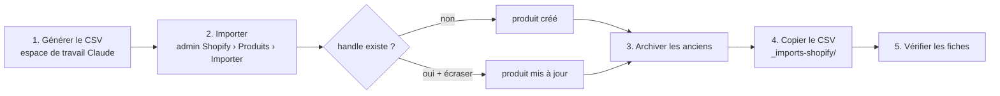

# FLOW - Importer les produits par CSV

## Rôle
Créer ou mettre à jour les produits de la boutique en important un CSV au format Shopify dans l'admin,
puis archiver ceux qui sortent du catalogue. Utilisé le 30/10/2026 pour passer des 5 produits
« famille illustrée » aux 3 objets de la décision 11.

## Intention
- Le thème reconnaît les objets par leur **tag** (`np-mug`, `np-verre`, `np-bois`) et leurs **handles** :
  le CSV est la source de ces deux valeurs, il doit rester aligné avec [[MOD - Thème Shopify]].
- **Archiver, pas supprimer** : un produit archivé garde son historique et peut revenir.
- Une copie de chaque CSV importé est rangée dans `~/Documents/nolaprint-theme/_imports-shopify/`
  (hors dossiers de thème, donc pas envoyée par le push).

## Diagramme

## Étapes
1. **Générer le CSV** (Claude) : colonnes Shopify standard (`Handle`, `Title`, `Body (HTML)`, `Vendor`,
   `Type`, `Tags`, `Option1 Name/Value`, `Variant SKU`, `Variant Price`, `SEO Title`,
   `SEO Description`, `Status`…). Une ligne par variante ; seules les colonnes de variante sont
   remplies sur les lignes suivantes.
2. **Importer** (Mateo, dans le navigateur) : admin Shopify › Produits › Importer, en déposant le fichier.
   Pour une mise à jour, cocher l'écrasement des produits de même handle.
3. **Archiver les anciens** (Mateo) : produits sortis du catalogue passés en statut « Archivé ».
4. **Ranger une copie** du CSV dans `_imports-shopify/`, nommée par date ou par version.
5. **Vérifier** (Mateo) : chaque fiche affiche les designs et l'aperçu (le tag est reconnu), et le bois
   propose ses 6 formes.

## Imports du 30/10/2026
| Fichier | Contenu |
|---|---|
| `nolaprint-produits-29-10.csv` | ancien import : les 5 produits désormais archivés |
| `nolaprint-produits-v2.csv` | les 3 nouveaux produits |
| `nolaprint-bois-maj.csv` | mise à jour (écrasement) de la description de la décoration en bois |

**Produits créés** (statut actif) :
| Handle | Tag | SKU | Variantes | Prix importé |
|---|---|---|---|---|
| `mug-personnalise` | `np-mug` | NP-MUG | aucune | 24,90 € |
| `boule-de-noel-verre-personnalisee` | `np-verre` | NP-VERRE | aucune | 27,90 € |
| `decoration-bois-personnalisee` | `np-bois` | NP-BOIS-01 à 06 | Forme : Cœur, Sapin, Étoile, Cloche, Chaussette de Noël, Ovale | 19,90 € |

**Produits archivés** (pas supprimés) : `mug-famille-illustree`, `affiche-famille-illustree`,
`boule-de-noel-famille`, `duo-mamie-papi`, `lot-mug-affiche`.

## Entrées et sorties
- Entrée : un CSV au format d'import Shopify.
- Sortie : produits créés ou mis à jour dans 04qh0j-2k.myshopify.com ; anciens produits archivés.

## Cas limites
- **Prix** : les prix importés (24,90 / 27,90 / 19,90 €) sont ceux d'avant la décision 12
  (17,90 / 19,90 / 17,90 €), qui n'est pas encore appliquée dans Shopify. ⚠️ à vérifier
- **Tag oublié ou mal écrit** : le produit s'affiche avec la fiche simple, sans designs ni aperçu.
- **Handle changé** : la section « Sur nos autres objets » (`np-main-product.liquid` l.172) ne trouve
  plus le produit ; changer les deux en même temps.
- **Nom de forme changé** : le premier mot de la variante doit rester une clé de `np-bois-shapes`
  (`coeur`, `sapin`, `etoile`, `cloche`, `chaussette`, `ovale`).
- **Import sans écrasement** sur un handle existant : Shopify ne met pas le produit à jour.
- **CSV dans `assets/`** : il serait envoyé avec le thème ; toujours le ranger dans `_imports-shopify/`.

## Notes liées
[[MOD - Thème Shopify]] · [[FLOW - Déployer la maquette dans Shopify]] · [[CMP - Produit]]
