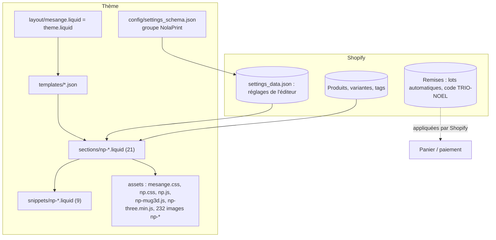

# MOD - Thème Shopify

## Rôle
Le dossier du thème : quels fichiers font la boutique NolaPrint, quels réglages la pilotent depuis
l'éditeur Shopify, et les règles pour le modifier sans casser. Les pages elles-mêmes sont décrites dans
les MOD de `2-modules/`.

## Intention
- **Tout ce qui est NolaPrint porte le préfixe `np-`** (sections, snippets, assets) ; le reste est Horizon d'origine, gardé mais inutilisé.
- **Pas d'app de personnalisation** : la fiche, l'aperçu et la 3D sont dans le thème ; Shopify reçoit des propriétés de ligne ([[CMP - Panier]]), le serveur fabrique le fichier d'impression ([[10 - Notre serveur produit l'image finale, Printify la reçoit par l'API]]).
- **Les choix commerciaux sont des réglages**, pas du code (groupe « NolaPrint : offres et livraison »).
- **Une sauvegarde zip avant chaque refonte**, à la racine du thème.

## Diagramme

## Fichiers
| Dossier | Fichiers NolaPrint | Rôle |
|---|---|---|
| `layout/` | `mesange.liquid` (accueil), `theme.liquid` (autres pages) — identiques, 49 lignes ; `password.liquid` (Horizon) | polices, CSS, JSON-LD de l'accueil, en-tête, `main`, pied de page, `np.js` |
| `templates/` | `index`, `product`, `cart`, `collection`, `list-collections`, `search`, `404`, `blog`, `article`, `page` + 8 `page.<nom>.json` | une section `np-*` par page ; textes des pages légales dans `body` |
| `sections/` | `np-header`, `np-footer`, `np-hero`, `np-trust`, `np-modes`, `np-galerie`, `np-catalogue`, `np-offres`, `np-demo`, `np-faq`, `np-main-product`, `np-main-cart`, `np-main-collection`, `np-list-collections`, `np-main-search`, `np-page-content`, `np-retractation`, `np-contact`, `np-404`, `np-main-blog`, `np-main-article` (21) | voir les MOD |
| `snippets/` | `np-designs`, `np-type`, `np-name-overlay`, `np-bois-shapes`, `np-shape-icon`, `np-product-card`, `np-icon`, `np-url`, `np-breadcrumbs-ld` ; `meta-tags` (Horizon, image de partage `-hd.jpg` ajoutée l.78-108) | briques réutilisées |
| `assets/` | `mesange.css` (base), `np.css` (refontes), `np.js` (tout le comportement), `np-mug3d.js` + `np-three.min.js` (3D), images `np-*` | |
| `config/` | `settings_schema.json` (groupe NolaPrint à la fin), `settings_data.json` | réglages |
| racine | `_imports-shopify/` (CSV), `_sauvegarde-*.zip`, `Claude outputs/` (aperçus) | hors thème, ignorés au push |

## Réglages du thème « NolaPrint : offres et livraison »
| Id | Défaut | Rôle |
|---|---|---|
| `np_lots_enabled` | oui | affiche les lots de 3 (fiche, accueil, panier) |
| `np_lot_off_mug` / `_verre` / `_bois` | 180 / 197 / 180 | remise par article dès 3, en centimes |
| `np_text_extra` | 100 | supplément texte si pas de variante « Personnalisation » |
| `np_libre_extra` | 200 | supplément « Votre image » (texte inclus), idem |
| `np_trio_enabled` | oui | active le trio |
| `np_trio_off` | 520 | remise du trio, en centimes |
| `np_trio_code` | TRIO-NOEL | code Shopify posé par le panier |
| `np_ship_price` | 490 | prix de la livraison |
| `np_free_ship` | 6000 | livraison offerte dès |

Réglages de section utiles : fiche produit (mention TVA, `text_max` 15, accroches, délais par objet,
heure limite `cutoff` 14 h, dates Noël, rétractation, GPSR, onglets) ; en-tête (6 messages, produits du menu) ;
pied de page (e-mail, délai) ; chaque section de l'accueil (titres, textes, produits).

## Formes de la décoration en bois
| Forme | Texte (x, y) | Échelle | Zone d'impression (cx, cy, taille) |
|---|---|---|---|
| Cœur | 495, 673.5 | 0.3946 | 495, 541.2, 473.6 |
| Sapin | 495, 766.6 | 0.3363 | 495, 653.9, 403.6 |
| Étoile | 498, 683.3 | 0.3729 | 498, 558.4, 447.5 |
| Cloche | 500, 767.7 | 0.3756 | 500, 641.9, 450.7 |
| Chaussette | 591.5, 701.4 | 0.2949 | 591.5, 602.6, 353.9 |
| Ovale | 493, 674.3 | 0.4874 | 493, 511.1, 584.9 |

Repère 1000 × 1000, `np-bois-shapes.liquid` l.23-28. Clé de forme = nom de variante en minuscules, sans accent, premier mot (« Chaussette de Noël » → `chaussette`).

## Règles pour modifier
1. Sauvegarde zip à la racine avant une refonte (ex. `_sauvegarde-avant-prix-trio-2026-11-02.zip`).
2. Libellés des réglages : 70 caractères au maximum (sinon Shopify refuse la section au push, vécu le 02/11).
3. Pousser avec `--only` sur les fichiers modifiés ; un push complet remplace aussi `settings_data.json` et les templates, donc les réglages faits dans l'éditeur ([[FLOW - Déployer la maquette dans Shopify]]).
4. Vérifier `node --check assets/np.js` et la validité JSON des schémas avant de pousser.
5. Mettre à jour la note `MOD` concernée et les numéros de ligne.

## Sauvegardes
`_sauvegarde-avant-refonte-2026-10-30.zip` · `_sauvegarde-avant-refonte-fiche-pages-2026-11-02.zip` · `_sauvegarde-avant-mug-3d-2026-11-02.zip` · `_sauvegarde-avant-prix-trio-2026-11-02.zip`.

## Cas limites
- `index.json` utilise encore `layout: mesange` ; le fichier est identique à `theme.liquid` (vérifié le 02/11) : pas d'effet. `mesange.css` reste la feuille de base, à ne pas supprimer.
- Les 42 sections et 95 blocs Horizon d'origine restent dans le thème, inutilisés.
- Avertissements Theme Check sur les polices Google : non bloquants.

## Notes liées
[[OVR - Boutique NolaPrint]] · [[FLOW - Déployer la maquette dans Shopify]] · [[FLOW - Importer les produits par CSV]] · [[CMP - Panier]]
