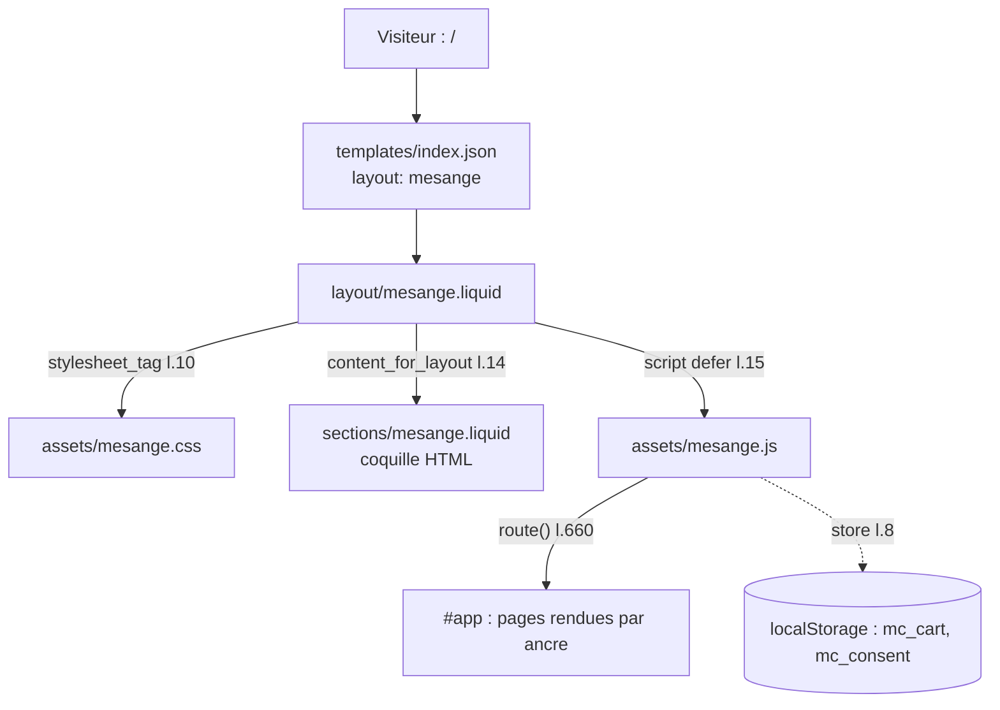

# MOD - Thème Shopify

## Rôle
Affiche la maquette NolaPrint comme page d'accueil de la boutique Shopify, au pixel près, sans passer
par l'habillage Horizon. Rendu validé visuellement le 29/10/2026 (ordinateur et téléphone).
Rien n'est achetable : le panier, la commande et les cookies restent ceux de la maquette.

## Intention
Une étape de vitrine avant le thème reconstruit prévu par [[07 - La maquette est le cahier des charges du thème Shopify]] :
voir la boutique en vrai sur Shopify, sur un domaine Shopify, sans produit ni paiement.
Le moyen : un **layout alternatif**. `templates/index.json` désigne `layout: mesange` au lieu de
`theme.liquid`, donc la page d'accueil ne charge ni l'en-tête, ni le pied, ni les styles de Horizon.
Les autres adresses (`/cart`, `/products/…`, `/pages/…`) gardent le design Horizon.

## Diagramme

## Les 5 fichiers
| Fichier | Lignes | Contenu | Origine dans la maquette |
|---|---|---|---|
| `layout/mesange.liquid` | 17 | `<head>`, polices Google, `content_for_header`, `content_for_layout`, appel du JS | l.1-10, réécrit en Liquid |
| `sections/mesange.liquid` | 114 | bandeau, en-tête, `<main id="app">`, pied, tiroir panier, bannière cookies, puce maquette, `` | l.490-599 |
| `templates/index.json` | 5 | `layout: mesange`, une section `main` de type `mesange` | — (remplace l'index Horizon) |
| `assets/mesange.css` | 475 | tous les styles | l.12-486 |
| `assets/mesange.js` | 752 | données, illustrations, pages, routeur, cookies, flocons | l.601-1352 |

| Symbole | Rôle | Appelé par | Appelle |
|---|---|---|---|
| `content_for_header` (layout l.11) | scripts Shopify obligatoires (analytics, barre d'aperçu) | Shopify | — |
| `content_for_layout` (layout l.14) | insère la section `mesange` | Shopify | `sections/mesange.liquid` |
| `` (section l.112) | déclare la section « Mésange maquette » | `index.json` | — |
| `store` (JS l.8) | lecture et écriture `localStorage` | panier, cookies | — |
| `ART` (JS l.55) | illustrations SVG des produits | `card`, fiche produit, panier | — |
| `PRODUCTS` (JS l.159) | catalogue en dur, 11 produits | toutes les pages | — |
| `renderCart` (JS l.233) | tiroir panier | ajout, `+`/`−` | `store` |
| `renderHome` (JS l.307) | page d'accueil | `route` | `card`, `ART` |
| `route` (JS l.660) | routeur par ancre | `hashchange`, démarrage l.726 | pages, `bindPage` |
| `bindPage` (JS l.675) | filtres, démo, formulaires | `route` | — |
| `@media (max-width: 460px)` (CSS l.111) | bandeau de réassurance en 2 colonnes sur téléphone | — | — |

## Entrées et sorties
- Entrée : une visite sur `/`. Aucune donnée Shopify lue (ni produit, ni panier, ni client).
- Sortie : la maquette rendue. Le panier et le choix de cookies restent dans le navigateur.

## Cas limites
- Fichiers JS et CSS en `assets/*.js` et `*.css`, pas en `.liquid` : Shopify n'interprète pas leur contenu.
  La maquette ne contient ni `{{` ni `{%`, donc la section se colle sans échappement.
- Avertissements Theme Check sur les polices Google (layout l.7-9) : recommandation de performance, non bloquante.
- Boutique protégée par mot de passe : le visiteur voit d'abord `password.liquid` de Horizon.
- Un clic sur un lien Shopify natif (`/cart`) ferait apparaître Horizon ; la maquette n'en contient aucun.
- Bannière cookies maison seulement : non conforme tant que l'API Customer Privacy n'est pas branchée ([[MOD - Cookies et consentement]]).

## Écart avec la maquette
- CSS l.111 : `1fr` → `repeat(2, minmax(0,1fr))`, modifié dans le thème le 29/10/2026.
  ⚠️ à reporter dans la maquette (règle de [[07 - La maquette est le cahier des charges du thème Shopify]] : la maquette d'abord).
- ⚠️ à vérifier : la maquette déployée est `maquette-mesange-noel.html` (avec aperçu en direct), alors que
  [[OVR - Boutique NolaPrint]] cite `nolaprint-sans-apercu-en-direct.html`.

## Pour rendre la boutique achetable
1. Créer les produits dans l'admin et ajouter leur `variant` à `PRODUCTS`.
2. À l'ajout au panier, appeler `/cart/add.js` avec les prénoms en `properties`.
3. « Passer commande » → `/checkout` ; retirer la commande simulée.
4. Remplacer la bannière cookies par celle de Shopify.
Ces étapes sont la transition vers le thème reconstruit de la décision 07, pas une fin en soi.

## Notes liées
[[OVR - Boutique NolaPrint]] · [[FLOW - Déployer la maquette dans Shopify]] · [[MOD - Panier et commande]] · [[RCH - API Shopify pour la boutique agentique (22-10-2026)]]
