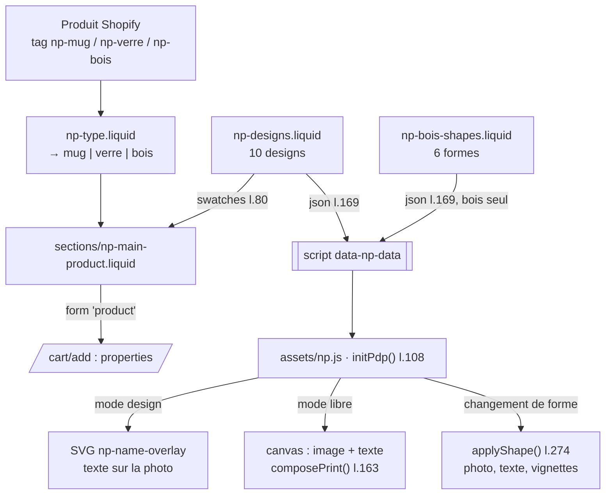

# MOD - Thème Shopify

## Rôle
Le thème NolaPrint de la boutique, refondu le 30/10/2026 pour l'offre de la décision 01 :
3 objets (mug, boule de Noël en verre, décoration en bois), 10 designs où la cliente remplace
« Votre prénom », un mode « Ma création » avec envoi d'image, et l'aperçu en direct sur la photo
de l'objet. Les produits sont de vrais produits Shopify (importés par CSV, voir
[[FLOW - Importer les produits par CSV]]) : l'ajout au panier passe par le formulaire produit Shopify.

## Intention
- **Une seule liste de designs** (`np-designs.liquid`) sert l'accueil, la fiche produit et le JSON lu
  par `np.js` : ajouter un design = une ligne par tableau + ses images.
- **Le thème reconnaît un objet par son tag** (`np-mug`, `np-verre`, `np-bois`), pas par son handle :
  un produit sans ces tags reçoit une fiche simple.
- **Ce que la cliente voit est ce qui part à l'impression** : texte posé dans la zone imprimable mesurée
  sur chaque photo, image cadrée dans la même zone, case « j'ai vérifié l'aperçu » obligatoire.
- L'ancienne vitrine (layout `mesange` + `mesange.js`, 11 produits en dur) est sauvegardée dans
  `_sauvegarde-avant-refonte-2026-10-30.zip` à la racine du thème.

## Diagramme

## Les objets
| Objet | Tag | Handle | Variantes | Imprimeur (GPSR) |
|---|---|---|---|---|
| Mug | `np-mug` | `mug-personnalise` | aucune | Textildruck Europa, Allemagne |
| Boule de Noël en verre | `np-verre` | `boule-de-noel-verre-personnalisee` | aucune | Chill, Pays-Bas |
| Décoration en bois | `np-bois` | `decoration-bois-personnalisee` | option « Forme » : Cœur, Sapin, Étoile, Cloche, Chaussette de Noël, Ovale | WOYC, Italie |

## Les 10 designs
| Id | Nom | Pour | Texte à remplacer | Police |
|---|---|---|---|---|
| d01 | Maman d'amour | Maman | Votre prénom | Dancing Script |
| d02 | Super Papa | Papa | Votre prénom | Fredoka |
| d03 | Mamie chérie | Mamie | Votre prénom | Playfair |
| d04 | Le meilleur Papy | Papy | Votre prénom | Playfair |
| d05 | Toi & moi | Couple | Vos prénoms | Dancing Script |
| d06 | Notre famille | Famille | Vos prénoms | Caveat |
| d07 | Joyeux Noël | Noël | Votre prénom | Dancing Script |
| d08 | Mon premier Noël | Bébé et parents | Votre prénom | Playfair |
| d09 | Meilleures amies | Amies | Vos prénoms | Caveat |
| d10 | Frères & sœurs | Frères et sœurs | Vos prénoms | Fredoka |

Images par design et par objet, dans `assets/` : `np-<objet>-<id>-s.jpg` (carte de l'accueil, avec
« Votre prénom »), `-t.jpg` (vignette), `-nu.jpg` (fiche, sans texte), plus `np-<objet>-vierge*.jpg`
pour « Ma création ». Bois : `np-bois-<forme>-<id>-nu|t.jpg` par forme (le cœur utilise `np-bois-<id>-*`).

## Fiche produit : deux modes
1. **Un de nos designs** : vignettes des 10 designs, champ « Votre texte » (24 caractères par défaut,
   réglage `text_max`) qui remplace « Votre prénom » sur la photo. Propriétés envoyées au panier :
   `Personnalisation = Design NolaPrint`, `Design`, `_design` (id), `Texte`.
2. **Ma création** : image JPG ou PNG, 15 Mo au plus. Le code contrôle la définition (alerte sous 800 px,
   « correcte » de 800 à 1499, « parfaite » à partir de 1500), puis on choisit le texte (facultatif), la
   police (Classique, Manuscrite, Moderne, Ronde) et la couleur (Noir, Blanc, Rouge, Doré, Bleu marine).
   Propriétés : `Personnalisation = Création libre`, `Votre image` (fichier), `Texte`, `Police`,
   `Couleur du texte`, `_Droits sur l'image = oui` (case obligatoire).

Commun aux deux : case `_Aperçu vérifié` obligatoire ; liens directs `?design=d03`, `?mode=libre`, `?texte=Léa`.

## Les 6 formes en bois
Chaque forme a sa photo (vierge et avec chaque design) et sa zone d'impression, mesurée sur les maquettes
dans un repère de 1000 × 1000 (`np-bois-shapes.liquid` l.23-28). Au changement de forme, `applyShape()`
change la photo, redessine le tracé du texte, déplace la zone d'impression de « Ma création », remplace
les vignettes des designs et met à jour le prix et la mention « Forme : … ».

| Forme | Texte (x, y) | Échelle | Zone d'impression (cx, cy, taille) |
|---|---|---|---|
| Cœur | 495, 673.5 | 0.3946 | 495, 541.2, 473.6 |
| Sapin | 495, 766.6 | 0.3363 | 495, 653.9, 403.6 |
| Étoile | 498, 683.3 | 0.3729 | 498, 558.4, 447.5 |
| Cloche | 500, 767.7 | 0.3756 | 500, 641.9, 450.7 |
| Chaussette | 591.5, 701.4 | 0.2949 | 591.5, 602.6, 353.9 |
| Ovale | 493, 674.3 | 0.4874 | 493, 511.1, 584.9 |

La clé de forme est déduite du nom de variante (`np-main-product.liquid` l.131) : minuscules, sans
accent, premier mot (« Chaussette de Noël » → `chaussette`).

## Symboles
| Symbole | Rôle | Appelé par | Appelle |
|---|---|---|---|
| `np-type.liquid` l.7-13 | tag → `mug`, `verre`, `bois` | fiche produit l.5, `np-product-card` l.8 | — |
| `np-designs.liquid` l.13-20 | les 10 designs (ids, noms, cibles, polices, couleurs, tailles) | accueil, fiche | — |
| `np-designs.liquid` mode `gallery` l.23 | cartes de l'accueil | `np-galerie` l.54 | — |
| `np-designs.liquid` mode `swatches` l.36 | vignettes de la fiche | fiche l.80 | — |
| `np-designs.liquid` mode `json` l.47 | données pour `np.js` | fiche l.169 | — |
| `np-bois-shapes.liquid` l.7-44 | 6 formes : photos, vignettes, zones | fiche l.169 | — |
| `np-name-overlay.liquid` l.13-56 | SVG du texte (courbé sur le mug, droit sur boule et bois) | fiche l.39 | — |
| `np-shape-icon.liquid` | silhouette de chaque forme | fiche l.133 | — |
| `np-main-product.liquid` l.66-75 | onglets « Un de nos designs » / « Ma création » | — | — |
| `np-main-product.liquid` l.91-124 | panneau « Ma création » | — | — |
| `np-main-product.liquid` l.126-137 | choix de la forme (bois) | — | `np-shape-icon` |
| `np-main-product.liquid` l.172 | les 3 handles pour « Sur nos autres objets » | — | `np-product-card` |
| `GEO` (np.js l.101) | zones d'impression par objet | `initPdp` | — |
| `initPdp` (np.js l.108) | aperçu en direct de la fiche | `init` l.320 | toutes les fonctions ci-dessous |
| `drawDesignText` (np.js l.146) | texte sur le design | saisie, `selectDesign` | `setOverlay` |
| `selectDesign` (np.js l.152) | change de design | vignettes, `?design=` | `drawDesignText` |
| `composePrint` / `drawLibre` (np.js l.163 / l.205) | image + texte de « Ma création » | `setMode`, saisie | — |
| `setMode` (np.js l.227) | bascule de mode, active / désactive les champs | onglets, `?mode=` | — |
| `readFile` (np.js l.239) | contrôle de l'image : format, poids, définition | `change` du fichier | `drawLibre` |
| `applyShape` (np.js l.274) | adapte l'aperçu à la forme choisie | radios de forme | `drawDesignText`, `drawLibre` |

## Accueil
`templates/index.json` : `np-hero` → `np-trust` → `np-modes` (les deux modes, « Créer le mien » →
`?mode=libre`) → `np-galerie` (les 10 designs × 3 objets, filtre par destinataire, carte « Création
libre ») → `np-catalogue` → `np-demo` → `np-faq`.

## Entrées et sorties
- Entrée : un produit tagué `np-*` et son variant ; les paramètres d'URL `design`, `mode`, `texte`.
- Sortie : une ligne de panier Shopify avec les propriétés ci-dessus. L'image envoyée est un fichier
  joint à la ligne de commande ; la fusion design + prénom pour Printify est faite côté serveur
  ([[10 - Notre serveur produit l'image finale, Printify la reçoit par l'API]]).

## Cas limites
- Produit sans tag `np-*` : fiche simple (photo, variantes, ajout au panier), sans designs.
- Variante de bois dont le premier mot ne correspond à aucune clé de `np-bois-shapes` : l'aperçu garde
  la forme précédente.
- `index.json` désigne encore `layout: mesange`, mais `layout/mesange.liquid` est identique à
  `theme.liquid` (vérifié le 30/10) : pas d'effet visible. ⚠️ à vérifier : repasser `index.json` sur `theme`, puis supprimer `mesange.liquid` et `mesange.css`.
- Prix dans Shopify : 24,90 / 27,90 / 19,90 € (import du 30/10), pas encore ceux de la décision 09
  (17,90 / 19,90 / 17,90 €). ⚠️ à vérifier
- Couleurs du rendu indicatives (mention sous l'aperçu).
- Avertissements Theme Check sur les polices Google (`theme.liquid` l.5-7) : non bloquants.

## Notes liées
[[OVR - Boutique NolaPrint]] · [[FLOW - Déployer la maquette dans Shopify]] · [[FLOW - Importer les produits par CSV]] · [[01 - Audience visée et nouvelle offre, parents et grands-parents d'abord, nos designs ou la page blanche]]
