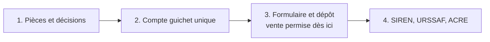

# TODO - Déclarer la micro-entreprise sur le guichet unique

## Pourquoi
La décision 05 retient la micro-entreprise et la franchise de TVA au départ. Aucune vente n'est permise
avant le dépôt du dossier (C. trav., art. L8221-3, 1°), et les mentions légales, les CGV et les paiements
attendent l'identité et le SIREN
([[RCH - Création de la micro-entreprise, impôts, délais et nom sur le site (02-11-2026)]]).
Noël impose de déposer au plus tôt.

## Ce qu'il faut faire

### Étape 1 — Pièces et décisions
Titulaire
- [ ] Pièce d'identité valide, recto et verso dans un seul PDF, en couleur, quatre coins visibles
- [ ] Numéro de sécurité sociale (carte Vitale ou ameli.fr)
- [ ] E-mail consulté chaque jour et téléphone

Adresse de l'entreprise (à décider, options dans la RCH § 2)
- [ ] Adresse choisie : appartement de sa mère, société de domiciliation ou domicile
- Si l'appartement de sa mère :
  - [ ] Convention de mise à disposition signée (modèle ci-dessous)
  - [ ] Pièce d'identité de sa mère, recto et verso
  - [ ] Justificatif de l'appartement de moins de 3 mois à son nom (électricité, eau, internet) ou dernier
    avis de taxe foncière ; adresse identique à celle déclarée (numéro, bâtiment, étage)
  - [ ] Règlement de copropriété relu : pas de clause d'habitation bourgeoise exclusive ⚠️
  - [ ] Nom du titulaire et « NolaPrint » sur la boîte aux lettres
- Si une société de domiciliation :
  - [ ] Contrat de domiciliation signé avant le formulaire

Décisions avant le formulaire
- [ ] Nom commercial « NolaPrint », absent des marques sur data.inpi.fr
- [ ] Date de début d'activité : le jour du dépôt, jamais une date passée
- [ ] Versement libératoire : RFR 2024 du foyer (avis 2025) ÷ nombre de parts ≤ 29 315 € ? Puis intérêt à comparer
- [ ] Déclaration du CA mensuelle (conseillée au départ) ou trimestrielle

Modèle de convention, si l'appartement est retenu :

> **CONVENTION DE MISE À DISPOSITION D'UN LOCAL À TITRE GRATUIT**
>
> Je soussignée [Prénom NOM de la propriétaire], née le [date] à [ville], demeurant [adresse principale],
> propriétaire du logement situé [adresse complète de l'appartement],
>
> autorise [Prénom NOM du titulaire], né le [date] à [ville], demeurant [adresse personnelle],
> à utiliser cette adresse comme adresse de son entreprise individuelle (micro-entreprise), exercée
> sous le nom commercial « NolaPrint », et à y recevoir son courrier professionnel.
>
> Cette mise à disposition est consentie à titre gratuit, pour une durée indéterminée, à compter du
> [date]. Elle peut prendre fin à tout moment par l'une ou l'autre des parties, avec un préavis d'un mois.
>
> Aucune clientèle ne sera reçue dans ce local et aucun stock de marchandises n'y sera constitué.
>
> Fait à [ville], le [date], en deux exemplaires.
>
> Signature de la propriétaire :

### Étape 2 — Compte sur le guichet unique
- [ ] Uniquement formalites.entreprises.gouv.fr (gratuit) ; ignorer les sites payants qui l'imitent
- [ ] Compte créé, e-mail confirmé
- Détail écran par écran : à compléter pendant la démarche.

### Étape 3 — Formulaire et dépôt
- [ ] Entrepreneur individuel, régime micro-entrepreneur
- [ ] Activité commerciale : vente à distance de marchandises sur internet ⚠️ libellé exact à relever
- [ ] Adresse personnelle = domicile réel ; adresse de l'entreprise = l'adresse choisie
- [ ] Pièces jointes, déclaration de non-condamnation signée
- [ ] Accusé de dépôt téléchargé en PDF et gardé
- [ ] Mentions légales provisoires : « [Prénom NOM], EI, NolaPrint, [adresse de l'entreprise],
  SIREN en cours d'attribution, déclaration déposée le JJ/MM/2026 »

### Étape 4 — Après le dépôt
- [ ] SIREN reçu → mentions légales, CGV, conditions d'utilisation et factures à jour (plus aucun `[À REMPLIR` d'identité)
- [ ] Espace autoentrepreneur.urssaf.fr activé
- [ ] ACRE : formulaire URSSAF au plus tard le 60e jour suivant le début d'activité
- [ ] Opposition à la diffusion Sirene si voulue (statut-diffusion-sirene.insee.fr, FranceConnect)
- [ ] Shopify Payments activé avec le SIREN (Paramètres → Paiements)
- [ ] Première déclaration de CA à l'URSSAF à l'échéance choisie

## Comment prouver
- Accusé de dépôt daté, antérieur à la première vente.
- Avis de situation Sirene de l'EI, à l'adresse choisie.
- Mentions légales en ligne avec le SIREN, plus aucun `[À REMPLIR` d'identité.
- Accord ACRE de l'URSSAF, ou 30 jours sans réponse après la demande.

## Points à vérifier (⚠️)
- Demande de complément du guichet unique : réponse sous 15 jours, sinon dossier classé sans suite.
- Shopify Payments, dossier déposé mais sans SIREN : activation possible ou non.
- Règlement de copropriété, si l'appartement est retenu.
- Adresse de retour des colis (décision 11), à trancher avec l'adresse de l'entreprise.

## État
- 2026-11-02 : créée ; étape 1 en cours ; adresse de l'entreprise à décider.
